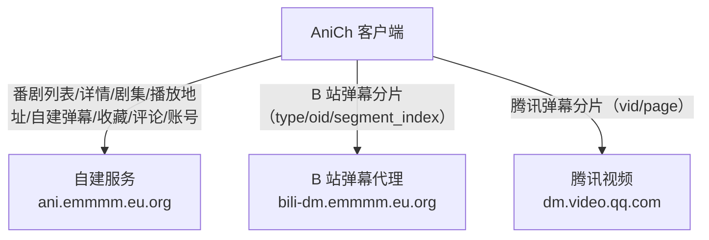

# 01 项目概览

## 1. 项目定位

AniCh 是一个使用 Flutter 开发的**在线动漫播放与弹幕应用**，主打多平台、多番剧源、多弹幕源。应用内部以图片社区（标签 / 插画 / COSPLAY 帖子）作为首页，番剧模块提供索引、搜索、详情、播放、弹幕、追番与评论能力。

项目同时注册了六大平台目录（`android/`、`ios/`、`linux/`、`macos/`、`web/`、`windows/`），但实际可运行平台以桌面（Windows/macOS/Linux）与移动端（Android/iOS）为主（web 不可用原因见 [09 构建运行](./09-构建运行与开发指南.md#93-平台支持现状)）。

## 2. 关键元信息

| 项 | 值 | 来源 |
| --- | --- | --- |
| Dart SDK | `>=3.4.4 <4.0.0` | `pubspec.yaml:21-22` |
| 应用版本 | `1.1.0+2` | `pubspec.yaml:19` |
| Flutter 工程版本 | `b0850beeb25f6d5b10426284f506557f66181b36`（stable） | `.metadata:6-9` |
| Android applicationId | `cx.xs.open` | `android/app/build.gradle:32,43` |
| 桌面窗口标题 | AniCh | `lib/main.dart:225` |
| 服务端 API | `https://ani.emmmm.eu.org` | `lib/src/config.dart:14` |
| B 站弹幕代理 | `https://bili-dm.emmmm.eu.org` | `lib/src/config.dart:17` |
| 腾讯视频弹幕 | `https://dm.video.qq.com` | `lib/src/config.dart:18` |
| 代码规模 | `lib/` 下 166 个 Dart 文件，约 2.8 万行手写代码（另含约 5.5 千行 Protobuf 生成代码，合计约 3.4 万行） | 仓库实测 |

## 3. 功能清单（以代码为准）

| 功能 | 状态 | 入口 / 实现位置 |
| --- | --- | --- |
| 图片社区（最新 / 插画 / COSPLAY / 标签） | ✅ | `pages/home` |
| 番剧索引（类型 / 语言 / 年份筛选 + 分页） | ✅ | `pages/bangumi/views/index.dart`，`BangumiIndexController` |
| 番剧分类（genre）与标签（mark）浏览 | ✅ | `pages/bangumi/views/genre.dart`、`mark.dart` |
| 最近更新 | ✅ | `pages/bangumi/views/latest.dart` |
| 番剧搜索（搜索面板 + 热搜历史） | ✅ | `pages/search_panel`、`pages/search` |
| 番剧详情（简介 / 剧集 / 角色 / 制作人员 / 推荐） | ✅ | `pages/bangumi_detail` |
| 在线播放（线路切换、倍速、画面尺寸） | ✅ | `pages/bangumi_vod` + `widgets/player` |
| 多源弹幕（自建、B 站、B 站港澳台、腾讯） | ✅ | `pages/bangumi_vod/controller.dart:358-540` |
| 弹幕发送 / 举报入口 | ✅ 发送；长按弹幕举报 | `widgets/player/controls.dart` + `pages/bangumi_vod/controller.dart` |
| 弹幕屏蔽（关键词 + 正则） | ✅ | `widgets/danmaku_shield` |
| 弹幕样式设置（区域 / 透明度 / 字号 / 速度） | ✅ | `widgets/danmaku_settings` |
| 全文评论（番剧分集评论） | ✅ | `widgets/bangumi_vod_comment` |
| 帖子评论 / 回复 / 点赞 / 收藏 | ✅ | `pages/thread` + `widgets/thread_comment` |
| 追番管理（想看 / 在看 / 看过） | ✅ 列表；分页有缺陷 | `pages/bangumi_collection` |
| 观看记录（按番剧 + 分集保存进度） | ✅ | `pages/settings/play_history.dart` + `PlayHistoryStorage` |
| 图片收藏 | ✅ | `pages/thread_collection` |
| 离线缓存 | ✅ 下载/暂停/继续/删除，本地文件优先播放 | `pages/download` + `download_manager.dart` |
| 超分辨率 | ✅ GPU 硬件解码（hwdec=auto-safe）+ 4K 输出 + 可选 FSR/NIS/SGSR/BCAS/Anime4K/xBR/Sharp Bilinear 着色器引擎 | `widgets/player/controller.dart`、`widgets/player/upscaler.dart` |
| 检查更新 | ⚠️ 部分 | `utils/utils.dart:335`；更新源指向 `nansheng1810/AniCh-Next` |
| 桌面小窗 / 画中画 | ✅ | `PlayerSystemMixin.enterSmallWindow/enablePIP` |
| 截图保存 | ✅ | `PlayerSystemMixin.saveScreenshot` |
| 主题（动态取色 / 自定义种子色 / 明暗模式） | ✅ | `pages/settings/theme.dart`、`ThemeSettingsStorage` |

## 4. 技术选型

| 领域 | 选型 | 说明 |
| --- | --- | --- |
| 框架 | Flutter (Material 3) | 单代码库多端；`useMaterial3: true` |
| 状态管理 / 路由 / 依赖注入 | GetX (`get`) | `GetxController` + `StateMixin` + `GetBuilder` / `Obx`；路由 `GetPage` |
| 网络 | Dio | 各 API 文件各自创建 `Dio` 实例，无拦截器 |
| 序列化 | Protobuf (`protobuf`) + 手写 JSON 模型 | 列表/详情接口主用 Protobuf，账号与部分接口用 JSON |
| 本地持久化 | `get_storage` | 两个 Box：默认 Box 与 `playHistory` |
| 视频 | `media_kit` + `media_kit_video` + `media_kit_libs_video` | 跨平台 libmpv 封装 |
| 弹幕 | 自研 `ns_danmaku` | 自绘滚动/顶部/底部弹幕，1ms 内部时钟驱动 |
| UI 辅助 | `flutter_svg`、`flutter_staggered_grid_view`、`photo_view`、`flutter_smart_dialog` | SVG 图标、瀑布流、图片预览、全局弹窗 |
| 系统能力 | `window_manager`、`wakelock_plus`、`screen_brightness`、`perfect_volume_control`、`auto_orientation`、`floating`、`image_gallery_saver`、`file_picker`、`permission_handler` | 桌面窗口、屏幕常亮、亮度/音量手势、方向锁定、PiP、截图、文件选择、权限 |
| 工具 | `logger`、`intl`、`package_info_plus`、`device_info_plus`、`dynamic_color` | 日志、时间格式化、包/设备信息、Material You 取色 |

完整依赖版本见 `pubspec.yaml`，模块级依赖关系见 [10 依赖关系与调用链路](./10-依赖关系与调用链路.md)。

## 5. 数据来源与业务边界



- **番剧元数据与视频地址**完全依赖自建服务端；客户端不做第三方页面抓取。
- **弹幕**是混合来源：自建弹幕按 `bangumi + episode + skip` 分页；B 站/港澳台弹幕依赖剧集数据中的 `sites`（`bili_cid` / `bili_hmt_cid`）；腾讯弹幕依赖 `sites` 中的 `qq`。
- **账号体系**为自建：登录/注册/改密/初始化用户信息均走自建 API，Token 存于 `GetStorage` 并以 Protobuf 头 `_` 传递。

## 6. 代码组织速览

```
lib/
├── main.dart                  # 入口：初始化 + 全局主题/弹窗/手势
├── protobuf/                  # 6 组 .pb.dart（account/bangumi/danmaku/list/random/thread）
└── src/
    ├── config.dart            # 服务端地址、UA、版本
    ├── router.dart            # 24 条 GetPage 路由
    ├── middlewares/auth.dart  # 登录态路由守卫
    ├── apis/                  # 7 个 API 类（静态方法）
    ├── pages/                 # 18 个业务页面目录
    ├── widgets/               # 播放器、弹幕、评论、设置、通用组件
    └── utils/                 # 弹窗/时间/日志/颜色/样式/节流
```

详细目录树与分层说明见 [02 目录结构与分层架构](./02-目录结构与分层架构.md)。

## 7. 阅读本 Wiki 的前置知识

- Flutter Widget 树与 `BuildContext`、`StatefulWidget` 生命周期；
- GetX 的 `GetxController`、`StateMixin`（`loading/success/error/empty`）、`GetBuilder`、`Obx`、`GetPage` 中间件；
- Protobuf Dart 生成类的 `fromBuffer` / `writeToBuffer`；
- `media_kit` 的 `Player` / `VideoController` 基本模型；
- 弹幕常见类型：滚动（scroll）、顶部（top）、底部（bottom）。
