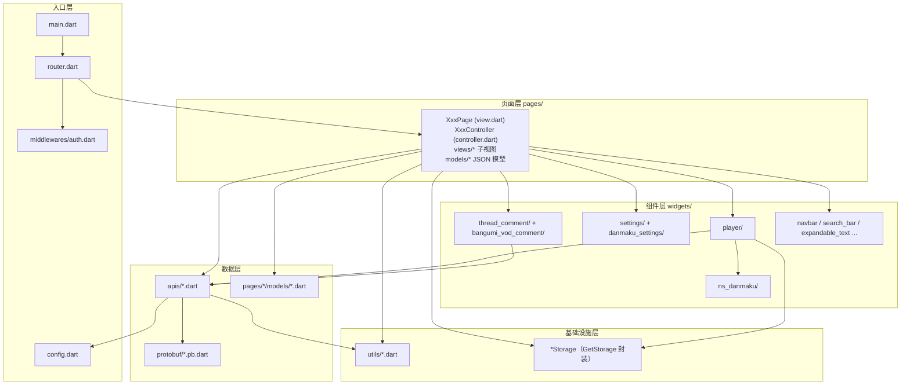

# 02 目录结构与分层架构

## 1. 仓库顶层结构

| 路径 | 作用 |
| --- | --- |
| `android/`、`ios/`、`linux/`、`macos/`、`web/`、`windows/` | Flutter 各平台宿主工程 |
| `lib/` | 全部 Dart 源码（入口、业务、组件、工具、协议模型） |
| `assets/images/` | `icon.png`（应用图标）、`no_image.svg`（图片占位） |
| `assets/icons/` | 弹幕开关/设置 SVG 图标（`danmaku_on/off/setting.svg`） |
| `fonts/` | `Ubuntu.ttf` |
| `screenshots/` | README 预览图 |
| `test/bangumi_collection_model_test.dart` | 收藏分页 `next` 解析测试 |
| `pubspec.yaml` / `pubspec.lock` | 依赖与资源配置 |
| `.github/workflows/ci.yml` | CI：`flutter analyze` + `flutter test` |
| `docs/wiki/` | 架构与开发文档 |
| `analysis_options.yaml` | `flutter_lints` 默认规则 |
| `.metadata` | Flutter 工程迁移元数据 |

### 1.1 值得注意的资源不一致

- `main.dart:91,98` 使用 `fontFamily: 'Ubuntu'`，`pubspec.yaml:115-119` 已声明 `fonts/Ubuntu.ttf`，且该文件存在于 `fonts/`，字体会正常打包。
- `Utils.showStatement()`（`utils/utils.dart:295`）读取 `assets/statement.txt`，但 `assets/` 下**不存在该文件**；该方法当前也未被任何页面调用。

## 2. lib 目录树（按职责分组）

```
lib/
├── main.dart                          # 应用入口（194 行）
├── protobuf/                          # protoc 生成的二进制协议模型
│   ├── account.pb.dart                # 登录/注册/改密/init/token
│   ├── bangumi.pb.dart                # 番剧列表/详情/剧集/角色/人物/相关/线路
│   ├── danmaku.pb.dart                # 自建弹幕、B 站弹幕
│   ├── list.pb.dart                   # 通用帖子列表、自动补全、标签信息
│   ├── random.pb.dart                 # 随机图片
│   ├── thread.pb.dart                 # 帖子详情
│   └── *.pbenum/pbjson/pbserver.dart  # 生成代码的配套文件
└── src/
    ├── config.dart                    # AppConfig：版本、UA、3 个服务地址
    ├── router.dart                    # AppRoute.pages（24 条路由）
    ├── middlewares/
    │   └── auth.dart                  # AuthMiddleware 登录守卫
    ├── apis/                          # 网络访问（全部静态方法）
    │   ├── account.dart               # 账号
    │   ├── bangumi.dart               # 番剧 + 弹幕 + 收藏 + 评论 + 角色/人物
    │   ├── home.dart                  # 帖子列表 / 标签
    │   ├── info.dart                  # 检查更新（GitHub）
    │   ├── search.dart                # 图片搜索 / 番剧搜索
    │   ├── tags.dart                  # 标签详情 / 标签下帖子
    │   └── thread.dart                # 帖子详情 / 收藏 / 点赞 / 评论
    ├── pages/                         # 页面级模块（Controller + View + 子视图）
    │   ├── home/                      # 首页（图片社区）
    │   ├── bangumi/                   # 番剧 tab（最近更新/索引/分类/标签）
    │   ├── bangumi_detail/            # 番剧详情（5 个子 tab）
    │   ├── bangumi_vod/               # 播放页（播放器 + 简介/评论）
    │   ├── bangumi_collection/        # 追番列表（想看/在看/看过）
    │   ├── bangumi_genre_list/        # 分类结果列表
    │   ├── bangumi_mark_list/         # 标签结果列表
    │   ├── character/                 # 角色详情 + 出演作品
    │   ├── person/                    # 制作人员详情 + 参与作品
    │   ├── search/                    # 搜索结果（图片/番剧）
    │   ├── search_panel/              # 搜索输入面板
    │   ├── tags/                      # 标签详情 + 帖子列表
    │   ├── thread/                    # 帖子详情 + 评论
    │   ├── thread_collection/         # 图片收藏
    │   ├── profile/                   # 个人中心
    │   ├── account/                   # 登录/注册/改密
    │   ├── settings/                  # 外观/账号/弹幕/信息/历史
    │   └── download/                  # 离线缓存（任务模型 / 下载管理器 / 列表页）
    ├── widgets/                       # 跨页面复用组件
    │   ├── player/                    # 播放器控制器 + 控件 UI
    │   ├── ns_danmaku/                # 弹幕渲染引擎
    │   ├── danmaku_settings/          # 弹幕设置 UI + 持久化
    │   ├── danmaku_shield/            # 弹幕屏蔽 UI + 持久化
    │   ├── thread_comment/            # 帖子评论组件
    │   ├── bangumi_vod_comment/       # 番剧评论组件（与上者高度重复）
    │   ├── settings/                  # 设置项原子组件（卡片/开关/菜单/数值）
    │   ├── multi_sliver_compat/       # NestedScrollView 多 Sliver 兼容
    │   └── *.dart                     # 导航栏、搜索框、可展开文本、拖拽区等
    └── utils/                         # 无业务状态的工具函数
        ├── utils.dart                 # 弹窗、权限、剪贴板、更新、复制等
        ├── time.dart                  # 时间/时间戳格式化
        ├── log.dart                   # 日志（调试面板 + 文件）
        ├── account.dart               # Token Protobuf 组包
        ├── app_style.dart             # 主题、间距、圆角常量
        ├── color.dart                 # Hex/十进制转 Color
        ├── custom_throttle.dart       # 延时节流
        └── listen_fourth_button.dart  # 侧键手势识别
```

## 3. 分层架构



### 3.1 分层职责与依赖规则（代码中的实际约定）

| 层 | 职责 | 允许依赖 | 实际违反情况 |
| --- | --- | --- | --- |
| 入口层 | 初始化、主题、路由注册、鉴权 | 页面层、基础设施 | `main.dart` 直接调用 `AccountApi.init()` 与 `Utils.checkUpdate()` |
| 页面层 | 页面状态、数据编排、UI 组装 | 组件层、数据层、基础设施 | 部分 View 内直接调用 API（如播放页发送弹幕、评论组件直接请求） |
| 组件层 | 可复用 UI 与交互 | 数据层（少数）、基础设施 | 播放器控件直接调用 `BangumiApi.postDanmaku` |
| 数据层 | HTTP 请求与协议解析 | `config`、`protobuf`、`utils/account` | 每个 API 文件各自创建 Dio 实例 |
| 基础设施 | 无状态工具与持久化 | 无 | `Log` 依赖 `Utils.timeFormat`，形成轻微循环依赖 |

### 3.2 页面层统一范式

每个页面目录遵循固定范式：

```
pages/<module>/
├── controller.dart      # GetxController（可多个：页面壳 + 各 tab 数据）
├── view.dart            # XxxPage，Scaffold 骨架
├── views/               # 各 tab 子视图（Stateful/Stateless Widget）
└── models/              # 接口返回的 JSON 模型（部分模块没有）
```

页面壳 Controller 只负责 `TabController` 与底部导航动画；各 tab 的数据由独立 Controller 负责，并在子 View 内通过 `GetBuilder(init: ...)` 创建。例如：

- `HomeController`（壳）+ `HomeAllController` / `HomeArtworkController` / `HomeCosplayController` / `HomeTagsController`（4 个 tab 数据）。
- `BangumiController`（壳）+ `BangumiLatestController` / `BangumiIndexController` / `BangumiGenreController` / `BangumiMarkController`。
- `BangumiDetailController`（壳 + 详情 + 收藏）+ `BangumiDetailEpisodesController` / `CharactersController` / `PersonsController` / `RelatedController`。

好处是每个 tab 可独立刷新与分页；代价是大量 Controller 模板代码重复（见 [11 代码质量](./11-代码质量与改进建议.md)）。

## 4. 路由与页面映射

| 路由 | 页面类 | 文件 | 鉴权 |
| --- | --- | --- | --- |
| `/` | `HomePage` | `pages/home/view.dart` | 否 |
| `/tags` | `TagsPage` | `pages/tags/view.dart` | 否 |
| `/login` | `LoginPage` | `pages/account/login.dart` | 否 |
| `/register` | `RegisterPage` | `pages/account/register.dart` | 否 |
| `/change_password` | `ChangePasswordPage` | `pages/account/change_password.dart` | 否 |
| `/profile` | `ProfilePage` | `pages/profile/view.dart` | ✅ `AuthMiddleware` |
| `/thread/:id` | `ThreadPage` | `pages/thread/view.dart` | 否 |
| `/bangumi` | `BangumiPage` | `pages/bangumi/view.dart` | 否 |
| `/bangumi_genre_list` | `BangumiGenreListPage` | `pages/bangumi_genre_list/view.dart` | 否 |
| `/bangumi_mark_list` | `BangumiMarkListPage` | `pages/bangumi_mark_list/view.dart` | 否 |
| `/bangumi/:id` | `BangumiDetailPage` | `pages/bangumi_detail/view.dart` | 否 |
| `/vod/:id` | `BangumiVodPage` | `pages/bangumi_vod/view.dart` | 否 |
| `/character` | `CharacterPage` | `pages/character/view.dart` | 否 |
| `/person` | `PersonPage` | `pages/person/view.dart` | 否 |
| `/search_panel` | `SearchPanelPage` | `pages/search_panel/view.dart` | 否 |
| `/search` | `SearchPage` | `pages/search/view.dart` | 否 |
| `/account_settings` | `AccountSettingsPage` | `pages/settings/account.dart` | 否（页面内自行判断） |
| `/theme_settings` | `ThemeSettingsPage` | `pages/settings/theme.dart` | 否 |
| `/danmaku_settings` | `DanmakuSettingsPage` | `pages/settings/danmaku.dart` | 否 |
| `/info` | `InfoSettingsPage` | `pages/settings/info.dart` | 否 |
| `/play_history` | `PlayHistoryPage` | `pages/settings/play_history.dart` | 否 |
| `/bangumi_collection` | `BangumiCollectionPage` | `pages/bangumi_collection/view.dart` | 否 |
| `/thread_collection` | `ThreadCollectionPage` | `pages/thread_collection/view.dart` | 否 |
| `/download` | `DownloadPage` | `pages/download/view.dart` | 否 |

> 路由参数约定：列表页跳详情使用 `Get.toNamed('/bangumi/$id', arguments: data)`；详情页跳播放使用 `Get.toNamed('/vod/$id', arguments: {'id': ..., 'data': ..., 'episodes': ..., 'episode': ...})`。部分页面直接读取 `Get.arguments.id`（Protobuf 对象字段）或 `Get.arguments['id']`，两种写法并存，修改时需注意（见 05 各模块说明）。

## 5. 命名与代码风格约定

- **文件**：`snake_case.dart`；页面固定 `controller.dart` / `view.dart`；子视图放在 `views/`。
- **类**：`XxxController`、`XxxPage`、`XxxView`、`XxxStorage`、`XxxApi`。
- **Controller 命名**：页面壳用模块名（`HomeController`），tab 数据用 `模块+Tab+Controller`（`HomeAllController`）。
- **状态**：`Rx*` 响应式变量；`StateMixin` 的 `change(...)` 驱动 `.obx()` 三态渲染。
- **注释**：中文注释为主，集中在方法上方；生成代码（protobuf、JSON 模型）保留英文模板注释。
- **格式化**：`flutter_lints ^3.0.0` 默认规则，无额外自定义规则（`analysis_options.yaml:12-25`）。
