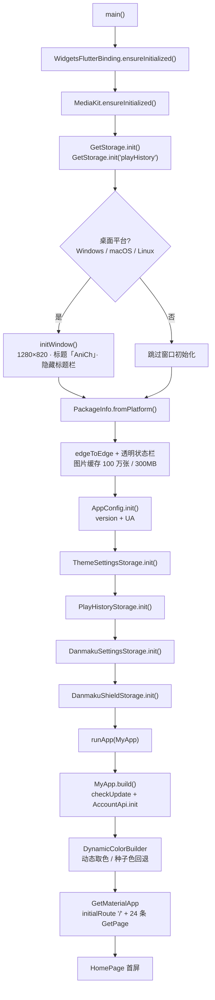
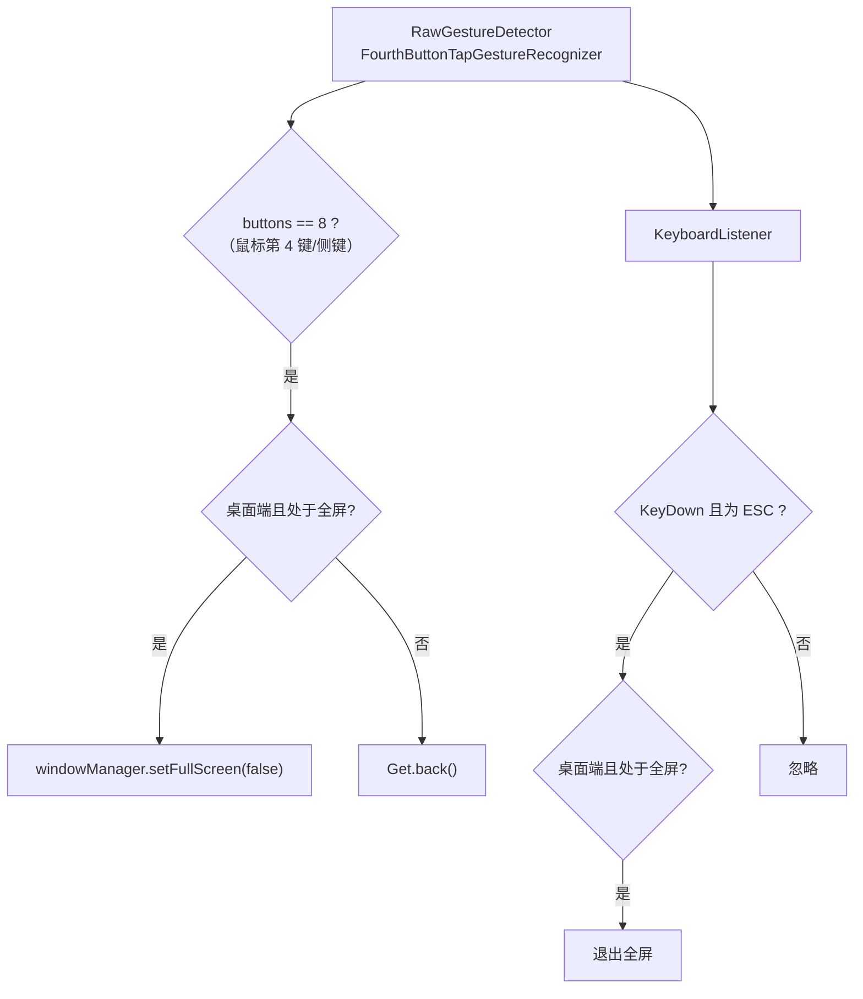

# 03 · 启动流程与运行机制

本篇沿着「进程启动 → 依赖初始化 → 根 Widget 构建 → 路由与鉴权 → 全局手势」的顺序，逐段说明 AniCh 从 `main()` 到首屏渲染之间发生的全部事情。所有结论均以当前仓库源码为准，标注了对应的文件与行号，便于直接跳转核对。

---

## 3.1 一图看懂启动链路



对应的入口代码在 [main.dart](../../lib/main.dart#L26-L51)。

---

## 3.2 `main()` 逐段解析

### 3.2.1 初始化顺序表

| 步骤 | 调用 | 作用 | 是否必须早于 UI |
| --- | --- | --- | --- |
| 1 | `WidgetsFlutterBinding.ensureInitialized()` | 初始化 Flutter 引擎绑定，使后续插件/平台通道可用 | 是 |
| 2 | `MediaKit.ensureInitialized()` | 初始化 media_kit 的原生播放内核 | 是 |
| 3 | `GetStorage.init()` | 打开默认持久化 Box（主题、弹幕设置、token、user 等） | 是 |
| 4 | `GetStorage.init('playHistory')` | 打开独立 Box 存放播放历史 | 是 |
| 5 | `initWindow()` | 桌面端窗口尺寸、标题、无边框与「准备好后再显示」 | 仅桌面 |
| 6 | `PackageInfo.fromPlatform()` | 读取应用版本号，写入 `Utils.packageInfo` | 是（检查更新依赖它） |
| 7 | `setEnabledSystemUIMode(edgeToEdge)` | 安卓全面屏沉浸式布局 | 否（但影响首帧布局） |
| 8 | `setSystemUIOverlayStyle(statusBarColor: transparent)` | 透明状态栏 | 否 |
| 9 | `imageCache.maximumSize = 1000000` / `maximumSizeBytes = 300 << 20` | 提高图片缓存上限（图片社区首页大量封面） | 否 |
| 10 | `AppConfig.init()` | 生成 `version` 与 `ua` 两个 `RxString` | 是（所有 Dio 的 UA 头依赖它） |
| 11 | `ThemeSettingsStorage.init()` | 恢复主题模式、动态取色开关、种子色 | 是（`MyApp.build` 直接读取） |
| 12 | `PlayHistoryStorage.init()` | 从 `playHistory` Box 读出全部历史记录到 `RxList` | 否 |
| 13 | `DanmakuSettingsStorage.init()` | 恢复弹幕开关、区域、透明度、字号、速度、三类弹幕源开关 | 否 |
| 14 | `DanmakuShieldStorage.init()` | 恢复自定义屏蔽词集合 | 否 |
| 15 | `runApp(const MyApp())` | 挂载根 Widget | — |

### 3.2.2 值得注意的实现细节

**(1) `AppConfig.init()` 是异步函数但没有 `await`**

[main.dart](../../lib/main.dart#L41) 中直接调用 `AppConfig.init();`，而该方法内部 `await PackageInfo.fromPlatform()`。这意味着 `AppConfig.version` / `AppConfig.ua` 要等到一次异步回调后才有值。由于 `init()` 在 `runApp()` 之前被调用，微任务队列会在首帧前排队执行，实际表现通常正常；但若某个 `Dio` 在同步构造阶段就读取 `AppConfig.ua`，此时可能拿到空字符串。

**(2) `PackageInfo` 被获取了两次**

`main()` 第 32 行已经 `Utils.packageInfo = await PackageInfo.fromPlatform();`，而 `AppConfig.init()` 内部又调用了一次 `PackageInfo.fromPlatform()`。两次平台通道调用属于冗余，可合并为一次并共享结果。

**(3) `initWindow()` 的平台守卫**

[main.dart](../../lib/main.dart#L179-L194)：

```dart
Future initWindow() async {
  if (!(Platform.isMacOS || Platform.isWindows || Platform.isLinux)) {
    return;
  }
  await windowManager.ensureInitialized();
  WindowOptions windowOptions = const WindowOptions(
      size: Size(1280, 820),
      title: 'AniCh',
      titleBarStyle: TitleBarStyle.hidden,
      skipTaskbar: false,
      windowButtonVisibility: false);
  windowManager.waitUntilReadyToShow(windowOptions, () async {
    await windowManager.show();
    await windowManager.focus();
  });
}
```

要点：

- Android / iOS 上函数直接返回，因此手机端不存在窗口管理的额外开销。
- `titleBarStyle: TitleBarStyle.hidden` 表示不使用系统标题栏，窗口拖动完全依赖应用内的 `drag_to_move_bar`（见 [drag_to_move_bar.dart](../../lib/src/widgets/drag_to_move_bar.dart)）。
- `windowButtonVisibility: false` 隐藏 macOS 红绿灯按钮。
- 使用 `waitUntilReadyToShow` 而不是先 `show()`，避免窗口出现时内容尚未布局造成的白屏闪烁。

**(4) 图片缓存被显著放大**

`maximumSize = 1000000`（按张数计）与 `maximumSizeBytes = 300 << 20`（约 300 MB）。两者共同生效，实际受内存字节上限约束较多。对以「瀑布流图片」为首页的应用是合理取舍，但在低内存设备上会提高被系统回收的概率。

---

## 3.3 根 Widget：`MyApp`

### 3.3.1 `build()` 中执行的副作用

[main.dart](../../lib/main.dart#L57-L66)：

```dart
Widget build(BuildContext context) {
  // 检测更新
  Utils.checkUpdate();
  // 获取用户信息
  final box = GetStorage();
  final token = box.read('token');
  if (token != null) {
    AccountApi.init();
  }
  ...
```

- `Utils.checkUpdate()` 发起一次「检查新版本」请求，失败时在内部 `catch` 静默处理（见 [utils.dart](../../lib/src/utils/utils.dart#L335-L337)）。
- `AccountApi.init()` 请求 `/init` 并用返回的用户档案覆盖本地 `user` 缓存（见 [account.dart](../../lib/src/apis/account.dart#L86-L98)）。

⚠️ **风险点**：这两个调用写在 `StatelessWidget.build()` 内。任何导致 `MyApp` 重建的因素（如 `ThemeSettingsStorage` 的响应式读取被移到外层、或上层 `runApp` 重新挂载）都会重复触发一次网络请求。当前之所以「只跑一次」，是因为 `MyApp` 之上没有会重建它的父级，且内部响应式读取（`ThemeSettingsStorage.isDynamic.value`）只会在 `DynamicColorBuilder` 回调内使用——但这是隐式依赖，不具备结构上的保证。更稳妥的做法是把这两件事移到 `main()` 中，或在 `StatefulWidget.initState()` 内做一次性标记。

### 3.3.2 动态取色与主题回退

[main.dart](../../lib/main.dart#L70-L86)：

```dart
return DynamicColorBuilder(
    builder: (lightDynamicColorScheme, darkDynamicColorScheme) {
  ColorScheme? lightColorScheme;
  ColorScheme? darkColorScheme;
  if (lightDynamicColorScheme != null &&
      darkDynamicColorScheme != null &&
      isDynamicColor) {
    lightColorScheme = lightDynamicColorScheme;
    darkColorScheme = darkDynamicColorScheme;
  } else {
    lightColorScheme = ColorScheme.fromSeed(
      seedColor: styleColor,
      brightness: Brightness.light,
    );
    darkColorScheme = ColorScheme.fromSeed(
        seedColor: styleColor, brightness: Brightness.dark);
  }
  ...
```

选择规则：

| 条件 | 结果 |
| --- | --- |
| 平台支持动态取色（Android 12+ / 部分桌面）且用户开启 `isDynamic` | 使用系统壁纸提取的 `lightDynamicColorScheme` / `darkDynamicColorScheme` |
| 平台不支持动态取色，或用户关闭该开关 | 以 `styleColor`（默认 `0xff3498db` 蓝色）为种子生成两套 `ColorScheme` |

`isDynamicColor` 与 `styleColor` 在 `build()` 开头一次性读取为普通变量（第 67–68 行），因此修改主题设置后需要 `ThemeSettingsStorage.setStyleColor()` 触发 `Get.changeThemeMode` 或页面重建，`MyApp` 才会重新计算配色。

### 3.3.3 `GetMaterialApp` 配置详解

[main.dart](../../lib/main.dart#L87-L165)：

| 参数 | 值 | 说明 |
| --- | --- | --- |
| `debugShowCheckedModeBanner` | `false` | 关闭右上角 DEBUG 角标 |
| `themeMode` | `ThemeMode.values[ThemeSettingsStorage.themeMode.value]` | 0=system、1=light、2=dark，与设置页下拉项下标一致 |
| `theme` | `ThemeData(fontFamily: 'Ubuntu', brightness: light, colorScheme: lightColorScheme, scaffoldBackgroundColor: Colors.white, useMaterial3: true)` | 浅色主题 |
| `darkTheme` | 同上，`brightness: dark`、`scaffoldBackgroundColor: Colors.black` | 深色主题 |
| `initialRoute` | `'/'` | 首屏即首页 |
| `getPages` | `AppRoute.pages` | 24 条路由，见 3.5 |
| `defaultTransition` | `Transition.noTransition` | 全局关闭页面切换动画，改为各页面自绘 |
| `scrollBehavior` | `AppScrollBehavior()` | 允许鼠标拖拽滚动 |
| `logWriterCallback` | 转发到 `Log.addDebugLog` + `Log.writeLog` | GetX 内部日志统一进调试面板 |
| `navigatorObservers` | `[FlutterSmartDialog.observer]` | 让 SmartDialog 能感知路由变化 |
| `builder` | `FlutterSmartDialog.init(...)` 包裹 `MediaQuery` + 全局手势 | 统一 loading 外观、锁定字号、拦截侧键/ESC |

**字体说明**：`fontFamily: 'Ubuntu'` 已在 `pubspec.yaml` 的 `fonts` 段声明，且 `fonts/Ubuntu.ttf` 存在，字体会正常打包并生效（详见 02 篇「资源不一致」一节）。

**字号锁定**：`MediaQuery.copyWith(textScaler: TextScaler.linear(1.0))`（[main.dart](../../lib/main.dart#L117-L119)）强制忽略系统字体缩放，避免弹幕与播放器控件因用户放大字号而错位；代价是无障碍适配缺失。

### 3.3.4 `FlutterSmartDialog` 的接入

```dart
builder: FlutterSmartDialog.init(
  loadingBuilder: ((msg) => const AppLoaddingWidget()),
  builder: (context, child) => MediaQuery(...),
);
```

- `loadingBuilder` 指定全局 `SmartDialog.showLoading()` 的外观为 [app_loadding_widget.dart](../../lib/src/widgets/app_loadding_widget.dart)。
- `FlutterSmartDialog.observer` 注册在 `navigatorObservers`，保证路由切换时对话框不会悬挂在已销毁的页面上。
- 业务代码中大量使用 `SmartDialog.showToast(...)` / `SmartDialog.showLoading()`（例如登录页、设置页），这正是它们能跨页面工作的原因。

---

## 3.4 全局手势：鼠标侧键与 ESC

[main.dart](../../lib/main.dart#L120-L162) 用 `RawGestureDetector` + `KeyboardListener` 包住了整棵树：



**侧键识别**：[listen_fourth_button.dart](../../lib/src/utils/listen_fourth_button.dart#L16-L24) 中判断 `down.buttons == 8`。在 Flutter 的 `kFourthButton` 语义下，该值对应鼠标的第 4 个按键（常见于游戏鼠标侧键），被复用为「返回」手势。

**ESC 处理**：仅在桌面端且 `windowManager.isFullScreen()` 为真时退出全屏，否则不做任何事（不会触发 `Get.back()`）。若希望 ESC 也能返回上一页，需要在此分支后追加 `Get.back()`。

⚠️ **已知局限**：`KeyboardListener` 的 `focusNode` 是一个新建的 `FocusNode()`，既没有 `autofocus: true`，也没有被任何 `Focus` 节点持有。因此除非子树中某个可聚焦控件恰好获得焦点并冒泡到此处，键盘事件不一定会被接收。桌面端 ESC 退出全屏能否生效，取决于当前焦点位置。

---

## 3.5 路由表与鉴权守卫

### 3.5.1 路由注册

全部路由集中声明在 [router.dart](../../lib/src/router.dart#L28-L87) 的 `AppRoute.pages` 静态字段中，`GetMaterialApp.getPages` 直接引用它。

| 路径 | 页面 Widget | 文件 | 备注 |
| --- | --- | --- | --- |
| `/` | `HomePage` | `pages/home/view.dart` | 图片社区首页，4 个 tab |
| `/tags` | `TagsPage` | `pages/tags/view.dart` | 标签信息 + 3 个 tab |
| `/login` | `LoginPage` | `pages/account/login.dart` | |
| `/register` | `RegisterPage` | `pages/account/register.dart` | |
| `/change_password` | `ChangePasswordPage` | `pages/account/change_password.dart` | |
| `/profile` | `ProfilePage` | `pages/profile/view.dart` | **挂 `AuthMiddleware`** |
| `/thread/:id` | `ThreadPage` | `pages/thread/view.dart` | 帖子详情，路径参数 `id` |
| `/bangumi` | `BangumiPage` | `pages/bangumi/view.dart` | 4 个 tab |
| `/bangumi_genre_list` | `BangumiGenreListPage` | `pages/bangumi_genre_list/view.dart` | |
| `/bangumi_mark_list` | `BangumiMarkListPage` | `pages/bangumi_mark_list/view.dart` | 与上一个页面实现高度重复，见 11 篇 |
| `/bangumi/:id` | `BangumiDetailPage` | `pages/bangumi_detail/view.dart` | 路径参数 `id` |
| `/vod/:id` | `BangumiVodPage` | `pages/bangumi_vod/view.dart` | 播放页，参数另由 `Get.arguments` 传入线路数组 |
| `/character` | `CharacterPage` | `pages/character/view.dart` | |
| `/person` | `PersonPage` | `pages/person/view.dart` | |
| `/search_panel` | `SearchPanelPage` | `pages/search_panel/view.dart` | |
| `/search` | `SearchPage` | `pages/search/view.dart` | |
| `/account_settings` | `AccountSettingsPage` | `pages/settings/account.dart` | |
| `/theme_settings` | `ThemeSettingsPage` | `pages/settings/theme.dart` | |
| `/danmaku_settings` | `DanmakuSettingsPage` | `pages/settings/danmaku.dart` | |
| `/info` | `InfoSettingsPage` | `pages/settings/info.dart` | |
| `/play_history` | `PlayHistoryPage` | `pages/settings/play_history.dart` | |
| `/bangumi_collection` | `BangumiCollectionPage` | `pages/bangumi_collection/view.dart` | |
| `/thread_collection` | `ThreadCollectionPage` | `pages/thread_collection/view.dart` | |
| `/download` | `DownloadPage` | `pages/download/view.dart` | ✅ 离线缓存任务列表 |

> 合计 24 条 `GetPage`。其中 3 条使用路径参数（`/thread/:id`、`/bangumi/:id`、`/vod/:id`），参数通过 `Get.parameters['id']` 读取。

### 3.5.2 `AuthMiddleware`

[auth.dart](../../lib/src/middlewares/auth.dart#L5-L15)：

```dart
class AuthMiddleware extends GetMiddleware {
  final box = GetStorage();
  @override
  RouteSettings? redirect(String? route) {
    final token = box.read('token');
    if (token == null) {
      return const RouteSettings(name: '/login');
    }
    return null;
  }
}
```

判据非常朴素：默认 Box 里是否存在 `token` 键。

- 返回 `RouteSettings(name: '/login')` 会替换掉原目标路由，用户登录成功后不会自动回到 `/profile`（需登录页自行 `Get.back()` 或显式跳转）。
- 只做「有没有 token」的检查，不校验 token 是否过期或有效；无效 token 会在后续请求里由服务端拒绝，表现为数据请求失败而非跳转登录页。
- 当前仅 `/profile` 使用该中间件，其余需要登录的操作（收藏、点赞、发弹幕、追番）在页面内部以「未登录则提示/跳转」的方式处理。

---

## 3.6 日志与调试链路

`GetMaterialApp.logWriterCallback` 把 GetX 自己的日志接到应用日志系统：

```
GetX 内部日志
   → logWriterCallback(text, isError)
      → Log.addDebugLog(text, color)      // 仅在非 release 模式写入 RxList<DebugLogModel>
      → Log.writeLog(text, Level)         // 写入 LogFileWriter
```

- `Log.debugLogs` 是一个 `RxList<DebugLogModel>`，可在设置页/调试页实时展示（模型定义见 [log.dart](../../lib/src/utils/log.dart#L157-L163)）。
- `Log.addDebugLog` 在 `kReleaseMode` 下直接返回，因此正式包不保留内存日志。
- ⚠️ `Log.initWriter()` 与 `Log.disposeWriter()` 在整个仓库中没有被调用（可全局搜索确认），所以 `logFileWriter` 始终为 `null`，`Log.writeLog(...)` 是空操作，日志文件从不产生。若需要落盘日志，应在 `main()` 里 `Log.initWriter()`，并在应用退出时 `Log.disposeWriter()`。

---

## 3.7 启动相关的常见问题排查

| 现象 | 可能原因 | 排查方向 |
| --- | --- | --- |
| 桌面端启动后白屏、窗口不出现 | `initWindow()` 的 `waitUntilReadyToShow` 回调未触发 | 检查是否在 `main()` 里 `await initWindow()`；确认未在 Android/iOS 上误调 |
| 首屏所有请求都返回 401/400 | `AppConfig.ua` 为空或被服务端拒绝 | 检查 `AppConfig.init()` 是否执行；确认 `Utils.packageInfo` 已赋值 |
| 播放页黑屏但进度条在走 | `MediaKit.ensureInitialized()` 缺失或平台包未安装 | 确认 `main()` 第 2 行；确认 `media_kit_libs_*` 依赖存在 |
| 修改主题不生效 | `MyApp.build()` 只在启动时读取一次主题设置 | 主题设置页需调用 `ThemeSettingsStorage.setThemeMode()` / `setStyleColor()` 并触发重建 |
| 字体与设计稿不一致 | 修改了 `fontFamily` 但未同步声明字体 | 检查 `pubspec.yaml` 的 `fonts` 段与 `fonts/Ubuntu.ttf` |
| 退出应用后设置丢失 | 直接写 `GetStorage` 时未 `await`，进程被杀导致落盘未完成 | `GetStorage` 的 `write` 一般是异步落盘，重要设置在 `set*` 方法内已同步更新内存值，下次启动可接受丢失风险 |
| Android 编译失败（签名） | `android/app/build.gradle` 无条件读取 `key.properties` | 仓库未提供 `android/key.properties`，见 09 篇构建章节 |

---

## 3.8 本篇涉及的文件索引

| 文件 | 职责 |
| --- | --- |
| [main.dart](../../lib/main.dart) | 进程入口、全局初始化、根 Widget、主题装配、全局手势 |
| [router.dart](../../lib/src/router.dart) | 24 条路由注册 |
| [auth.dart](../../lib/src/middlewares/auth.dart) | 登录守卫中间件 |
| [config.dart](../../lib/src/config.dart) | 服务端地址、版本号与 UA |
| [listen_fourth_button.dart](../../lib/src/utils/listen_fourth_button.dart) | 鼠标第 4 键手势识别器 |
| [log.dart](../../lib/src/utils/log.dart) | 调试日志列表与文件日志写入器 |
| [theme_storage.dart](../../lib/src/pages/settings/storage/theme_storage.dart) | 主题设置读写 |
| [play_history_storage.dart](../../lib/src/pages/settings/storage/play_history_storage.dart) | 播放历史读写 |
| [danmaku_settings/storage.dart](../../lib/src/widgets/danmaku_settings/storage.dart) | 弹幕显示设置读写 |
| [danmaku_shield/storage.dart](../../lib/src/widgets/danmaku_shield/storage.dart) | 弹幕屏蔽词读写 |

持久化的完整字段与读写时机，见 [07-状态管理与本地持久化.md](./07-状态管理与本地持久化.md)；路由目标页面各自的业务逻辑，见 [05-页面模块详解.md](./05-页面模块详解.md)。
</Write>
