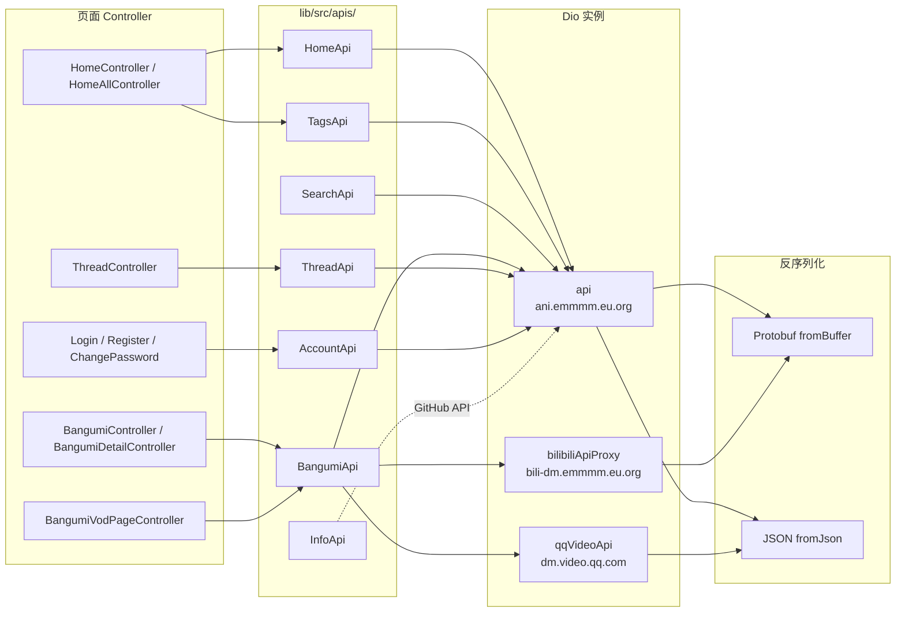
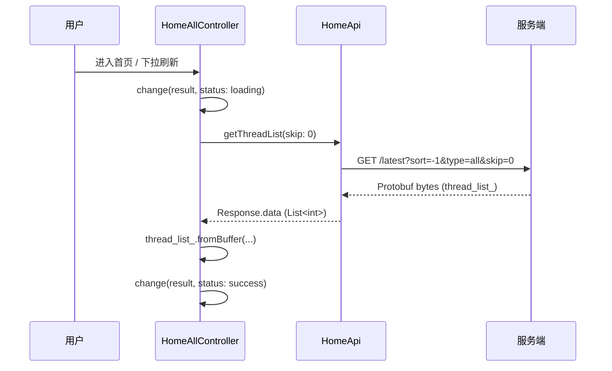
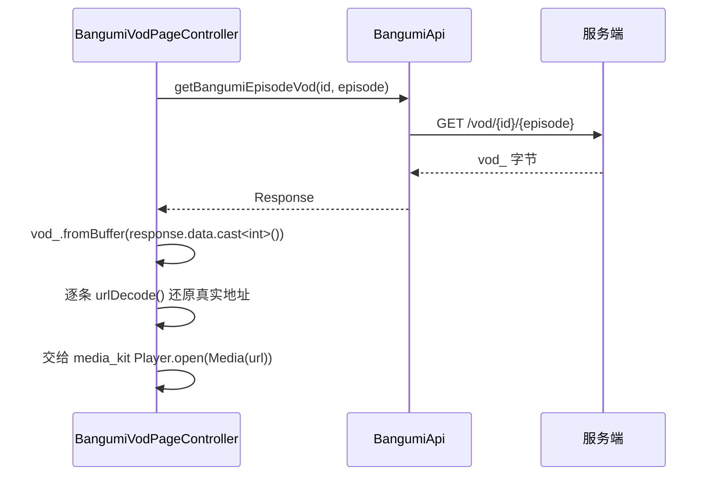
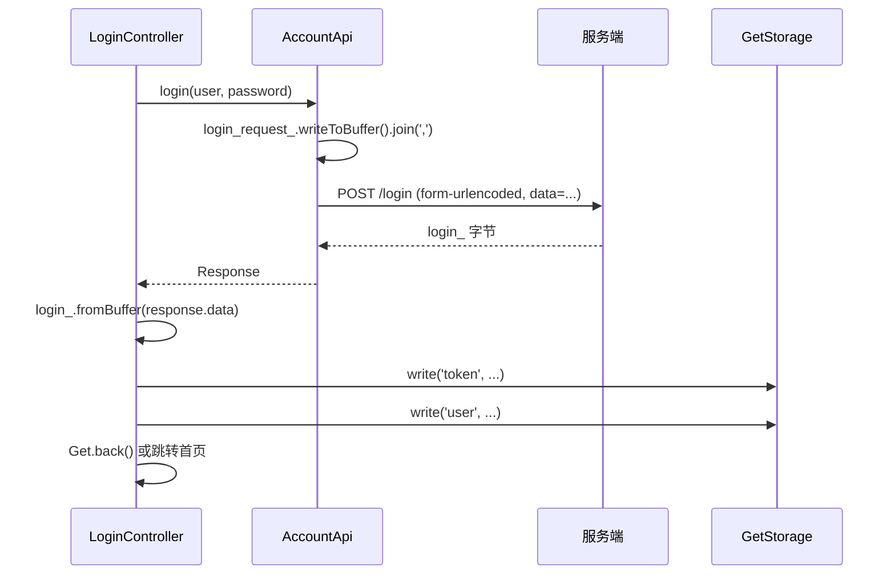

# 04 · 网络层与数据模型

本篇说明 AniCh 如何与服务端通信：请求在哪里发出、响应如何反序列化、鉴权头如何构造，以及 `lib/protobuf/` 下每个生成类的用途。所有端点均以源码为准。

---

## 4.1 网络层总览



要点：**没有统一的网络客户端**。每个 API 文件都在顶层自己 `final api = Dio(...)`，因此 `api` 这个标识符在 `home.dart`、`thread.dart`、`account.dart`、`bangumi.dart`、`tags.dart`、`search.dart`、`info.dart` 中各存在一份。

---

## 4.2 Dio 实例清单

| 实例 | 定义位置 | `baseUrl` | 用途 |
| --- | --- | --- | --- |
| `api` | [home.dart](../../lib/src/apis/home.dart#L6-L8)、[thread.dart](../../lib/src/apis/thread.dart#L7-L9)、[account.dart](../../lib/src/apis/account.dart#L11-L13)、[bangumi.dart](../../lib/src/apis/bangumi.dart#L8-L10)、[tags.dart](../../lib/src/apis/tags.dart#L6-L8)、[search.dart](../../lib/src/apis/search.dart#L6-L8)、[info.dart](../../lib/src/apis/info.dart#L6-L8) | `https://ani.emmmm.eu.org` | 主业务后端（自建 API） |
| `bilibiliApiProxy` | [bangumi.dart](../../lib/src/apis/bangumi.dart#L11-L12) | `https://bili-dm.emmmm.eu.org` | B 站弹幕代理 |
| `qqVideoApi` | [bangumi.dart](../../lib/src/apis/bangumi.dart#L13) | `https://dm.video.qq.com` | 腾讯视频弹幕直连 |

共同配置：

- 主业务 `api` 实例都带 `headers: {HttpHeaders.userAgentHeader: AppConfig.ua}`，即 `UA = "<packageName> <Platform> <version>"`（见 [config.dart](../../lib/src/config.dart#L33)）。
- `bilibiliApiProxy` 与 `qqVideoApi` **没有** UA 头。
- 没有任何实例配置 `connectTimeout` / `receiveTimeout` / `sendTimeout`，也没有 `Interceptor`。网络异常只能靠调用方 `try/catch`。

> `info.dart` 的 `baseUrl` 被注释掉（[info.dart](../../lib/src/apis/info.dart#L7)），因为检查更新直接请求 GitHub 绝对 URL。

---

## 4.3 鉴权头 `_` 的构造

所有需要登录的接口都通过一个名为 `_` 的 HTTP Header 传递凭证，值由 [account.dart](../../lib/src/utils/account.dart#L6-L15) 生成：

```dart
static String token() {
  final token = box.read('token');
  if (token != null) {
    final timestamp = DateTime.now().millisecondsSinceEpoch + 1000 * 60;
    final key = token_(token: token, time: timestamp.toRadixString(16));
    return key.writeToBuffer().join(',');
  }
  return '';
}
```

拆解：

1. 从默认 `GetStorage` Box 读取登录返回的 `token` 字符串。
2. 取当前时间 + 60 秒（`1000 * 60` 毫秒）作为有效期时间戳，转成十六进制字符串。
3. 用 Protobuf 消息 `token_`（字段 `token`、`time`）序列化为字节，再用 `join(',')` 变成逗号分隔的十进制字节串。
4. 作为 Header `'_'` 的值发送。

**特征与隐患**：

- 这是「自定义二进制转 CSV」的非常规协议，服务端必须按同样的规则解析。
- 时间戳加了 60 秒，属于客户端侧的简单防重放窗口；由于完全由客户端控制，不具备真正的安全性。
- `token` 以明文存放在 `GetStorage`（LevelDB/SharedPreferences 类存储），未使用 `flutter_secure_storage`。
- 未登录时返回空字符串，但很多接口仍然会带上 `'_': ''`，服务端需要能区分「无凭证」与「空凭证」。

**带 `_` 头的接口**：`AccountApi.init`、`BangumiApi.postDanmaku`、收藏相关（`collectStatus` / `cancelCollect` / `changeCollect` / `getCollect`）、番剧与帖子的评论相关全部接口、`ThreadApi` 的收藏/点赞/评论全部接口。

---

## 4.4 端点总表

### 4.4.1 内容流与标签（`HomeApi` / `TagsApi` / `SearchApi`）

| 方法 | 路径 | 查询参数 | 响应类型 | 反序列化 |
| --- | --- | --- | --- | --- |
| `HomeApi.getThreadList` | `GET /latest` | `sort`（默认 -1）、`type`（默认 `all`，另有 `artwork` / `cosplay`）、`skip` | `bytes` | `thread_list_.fromBuffer` |
| `HomeApi.getTags` | `GET /tags` | `skip` | `json` | `Tag.fromJson` |
| `TagsApi.getInfo` | `GET /t/{tag}/info` | — | `bytes` | `tag_info_.fromBuffer` |
| `TagsApi.getList` | `GET /t/{tag}` | `type`（默认 `all`）、`sort`（默认 -1）、`skip` | `bytes` | `thread_list_.fromBuffer` |
| `SearchApi.searchPicture` | `GET /search` | `keyword`、`skip` | `bytes` | `thread_list_.fromBuffer` |
| `SearchApi.searchBangumi` | `GET /bangumi/search` | `keyword`、`skip` | `bytes` | `bangumi_list_.fromBuffer` |

分页语义：`skip` 传的是**上一页最后一条的 id**（见 [home/controller.dart](../../lib/src/pages/home/controller.dart#L97) 的 `result.last.id`），不是页码偏移量。这是游标分页，而非 `offset/limit`。

### 4.4.2 账号（`AccountApi`）

| 方法 | 路径 | 请求体 | 响应类型 | 说明 |
| --- | --- | --- | --- | --- |
| `login` | `POST /login` | form：`data=<login_request_ 字节 CSV>` | `bytes` | 返回 `login_`，含 `token` 与 `user` |
| `getCode` | `POST /code` | form：`email` | 默认 JSON | 发送邮箱验证码 |
| `changePassword` | `POST /change_password` | form：`data=<change_password_request_ CSV>` | `bytes` | |
| `checkEmail` | `POST /user/check` | form：`email` | 默认 JSON | 邮箱可用性 |
| `checkName` | `POST /user/check` | form：`name` | 默认 JSON | 用户名可用性 |
| `register` | `POST /register` | form：`data=<register_request_ CSV>` | `bytes` | |
| `init` | `GET /init` | Header `_` | `bytes` | 返回 `init_`，转 JSON 后写入 `box['user']` |

注意 `login` / `changePassword` / `register` 的 `contentType` 被显式设为 `application/x-www-form-urlencoded`，而 `data` 字段里放的是「Protobuf 字节数组用逗号拼接」的字符串（[account.dart](../../lib/src/apis/account.dart#L21-L28)）。这与常规表单不同，属于该后端的私有约定。

`init` 是唯一一个把 Protobuf 转成 JSON 再落盘的接口：

```dart
final user = init_.fromBuffer(response.data).body.user.toProto3Json();
box.write('user', jsonDecode(jsonEncode(user)));
```

因此 `GetStorage` 中的 `user` 是一个普通 `Map`，页面里用 `user['name']`、`user['avatar']`、`user['color']` 读取。

### 4.4.3 番剧（`BangumiApi`）

| 方法 | 路径 | 参数 | 响应类型 | 反序列化 |
| --- | --- | --- | --- | --- |
| `getBangumiList` | `GET /bangumi/list` | `skip`、`type`、`lang`、`year`、`genre`、`mark` | `bytes` | `bangumi_list_` |
| `getTags` | `GET /bangumi/tag` | `type`（默认 `genre`，另有 `mark`）、`skip` | `json` | `Tag` |
| `getBangumiLatest` | `GET /bangumi/latest` | — | `bytes` | `bangumi_latest_` |
| `getBangumiDetail` | `GET /bangumi/detail/{id}` | — | `json` | `BangumiDetailModel` |
| `getBangumiEpisodes` | `GET /bangumi/episodes/{id}` | — | `bytes` | `bangumi_episodes_` |
| `getBangumiRelated` | `GET /bangumi/related/{id}` | — | `bytes` | `bangumi_related_` |
| `getBangumiEpisodeVod` | `GET /vod/{id}/{episode}` | — | 未显式指定 | `vod_`（调用方 `.cast<int>()` 后 `fromBuffer`） |
| `getCharacters` | `GET /bangumi/characters/{id}` | — | `bytes` | `bangumi_characters_` |
| `getCharacter` | `GET /bangumi/character/{id}` | — | `json` | `Character` |
| `getCharacterBangumi` | `GET /bangumi/character/{id}/bangumi` | `skip` | `json` | `CharacterBangumi` |
| `getPersons` | `GET /bangumi/persons/{id}` | — | `bytes` | `bangumi_persons_` |
| `getPerson` | `GET /bangumi/person/{id}` | — | `json` | `Person` |
| `getPersonsBangumi` | `GET /bangumi/person/{id}/bangumi` | `skip` | `json` | `PersonBangumi` |

`getBangumiEpisodeVod` 返回的 `vod_` 中每条 `vod_item_` 的 `url` 是**经过编码的播放地址**，由播放页的 `urlDecode()` 还原：

```dart
String urlDecode(str) {
  try {
    return utf8.decode(base64
        .decode(base64.normalize(str.substring(0, 3) + str.substring(4))));
  } catch (e) {
    debugPrint(e.toString());
    return '';
  }
}
```

即：删除第 4 个字符后做 base64 解码，再按 UTF-8 解码。实现见 [bangumi_vod/controller.dart](../../lib/src/pages/bangumi_vod/controller.dart#L543-L551)。

⚠️ `getBangumiEpisodeVod` 没有设置 `ResponseType.bytes`，但调用方按字节数组处理（`response.data.cast<int>()`）。这依赖 Dio 对非 JSON content-type 的兜底行为；为了让所有平台与转换器行为一致，建议显式加上 `options: Options(responseType: ResponseType.bytes)`。

### 4.4.4 收藏与播放进度（`BangumiApi`）

| 方法 | 路径 | 方法语义 |
| --- | --- | --- |
| `collectStatus` | `GET /bangumi/{id}/collect/status` | 查询追番状态 |
| `changeCollect` | `GET /bangumi/{id}/collect/{type}` | 设置状态（`type` 常见为想看/在看/看过等） |
| `cancelCollect` | `DELETE /bangumi/{id}/collect/cancel` | 取消追番 |
| `getCollect` | `GET /action/collect/{type}` | 分页查询追番列表，`page` 为页码 |

### 4.4.5 帖子（`ThreadApi`）

| 方法 | 路径 | 说明 |
| --- | --- | --- |
| `getData` | `GET /r/{id}` | 帖子详情 → `thread_` |
| `getCollect` | `GET /action/collects/{type}` | 图片收藏列表，`page` 页码 |
| `collectStatus` / `collect` / `cancelCollect` | `GET /r/{id}/collect/status`、`GET /r/{id}/collect`、`DELETE /r/{id}/collect/cancel` | 收藏状态与操作 |
| `likeStatus` / `like` / `cancelLike` | `GET /r/{id}/like/status`、`GET /r/{id}/like`、`DELETE /r/{id}/like/cancel` | 点赞状态与操作 |

### 4.4.6 评论（番剧与帖子共用同一组路径）

| 方法 | 路径 | 区分方式 |
| --- | --- | --- |
| 列表 | `GET /comment` | 查询参数 `type`：`bangumi_episode` 或 `thread`，另有 `id`、`skip` |
| 发送 | `POST /comment` | body `type`、`id`、`parent`、`reply`、`text`（新版服务端正文只认 `text`，传旧的 `contents` 会返回「缺少内容」） |
| 回复列表 | `GET /comment/{id}/replies` | `skip` |
| 点赞 / 取消 | `GET /comment/like?id=` / `DELETE /comment/like?id=` | |

`BangumiApi` 与 `ThreadApi` 中这五个方法的实现**逐字重复**，仅在 `type` 字面量上不同（见 11 篇重复代码一节）。

### 4.4.7 弹幕

| 方法 | 路径 | 参数 | 响应 |
| --- | --- | --- | --- |
| `BangumiApi.getDanmaku` | `GET /danmaku` | `bangumi`、`episode`、`skip` | `bytes` → `danmaku_`，每页 3000 条 |
| `BangumiApi.postDanmaku` | `POST /danmaku` | query `bangumi`、`episode`；body `text`、`type`、`time`、`color`；Header `_` | 默认 JSON |
| `BangumiApi.getBilibiliDanmaku` | `GET /`（代理域名） | `type`、`oid`、`segment_index` | `bytes` → `bilibili_danmaku_` |
| `BangumiApi.getQQDanmaku` | `GET /barrage/segment/{vid}/t/v1/{start}/{end}` | 由 `id` 取最后一段作为 `vid`；每段 30000 条 | `json` → `QqVideoModel` |

四类弹幕的具体加载、合并与渲染链路见 [06-播放器与弹幕系统.md](./06-播放器与弹幕系统.md)。

### 4.4.8 检查更新（`InfoApi`）

| 方法 | 地址 | 说明 |
| --- | --- | --- |
| `checkUpdate` | `GET https://api.github.com/repos/nansheng1810/AniCh-Next/releases/latest` | 返回 GitHub Release JSON，读取 `data['name']` 作为版本号 |

⚠️ 该地址指向本仓库 `nansheng1810/AniCh-Next` 的 Release 接口，若仓库改名需同步修改，否则「检查更新」会 404，详见 11 篇。

---

## 4.5 Protobuf 数据模型

生成代码位于 `lib/protobuf/`，每个 proto 对应四个文件：`*.pb.dart`（消息类）、`*.pbenum.dart`（枚举）、`*.pbjson.dart`（描述符）、`*.pbserver.dart`（服务端辅助）。业务代码只引用 `*.pb.dart`。

### 4.5.1 `account.pb.dart`

| 消息类 | 用途 | 关键字段 |
| --- | --- | --- |
| `login_request_` | 登录请求 | `user`、`password` |
| `login_` / `login_body_` | 登录响应 | `body.token`、`body.user` |
| `login_user_` | 登录用户 | `id`、`name`、`email`、`avatar`、`role`、`sex`、`exp`、`coin`、`color`、`address`、`created`、`updated` |
| `register_request_` / `register_` / `register_body_` / `register_user_` | 注册请求与响应 | 同上 |
| `change_password_request_` / `change_password_` / `change_password_body_` / `change_password_user_` | 改密 | `email`、`code`、`password` |
| `init_` / `init_body_` / `init_user_` | `/init` 响应 | 用户档案（字段与 `login_user_` 基本一致） |
| `token_` | 鉴权头载体 | `token`、`time` |

### 4.5.2 `list.pb.dart`

| 消息类 | 用途 | 关键字段 |
| --- | --- | --- |
| `thread_list_data_` | 图片流条目 | `id`、`title`、`image`、`count`、`color`、`width`、`height`、`ai`、`nsfw` |
| `thread_list_body_` / `thread_list_` | 列表包装 | `body.data` |
| `tag_info_related_` | 相关标签 | `name`、`translate`、`image` 等 |
| `tag_info_body_` / `tag_info_` | 标签详情 | `name`、`translate`、`count`、`desc`、`image`、`color`、`related` |
| `autocomplete_` / `autocomplete_body_` | 搜索联想 | 当前未被业务代码引用 |

### 4.5.3 `bangumi.pb.dart`

| 消息类 | 用途 | 关键字段 |
| --- | --- | --- |
| `bangumi_list_item_` | 番剧列表条目 | `id`、`title`、`episode`、`episodesTotal`、`status`、`date`、`image`、`tagline` |
| `bangumi_list_` | 列表包装 | `data` |
| `bangumi_latest_item_` | 最近更新条目 | `status`、`id`、`ep`、`airdate`、`duration`、`image`、`title`、`name` |
| `bangumi_latest_` | 包装 | `data` |
| `bangumi_episodes_sites_` | 剧集在各站点的映射 | `site`（如 `bili_cid`、`bili_hmt_cid`、`qq`）、`id` |
| `bangumi_episodes_rating_` | 评分 | `site`、`score` |
| `bangumi_episodes_data_` | 剧集条目 | `status`、`sort`、`airdate`、`duration`、`sites`、`rating`、`image`、`title`、`overview` |
| `bangumi_episodes_` | 包装 | `data` |
| `bangumi_characters_*` | 角色列表与详情 | 角色 id、姓名、演员等 |
| `bangumi_persons_*` | 制作人员列表 | 姓名、职位等 |
| `bangumi_related_*` | 相关推荐 | 复用列表条目的字段 |
| `vod_item_` | 播放地址条目 | `url`、`sort`、`type`、`caption` |
| `vod_` | 播放地址包装 | `data`（`vod_item_` 列表） |

`bangumi_episodes_sites_.site` 的取值直接决定弹幕源选择：播放页据此判断是否存在 B 站、B 站港澳台、腾讯弹幕。

### 4.5.4 `danmaku.pb.dart`

| 消息类 | 用途 | 关键字段 |
| --- | --- | --- |
| `data_` | 本站弹幕 | `id`、`color`、`date`、`text`、`t`、`time`、`type`、`from` |
| `danmaku_` | 本站弹幕包装 | `data`、`skip`（下一页游标） |
| `bilibili_danmaku_item_` | B 站弹幕条目 | `id`、`progress`（毫秒）、`mode`、`fontsize`、`color`（十进制 RGB）、`midHash`、`content`、`ctime`、`weight`、`action`、`pool`、`idStr` |
| `bilibili_danmaku_` | B 站弹幕包装 | `list` |

`bilibili_danmaku_item_.progress` 是毫秒，而本站 `data_.time` 是秒（double）。播放页在转换为统一的 `DanmakuItem` 时做了单位换算，详见 06 篇。

### 4.5.5 `thread.pb.dart`

| 消息类 | 用途 | 关键字段 |
| --- | --- | --- |
| `Images` | 帖子内图片 | `color`、`height`、`width`、`originalSize`、`masterSize`、`original`、`master` |
| `Tags` | 帖子标签 | `name`、`translate`、`color`、`image` |
| `thread_` | 帖子详情 | `id`、`title`、`ai`、`viewsCount`、`collectsCount`、`likesCount`、`date`、`created`、`updated`、`type`、`nsfw`、`source`、`images`、`tags` |

### 4.5.6 `random.pb.dart`

| 消息类 | 用途 | 说明 |
| --- | --- | --- |
| `images_body_` / `images_` | 随机图片响应 | **未被任何业务代码引用**，属于遗留生成文件 |

---

## 4.6 JSON 模型

除 Protobuf 外，以下数据使用手写 `fromJson`：

| 模型 | 位置 | 对应接口 | 说明 |
| --- | --- | --- | --- |
| `Tag` | [home/controller.dart](../../lib/src/pages/home/controller.dart#L303-L343) 与 [bangumi/controller.dart](../../lib/src/pages/bangumi/controller.dart#L304-L343) 各一份 | `GET /tags`、`GET /bangumi/tag` | `name`、`translate`、`count`、`color`、`image`；两份实现重复 |
| `BangumiDetailModel` | [bangumi_detail_model.dart](../../lib/src/pages/bangumi_detail/models/bangumi_detail_model.dart) | `GET /bangumi/detail/{id}` | 含 `id`、`airdate`、`title`、`image`、`genres`、`marks`、`rating`、`tagline` 等 |
| `BangumiCollection` | [bangumi_collection_model.dart](../../lib/src/pages/bangumi_collection/models/bangumi_collection_model.dart) | `GET /action/collect/{type}` | `Body.data/page/prev/next/total`；注意 `next` 是 `bool?` |
| `ThreadCollection` | `pages/thread_collection/models/thread_collection_model.dart` | `GET /action/collects/{type}` | 结构同上 |
| `Character` / `CharacterBangumi` | `pages/character/models/` | 角色相关 | |
| `Person` / `PersonBangumi` | `pages/person/models/` | 人物相关 | |
| `QqVideoModel` / `BarrageList` | [qq_video_model.dart](../../lib/src/pages/bangumi_vod/models/qq_video_model.dart) | 腾讯弹幕 | `barrage_list`，每项含 `content`、`time_offset`、`color` 等 |
| `Sticker` / `Lists` | `pages/bangumi_vod/models/sticker_model.dart` | 弹幕表情/贴纸 | |

`BangumiCollection.Body` 的字段类型值得单独记住：

```dart
class Body {
  List<Data>? data;
  int? page;
  bool? prev;
  bool? next;
  int? total;
}
```

`prev` / `next` 是布尔值而非页码。分页代码若把 `next` 强转成 `int?`，运行时会抛类型异常——这正是 `bangumi_collection` 三个 Controller 的现有 Bug（详见 11 篇）。

---

## 4.7 典型数据流

### 4.7.1 首页「最新」Tab



### 4.7.2 播放页加载一条播放地址



### 4.7.3 登录并写入本地凭证



---

## 4.8 网络层可改进点（摘要）

1. **统一 Dio 单例 + 拦截器**：当前 7 个文件各自创建 `Dio`，无法统一注入日志、重试、超时与错误映射。
2. **补齐超时**：无 `connectTimeout` / `receiveTimeout`，弱网下请求可能长时间悬挂。
3. **统一响应类型**：`getBangumiEpisodeVod` 未指定 `ResponseType.bytes`，与其他 Protobuf 接口不一致。
4. **鉴权失败处理**：401/403 没有全局拦截，无法自动清理失效 token 并跳转登录。
5. **重复端点实现**：番剧评论与帖子评论、两处 `Tag` 模型、两处收藏列表模型，均可下沉到公共层。
6. **检查更新地址**：`InfoApi` 指向 `nansheng1810/AniCh-Next`，仓库改名或迁移时需同步更新。

---

## 4.9 本篇涉及的文件索引

| 文件 | 职责 |
| --- | --- |
| [home.dart](../../lib/src/apis/home.dart) | 图片流与标签 |
| [tags.dart](../../lib/src/apis/tags.dart) | 标签详情与标签下内容 |
| [search.dart](../../lib/src/apis/search.dart) | 图片搜索、番剧搜索 |
| [thread.dart](../../lib/src/apis/thread.dart) | 帖子详情、收藏、点赞、评论 |
| [bangumi.dart](../../lib/src/apis/bangumi.dart) | 番剧、播放地址、弹幕、收藏、评论、角色/人物 |
| [account.dart](../../lib/src/apis/account.dart) | 登录、注册、改密、用户信息 |
| [info.dart](../../lib/src/apis/info.dart) | 检查更新 |
| [account.dart（工具）](../../lib/src/utils/account.dart) | 鉴权头 `_` 构造 |
| [config.dart](../../lib/src/config.dart) | 三个 baseUrl 与 UA |
| `lib/protobuf/*.pb.dart` | Protobuf 生成模型 |

各端点的调用方与页面行为，见 [05-页面模块详解.md](./05-页面模块详解.md)。
</file>
