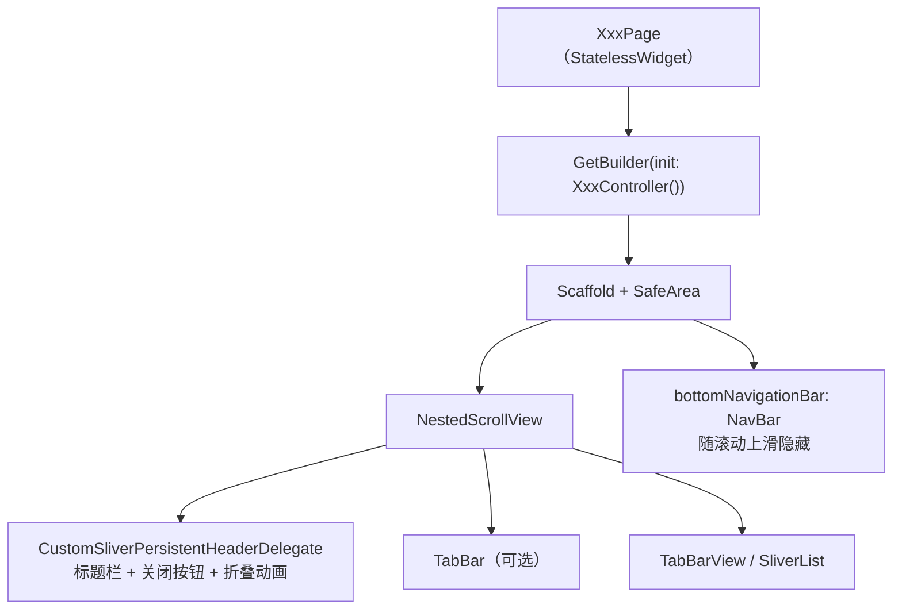

# 05 · 页面模块详解

本篇按页面逐个说明职责、Controller 分工、关键方法与页面间参数契约。播放页的播放器内核与弹幕引擎只做概要，细节见 [06-播放器与弹幕系统.md](./06-播放器与弹幕系统.md)。

---

## 5.1 页面层统一骨架

绝大多数页面遵循同一套结构：



公共设计：

- **标题栏**由 [drag_to_move_bar.dart](../../lib/src/widgets/drag_to_move_bar.dart) 提供拖拽区，配合桌面端 `TitleBarStyle.hidden` 实现无边框窗口拖动。
- **折叠动画**通过 [sliver_persistent_header_delegate.dart](../../lib/src/widgets/multi_sliver_compat/sliver_persistent_header_delegate.dart) 的 `onMaxOffset` 回调驱动 `AnimationController`，滚动时标题栏淡出、底部导航滑出。
- **关闭按钮** `closeWindowButton()` 在桌面端关闭窗口，在移动端退化为返回。
- **多 Tab 页面**固定采用「页面级 Controller 管 TabController，每个 Tab 一个独立 Controller」的模式，Tab 级 Controller 都 `with StateMixin<List<T>>`，通过 `controller.obx(...)` 渲染 loading/error/empty/success。

这套骨架的代价是**大量复制粘贴**：滚动监听、折叠动画、NestedScrollView 配置在 `home`、`tags`、`bangumi`、`bangumi_detail`、`profile`、`settings/*`、`download` 等页面近乎逐字重复。

---

## 5.2 页面与 Controller 对照表

| 路由 | 页面类 | 页面级 Controller | Tab / 子 Controller |
| --- | --- | --- | --- |
| `/` | `HomePage` | `HomeController` | `HomeTagsController`、`HomeAllController`、`HomeArtworkController`、`HomeCosplayController` |
| `/tags` | `TagsPage` | `TagsController` | `TagsAllController`、`TagsArtworkController`、`TagsCosplayController` |
| `/search_panel` | `SearchPanelPage` | `SearchPanelController` | — |
| `/search` | `SearchPage` | `SearchPageController` | `SearchBangumiController`、`SearchPictureController` |
| `/bangumi` | `BangumiPage` | `BangumiController` | `BangumiLatestController`、`BangumiIndexController`、`BangumiGenreController`、`BangumiMarkController` |
| `/bangumi_genre_list` | `BangumiGenreListPage` | `BangumiGenreListController` | — |
| `/bangumi_mark_list` | `BangumiMarkListPage` | `BangumiMarkListController` | — |
| `/bangumi/:id` | `BangumiDetailPage` | `BangumiDetailController` | `BangumiDetailIndexController`、`BangumiDetailEpisodesController`、`BangumiDetailCharactersController`、`BangumiDetailPersonsController`、`BangumiDetailRelatedController` |
| `/vod/:id` | `BangumiVodPage`（Stateful） | `BangumiVodPageController` | —（继承播放器基类） |
| `/thread/:id` | `ThreadPage` | `ThreadController` | `CommentController`（评论区） |
| `/bangumi_collection` | `BangumiCollectionPage` | `BangumiCollectionController` | `BangumiWishCollectionController`、`BangumiWatchCollectionController`、`BangumiWatchedCollectionController` |
| `/thread_collection` | `ThreadCollectionPage` | `ThreadCollectionController` | `ThreadAllCollectionController`、`ThreadArtworkCollectionController`、`ThreadCosplayCollectionController` |
| `/character` | `CharacterPage` | `CharacterController` | `CharacterIndexController` |
| `/person` | `PersonPage` | `PersonController` | `PersonIndexController` |
| `/login` | `LoginPage` | `LoginController` | — |
| `/register` | `RegisterPage` | `RegisterController` | — |
| `/change_password` | `ChangePasswordPage` | `ChangePasswordController` | — |
| `/profile` | `ProfilePage` | `ProfilePageController` | — |
| `/account_settings` | `AccountSettingsPage` | `AccountSettingsPageController` | — |
| `/theme_settings` | `ThemeSettingsPage` | `ThemeSettingsPageController` | — |
| `/danmaku_settings` | `DanmakuSettingsPage` | `DanmakuSettingsPageController` | — |
| `/info` | `InfoSettingsPage` | `InfoSettingsPageController` | — |
| `/play_history` | `PlayHistoryPage` | `PlayHistorySettingsPageController` | — |
| `/download` | `DownloadPage` | `DownloadPageController` | — |

---

## 5.3 首页 `/`

**职责**：图片社区的聚合入口，承担应用的首屏。

**Controller 分工**：

| Controller | 数据来源 | 说明 |
| --- | --- | --- |
| `HomeController` | 无请求 | 创建 4 个 `Tab`（标签 / 最新 / 插画 / COSPLAY）、`TabController`（默认 index=1）、折叠动画 |
| `HomeTagsController` | `HomeApi.getTags()` | 返回 JSON 数组，映射为页面内的 `Tag` 模型；分页用 `skip: result.length` |
| `HomeAllController` | `HomeApi.getThreadList()` | 全量图片流；分页用 `skip: result.last.id` |
| `HomeArtworkController` | `HomeApi.getThreadList(type: 'artwork')` | 插画分类 |
| `HomeCosplayController` | `HomeApi.getThreadList(type: 'cosplay')` | COSPLAY 分类 |

每个 Tab Controller 的 `get()` / `more()` / `reload()` 三件套几乎完全一致，仅接口参数不同。`more()` 用 `RxBool isLoading` 表示「正在加载更多」，而首屏状态由 `StateMixin` 的 `RxStatus` 表示。

⚠️ 分页边界未处理：当接口返回空列表时，`result.last.id` / `result.last` 会抛 `StateError`，`more()` 的 `try/catch` 会静默吞掉。

---

## 5.4 标签页 `/tags`

**职责**：某个标签下的内容聚合页，进入时从 `Get.arguments['tag']` 取标签名。

**Controller**：

| Controller | 方法 | 说明 |
| --- | --- | --- |
| `TagsController` | `getInfo()` | `TagsApi.getInfo(tag: Uri.encodeComponent(tag))`，返回 `tag_info_`，取 `body` 存入 `tag_info_body_`；3 个 Tab（综合 / 插画 / COSPLAY） |
| `TagsAllController` | `get()` / `more()` / `reload()` | `TagsApi.getList(tag, type: 'all')` |
| `TagsArtworkController` | 同上 | `type: 'artwork'` |
| `TagsCosplayController` | 同上 | `type: 'cosplay'` |

标签名做了 `Uri.encodeComponent`，这是全仓库少数正确处理 URL 编码的地方；其他把变量拼进路径的接口（如 `/t/{tag}` 在别处、`/bangumi/detail/{id}`）因为是数字 id 不需要编码。

---

## 5.5 搜索面板与搜索结果

### `/search_panel`

`SearchPanelPage` 是一个 `StatefulWidget`，其 Controller 负责：

- `searchType = Get.arguments['type']!`，类型来自 `SearchType` 枚举（图片 / 番剧）。
- `submit()`：把关键词插入内存历史列表头部，`Get.offAndToNamed('/search', arguments: {'type': searchType, 'keyword': ...})`。
- `onClickKeyword()`：写入输入框并立即提交。
- `onClear()`：有内容时清空，无内容时 `Get.back()`。
- `onChange()` 中的搜索联想已整段注释，`Debouncer` 未接入。

⚠️ 两个问题：

1. `Get.arguments['type']!` 直接非空断言。若从某个未传 `type` 的位置进入该页面，会在 `onInit` 阶段抛 `Null check operator used on a null value`。
2. 搜索历史 `historyCacheList` 只是 Controller 字段，**没有写入 `GetStorage`**，页面销毁即丢失；原设计中的 `histiryWord.put('cacheList', ...)` 已被注释。

### `/search`

`SearchPageController` 从 `Get.arguments` 读取 `type` 与 `keyword`，创建 2 个 Tab（图片 / 番剧），默认定位到 `searchType.index`。

| Controller | 接口 |
| --- | --- |
| `SearchPictureController` | `SearchApi.searchPicture(keyword, skip)` → `thread_list_` |
| `SearchBangumiController` | `SearchApi.searchBangumi(keyword, skip)` → `bangumi_list_` |

搜索结果卡片点击后分别跳 `/thread/:id` 与 `/bangumi/:id`。

---

## 5.6 番剧首页 `/bangumi`

**4 个 Tab**：最近更新 / 索引 / 分类 / 标签，默认 `initialIndex: 1`（索引）。

| Controller | 职责 | 关键点 |
| --- | --- | --- |
| `BangumiController` | Tab 管理、折叠动画 | 无网络请求 |
| `BangumiLatestController` | `getBangumiLatest()` → `bangumi_latest_` | 展示当季更新表 |
| `BangumiIndexController` | `getBangumiList()` → `bangumi_list_` | 三组筛选下拉：`typeList`（正篇/剧场版/特别篇）、`langList`（日语/国语/英语/韩语/其他）、`yearList`（当前年份向前 35 年，`onInit` 动态生成）|
| `BangumiGenreController` | `getTags(type: 'genre')` | 分类标签云，点击跳 `/bangumi_genre_list` |
| `BangumiMarkController` | `getTags(type: 'mark')` | 制作方标签云（如动画公司），点击跳 `/bangumi_mark_list` |

`BangumiIndexController.filter()` 会先把当前选择写入 `typeSelected` / `langSelected` / `yearSelected` 三个 `RxString`，再清空列表并重新请求；`more()` / `reload()` 都复用这三个「已生效」的筛选值，因此下拉框的 `*Select` 与查询用的 `*Selected` 是两套状态。这是有意设计，避免用户改了下拉但没点「筛选」时影响分页。

⚠️ `filter()` 末尾的 `isLoading(false)` 在任何分支都会执行，且 `filter()` 开始时没有把 `isLoading` 置真，该标志在该方法内实际无用。

---

## 5.7 番剧分类 / 标签列表页

`/bangumi_genre_list` 与 `/bangumi_mark_list` 各有一个 Controller（`BangumiGenreListController`、`BangumiMarkListController`），逻辑结构相同：

- 从 `Get.arguments` 取标签名；
- `get()` 调 `BangumiApi.getBangumiList(genre: ...)` 或 `(mark: ...)`；
- `more()` 用 `skip: result.last.id`；
- `reload()` 重新拉取第一页。

两个 `view.dart`（其中一个约 715 行）与两个 Controller 几乎逐字重复，差异仅在接口参数名（`genre` vs `mark`）与标题文案。可合并为一个带 `filterKey` 参数的页面，详见 11 篇。

---

## 5.8 番剧详情 `/bangumi/:id`

**入口参数**：`Get.arguments.id`（`BangumiDetailController.onInit` 第 61 行直接读取 `.id`，因此调用方必须传对象而非 `Map`？实际上 GetX 对 `Map` 也支持属性访问，传入 `{'id': 123}` 时 `Get.arguments.id` 等价于 `Get.arguments['id']`）。

**页面级 Controller `BangumiDetailController`**：

| 成员 | 说明 |
| --- | --- |
| `id` | `RxInt`，来自路由参数 |
| `result` | `List<BangumiDetailModel>`，手动缓存，`find(id)` 用于命中已加载数据 |
| `collectStatus` / `collectType` | 收藏状态与收藏类型（0=想看、1=在看、2=看过、999=未收藏） |
| `get()` | `GET /bangumi/detail/{id}` → `BangumiDetailModel.fromJson`；成功则替换缓存并 `change(data, success)` |
| `getCollectStatus()` | 先判断 `AccountUtil.token()` 是否为空，未登录直接返回；已登录请求收藏状态 |
| `changeCollect(index)` | 调 `GET /bangumi/{id}/collect/{type}`；成功后更新状态并 toast |
| `cancelCollect()` | `DELETE /bangumi/{id}/collect/cancel` |
| `showCollectSheet()` | 底部弹窗：我想看的 / 我在看的 / 我看过的 |
| `showMarkSheet()` | 底部弹窗：按当前 `collectType` 用 `Offstage` 隐藏已选中的那一项，并提供「取消收藏」 |

**5 个 Tab Controller**：

| Controller | 接口 | 说明 |
| --- | --- | --- |
| `BangumiDetailIndexController` | 无 | 🚧 空实现（`StateMixin` 但从不发请求），详情内容实际由页面级 `data` 直接渲染 |
| `BangumiDetailEpisodesController` | `getBangumiEpisodes(id)` → `bangumi_episodes_` | 剧集列表，点击携带 `data` 与 `episodes` 跳 `/vod/:id` |
| `BangumiDetailCharactersController` | `getCharacters(id)` → `bangumi_characters_` | 角色卡片，点击跳 `/character` |
| `BangumiDetailPersonsController` | `getPersons(id)` → `bangumi_persons_` | 制作人员，点击跳 `/person` |
| `BangumiDetailRelatedController` | `getBangumiRelated(id)` → `bangumi_related_` | 相关推荐 |

⚠️ `result` 缓存只在 `get()` 里维护，`find()` 用 `Get.arguments.id` 而不是 `id.value`，在首次进入时两者相同；若后续支持页面内切换番剧，这里需要同步修改。

---

## 5.9 播放页 `/vod/:id`

**这是全仓库最复杂的页面**，采用 `StatefulWidget` + `GetBuilder`，因为需要管理 `media_kit` 的 `VideoController` 生命周期与 Android PiP。

**入口参数**（由番剧详情剧集列表传入）：

```dart
id = Get.arguments['id'];
data = Get.arguments['data'];         // BangumiDetailModel?
episodes = Get.arguments['episodes']; // List<bangumi_episodes_data_>?
episode = Get.arguments['episode'];   // int，集数 sort
```

`data` / `episodes` 为可选的预加载数据：有则直接 `setBangumiData` / `setBangumiEpisodes`，无则 Controller 自行请求。见 [bangumi_vod/view.dart](../../lib/src/pages/bangumi_vod/view.dart#L33-L57)。

**`BangumiVodPageController` 关键方法**（[controller.dart](../../lib/src/pages/bangumi_vod/controller.dart)，约 1100 行）：

| 方法 | 职责 |
| --- | --- |
| `onInit` / `listen` | 监听播放位置流，驱动弹幕发射 |
| `setBangumiData` / `getBangumiData` | 复用传入数据或请求详情 |
| `setBangumiEpisodes` / `getBangumiEpisodes` | 复用传入剧集或请求剧集 |
| `getDanmaku` | 本站弹幕，按 `skip` 分页（每页 3000） |
| `getBilibiliDanmaku` | 从剧集 `sites` 中找 `bili_cid`，按分片拉取 |
| `getBilibiliHmtDanmaku` | 从 `sites` 中找 `bili_hmt_cid`，港澳台弹幕 |
| `getQQDanmaku` | 从 `sites` 中找 `qq`，按 `vid` 与 page 拉取腾讯弹幕 |
| `urlDecode` | 还原播放地址（去第 4 字符后 base64 解码） |
| `getPlayUrl` | `GET /vod/{id}/{episode}` → `vod_`，逐条 `urlDecode` |
| `setPlayer` | 创建 `Player` + `VideoController`，`open(Media(url))` |
| `changePlayLine` | 切换线路 |
| `reload` | 重新初始化播放器（控件中的刷新按钮） |
| `showDanmakuSettingsSheet` / `showDanmakuShield` | 弹幕设置、屏蔽词面板 |
| `showPlayerSettingsSheet` | 播放器综合设置 |
| `showEpisodesSheet` | 选集面板 |
| `showPlayUrlsSheet` | 线路选择面板 |
| `onClose` | 释放 `Player`、停止定时器 |

播放页还会写入播放历史（`PlayHistoryStorage`）并读取上次播放位置，详见 07 篇。

---

## 5.10 帖子详情 `/thread/:id`

**入口参数**：`Get.arguments.id`。

**`ThreadController`（`StateMixin<thread_>`）**：

| 方法 | 接口 | 说明 |
| --- | --- | --- |
| `get()` | `ThreadApi.getData(id)` | `thread_.fromBuffer` 后 `change(data, success)` |
| `getCollectStatus()` | `/r/{id}/collect/status` | 未登录直接返回 |
| `collect()` / `cancelCollect()` | `/r/{id}/collect` / `DELETE .../cancel` | 成功后改 `collectStatus` 并 toast |
| `getLikeStatus()` | `/r/{id}/like/status` | |
| `like()` / `cancelLike()` | `/r/{id}/like` / `DELETE .../cancel` | |
| `showDetailSheet(context, controller)` | — | 底部弹层内嵌评论区，使用 `KeepAliveWrapper` 保持滚动位置 |

**评论区**：由 [thread_comment/controller.dart](../../lib/src/widgets/thread_comment/controller.dart) 的 `CommentController` 承担，负责分页拉取、发送、回复、点赞。`bangumi_vod` 的评论区另有一份实现（`bangumi_vod_comment`），两者高度重复。

---

## 5.11 收藏列表页

### `/bangumi_collection`（追番）

`BangumiCollectionController` 管 3 个 Tab（我想看的 / 我在看的 / 我看过的），对应：

| Controller | 请求 |
| --- | --- |
| `BangumiWishCollectionController` | `getCollect(page: 1, type: 'wish')` |
| `BangumiWatchCollectionController` | `getCollect(page: 1, type: 'watch')` |
| `BangumiWatchedCollectionController` | `getCollect(page: 1, type: 'watched')` |

⚠️ 三个 Controller 的分页代码存在明确的类型错误：

```dart
page((data.body?.next as bool ? data.body!.next : 0) as int?)
```

`Body.next` 是 `bool?`，`true as int?` 在运行时必然抛 `_CastError`，`false` 则得到 `0`。结果是「加载更多」要么报错要么永远请求第 0 页，分页实际失效。正确写法应是用自增页码或 `body.page + 1`。

### `/thread_collection`（图片收藏）

`ThreadCollectionController` + 3 个 Tab Controller（全部 / 插画 / COSPLAY），请求 `ThreadApi.getCollect(page, type)`，模型为 `ThreadCollection`。分页逻辑与追番页同样存在问题。

---

## 5.12 账号页面

| 页面 | Controller | 关键行为 |
| --- | --- | --- |
| `LoginPage` | `LoginController` | `login()`：`SmartDialog.showLoading()` → `AccountApi.login` → `login_.fromBuffer` → 写入 `token` 与 `user` → `dismiss()` → 返回 `login_?`；页面拿到非空结果后 `Get.back()` |
| `RegisterPage` | `RegisterController` | `getCode()`、`checkEmail()`、`checkName()`、`register()`；注册成功同样直接写入 `token` / `user`，实现「注册即登录」 |
| `ChangePasswordPage` | `ChangePasswordController` | `getCode()`、`changePassword()`；成功后更新 `token` / `user` 并返回 |

共同点：

- 表单输入存在 Controller 的 `RxString` 字段（`user` / `password` / `email` / `code` / `name`），页面用 `TextEditingController` 双向绑定。
- 未做本地校验（邮箱格式、密码长度）就发请求，错误依赖服务端返回。
- `AccountUtil.token()` 在登录成功后立即可用，因为 `token` 已写入默认 Box。

---

## 5.13 个人中心 `/profile`

**受 `AuthMiddleware` 保护**，无 token 时重定向 `/login`。

`ProfilePage` 本身只负责滚动与折叠骨架，内容由 `ProfileView` 渲染，读 `GetStorage` 的 `user`：

- 头像：有 `avatar` 用 `Image.network`，否则用昵称首字 + 用户 `color` 作背景；
- 昵称、经验、硬币等基础信息；
- 入口：追番列表、图片收藏、观看历史、离线缓存、账号设置、外观设置、弹幕设置、关于；
- 退出登录：`box.remove('user')` 与 `box.remove('token')`，然后跳转登录页（见 [settings/account.dart](../../lib/src/pages/settings/account.dart)）。

---

## 5.14 设置页群

| 页面 | 文件 | 实际内容 |
| --- | --- | --- |
| 外观设置 | `settings/theme.dart` | 主题模式（跟随系统/浅色/深色）、动态取色开关、种子色选择；写入 `ThemeSettingsStorage` |
| 账号设置 | `settings/account.dart` | 头像 / 用户名 / 密码三项均弹出「功能未实现」；仅「退出登录」可用 |
| 弹幕设置 | `settings/danmaku.dart` | 弹幕开关、区域、透明度、字号、速度、三类弹幕源开关；写入 `DanmakuSettingsStorage` |
| 关于 | `settings/info.dart` | 版本号、开源地址等静态信息 |
| 播放历史 | `settings/play_history.dart` | 展示 `PlayHistoryStorage.history`，支持单条删除与全部清空 |

`settings/controller.dart` 中的 5 个 Controller（`ThemeSettingsPageController`、`AccountSettingsPageController` 等）全部是同一份模板：只创建与释放一个 `AnimationController`，没有任何业务逻辑。属于「为了 `GetBuilder(init:)` 而存在」的空壳。

---

## 5.15 角色 / 人物页

| 路由 | Controller | 数据 |
| --- | --- | --- |
| `/character` | `CharacterController`（`Get.arguments['id']`） | `Character.fromJson`，1 个 Tab「出演」；子 Controller `CharacterIndexController` 拉 `getCharacterBangumi` |
| `/person` | `PersonController`（`Get.arguments['id']`） | `Person.fromJson`，1 个 Tab「参与」；子 Controller `PersonIndexController` 拉 `getPersonsBangumi` |

两个页面结构与代码几乎完全对称，是又一处可抽象复用的重复代码。

---

## 5.16 离线缓存 `/download`

**职责**：展示下载任务与已完成缓存，支持暂停/继续、取消、删除与本地播放。

- **数据层**：`DownloadTask`（`pages/download/models/download_task.dart`）描述任务状态、进度与文件路径；`DownloadManager`（`pages/download/download_manager.dart`，全局 `Get.put`）负责 `Dio.download`、`CancelToken` 暂停、GetStorage 持久化（键 `downloadTasks`）与文件清理。
- **页面**：`DownloadPage` 保留标题栏与两个 Tab（正在下载 / 下载完成）。进行中任务显示进度条与暂停/继续、取消按钮；完成任务显示文件大小、播放与删除按钮；空态分别提示“暂无下载任务”/“暂无已完成缓存”。
- **入口**：个人中心“离线缓存”入口；播放页底部下载图标（由 `BangumiVodPageController.downloadCurrentEpisode()` 写入当前线路与剧集）。
- **播放**：`setPlayer()` 优先查询 `DownloadManager.localPath(id, episode, lineIndex)`，命中时直接 `player.open` 本地文件，线路文案显示“本地缓存”。
- **限制**：当前仅缓存直链视频（mp4 等），遇到 `.m3u8` 会提示暂不支持；暂停后继续会从头下载（部分文件在取消时删除）。

---

## 5.17 页面参数契约汇总

| 路由 | `Get.arguments` 形状 | 读取位置 |
| --- | --- | --- |
| `/tags` | `{'tag': String}` | `TagsController.onInit` |
| `/search_panel` | `{'type': SearchType}`，可选 `Get.parameters['keyword']` / `['hintText']` | `SearchPanelController.onInit` |
| `/search` | `{'type': SearchType, 'keyword': String}` | `SearchPageController.onInit` |
| `/bangumi/:id` | `{'id': int}` 或带 `id` 属性的对象 | `BangumiDetailController.onInit` |
| `/vod/:id` | `{'id': int, 'data': BangumiDetailModel?, 'episodes': List?, 'episode': int}` | `BangumiVodPageState.build` |
| `/thread/:id` | `{'id': int}` | `ThreadController.onInit` |
| `/character` | `{'id': int}` | `CharacterController.onInit` |
| `/person` | `{'id': int}` | `PersonController.onInit` |
| `/bangumi_genre_list` | `{'name': ...}` / 标签对象 | 页面 Controller |
| `/bangumi_mark_list` | `{'name': ...}` / 标签对象 | 页面 Controller |

⚠️ 这些契约全部是**隐式**的：没有统一的参数类或断言，调用方漏传时通常表现为 `onInit` 抛异常或页面空白。建议后续引入 `RouteArgs` 之类的强类型封装，至少在 `onInit` 做一次显式校验。

---

## 5.18 页面层共性问题

1. **重复骨架**：NestedScrollView + 折叠头 + NavBar 的 60 余行代码在每个页面复制一遍。
2. **重复 Controller 三件套**：`get()` / `more()` / `reload()` 在 30 余个 Controller 中重复出现，仅接口与模型不同。
3. **分页脆弱**：多数 `more()` 未判空列表，`result.last` 可能抛异常。
4. **错误处理单一**：几乎所有 `catch` 都是 `debugPrint` + `RxStatus.error('error')`，用户只看到统一的错误占位，没有区分网络错误与业务错误。
5. **空壳 Controller**：`settings/controller.dart` 的 5 个 Controller、`BangumiDetailIndexController` 均无业务价值。
6. **重复页面**：`bangumi_genre_list` / `bangumi_mark_list`、`character` / `person`、`thread_collection` / `bangumi_collection`、两套评论组件。

这些问题在 [11-代码质量与改进建议.md](./11-代码质量与改进建议.md) 中有集中整理与改进优先级建议。
</file>
