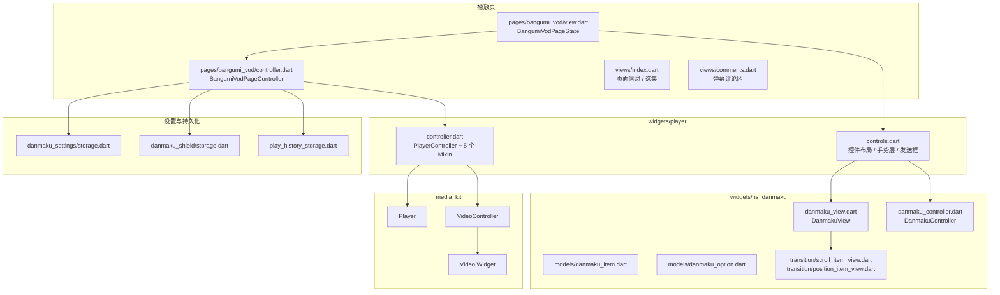
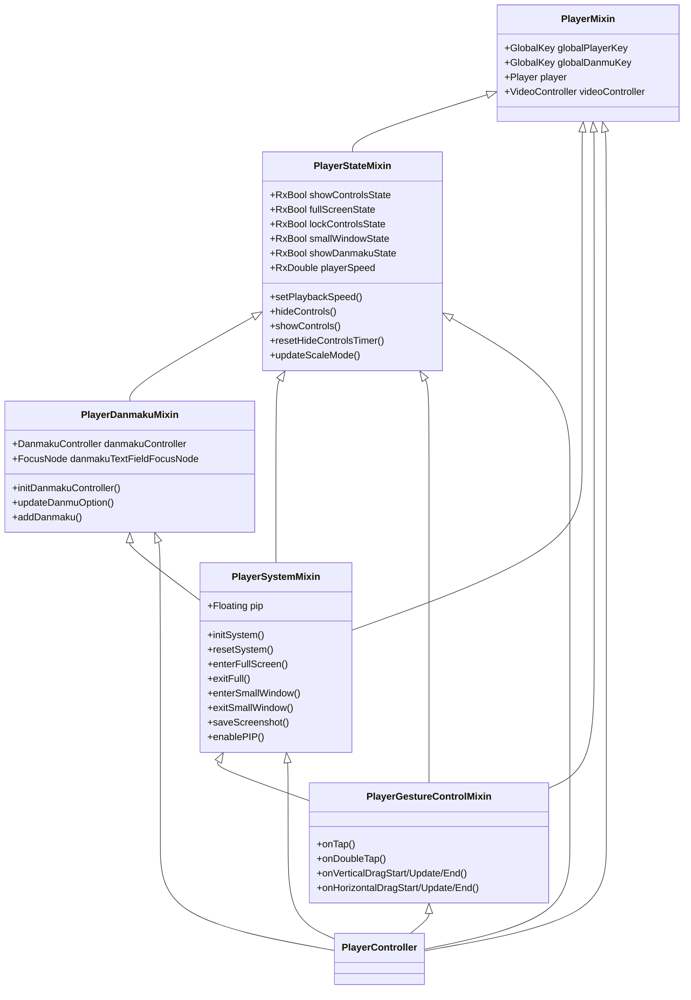
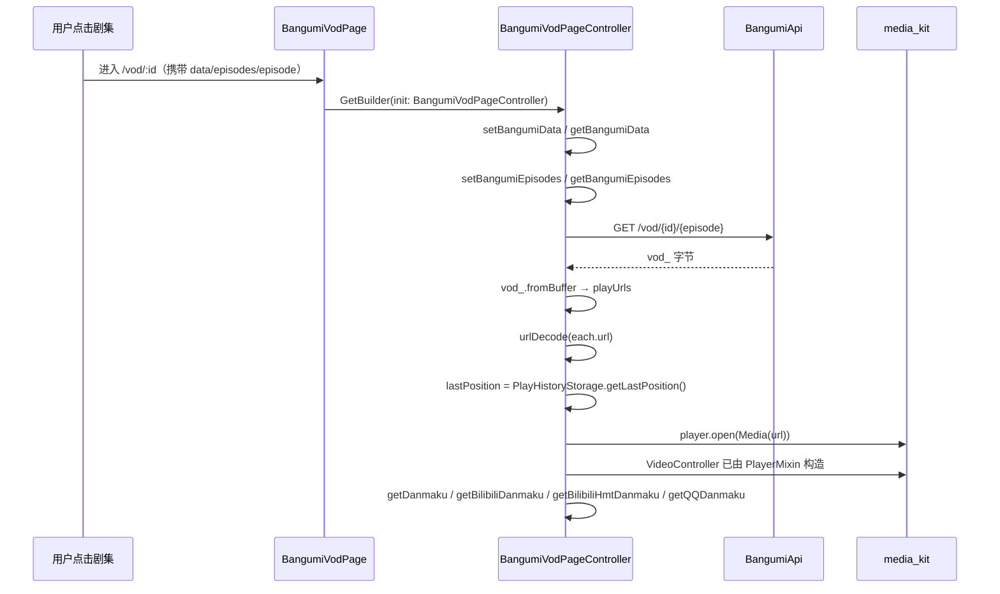

# 06 · 播放器与弹幕系统

本篇覆盖 AniCh 最核心也最复杂的部分：视频播放内核、控制器分层、全屏/小窗/PiP、手势，以及自研弹幕引擎 `ns_danmaku` 的调度与渲染机制。

---

## 6.1 模块组成



- **播放页控制器** `BangumiVodPageController` 负责业务（剧集、线路、弹幕数据、历史记录），并继承自 `PlayerController`。
- **播放器控制器** `PlayerController` 只负责播放器本身与系统能力，通过 5 个 Mixin 分层。
- **弹幕引擎** 是一个相对独立的 Widget 包，只依赖 `DanmakuController` 回调桥接，不依赖播放器。

---

## 6.2 播放器 Controller 的分层

### 6.2.1 继承关系



⚠️ Mixin 的 `on` 约束存在循环：`PlayerSystemMixin on PlayerMixin, PlayerStateMixin, PlayerDanmakuMixin`，而 `PlayerDanmakuMixin on PlayerStateMixin`。它能编译通过是因为 Dart 只要求 `on` 类型最终可满足，但阅读时容易误解。实际使用方式是 `PlayerController` 一次性 `with` 全部 5 个 Mixin。

### 6.2.2 各层职责

| 层 | 文件 | 职责 | 关键成员 |
| --- | --- | --- | --- |
| `PlayerMixin` | [player/controller.dart](../../lib/src/widgets/player/controller.dart#L28-L39) | 持有播放器与视频控制器 | `player`（`Player`）、`videoController`（`VideoController`）、两个 `GlobalKey` |
| `PlayerStateMixin` | 同上 L41–189 | UI 状态、控制器显隐、倍速、缩放模式、超分辨率 | `showControlsState`、`fullScreenState`、`lockControlsState`、`smallWindowState`、`scaleMode`、`playerSpeed`、`superResolution`、`applySuperResolution()` |
| `PlayerDanmakuMixin` | 同上 L191–237 | 弹幕控制器桥接与选项同步 | `danmakuController`、`initDanmakuController()`、`updateDanmuOption()`、`addDanmaku()` |
| `PlayerSystemMixin` | 同上 L239–497 | 全屏、横竖屏、桌面小窗、Android PiP、截图、屏幕常亮、亮度 | `pip`、`enterFullScreen()`、`exitFull()`、`enterSmallWindow()`、`enablePIP()`、`saveScreenshot()` |
| `PlayerGestureControlMixin` | 同上 L499–753 | 单击显隐、双击全屏、竖向音量/亮度、横向进度 | `onTap`、`onDoubleTap`、`onVerticalDrag*`、`onHorizontalDrag*` |
| `PlayerController` | 同上 L755–825 | 组合上述 Mixin，订阅播放器流 | `initStream()`、`disposeStream()`、`mediaEnd()`、`mediaError()` |

### 6.2.3 播放器流订阅

`PlayerController.initStream()`（[controller.dart](../../lib/src/widgets/player/controller.dart#L777-L809)）：

| 流 | 用途 |
| --- | --- |
| `player.stream.error` | 过滤 `no sound.` 后调用 `mediaError()`；业务层另行 toast |
| `player.stream.completed` | 播放结束 → `mediaEnd()`；播放页重写为显示控制器 |
| `player.stream.log` | 写入 `Log.d` |
| `player.stream.width` / `height` | 更新 `isVertical`（决定竖屏布局） |

`BangumiVodPageController.listen()`（[bangumi_vod/controller.dart](../../lib/src/pages/bangumi_vod/controller.dart#L127-L296)）**再次订阅**了 `error` / `completed` / `playing` / `position` 四条流。因此同一个错误会同时进入 `PlayerController` 与播放页两套处理逻辑，属于重复订阅。

---

## 6.3 播放初始化时序



关键代码：

```dart
void setPlayer() async {
  if (playUrls.isNotEmpty) {
    lastPosition(PlayHistoryStorage.getLastPosition(id, episode));
    final localPath = DownloadManager.instance.localPath(id, episode, currentLineIndex);
    currentLineInfo.value = localPath != null ? '本地缓存' : '线路${currentLineIndex + 1}';
    await player.open(Media(
      localPath != null ? Uri.file(localPath).toString()
                        : urlDecode(playUrls[currentLineIndex].url),
    ));
    ...
  }
}
```

- 本地缓存命中时直接播放已下载文件，不再使用网络地址。
- `urlDecode`：删除播放地址第 4 个字符后 base64 解码（见 04 篇）。
- `headers` 目前恒为空 Map，说明播放请求不带 Referer/UA；部分站点可能因此拒绝，代码里保留了扩展位。
- 多线路来自 `vod_.data`，`changePlayLine(index)` 切换后重新 `open`。

---

## 6.4 全屏、小窗与系统能力

| 能力 | 实现 | 平台 |
| --- | --- | --- |
| 进入全屏 | `SystemChrome.setEnabledSystemUIMode(immersiveSticky)` + `landScape()` | 全平台 |
| 横屏 | Android/iOS 用 `AutoOrientation.landscapeAutoMode(forceSensor: true)`；桌面用 MethodChannel `Utils.EnterNativeFullscreen` | 分平台 |
| 退出全屏 | Android/iOS 恢复 `edgeToEdge`（SDK < 29 用 `manual`）；桌面 `Utils.ExitNativeFullscreen` | 分平台 |
| 桌面小窗 | `windowManager.setSize(...)` 按视频宽高比 280px 或 400px，`setAlwaysOnTop(true)`，记录原尺寸与位置 | Windows/macOS/Linux |
| Android PiP | `Floating.enable(ImmediatePiP(aspectRatio: Rational.landscape()))`，监听 `PiPStatus.disabled` 恢复弹幕 | Android |
| 屏幕常亮 | `WakelockPlus.enable()` / `disable()` | 全平台 |
| 亮度调节 | `ScreenBrightness.current/setScreenBrightness/resetScreenBrightness` | Android/iOS/macOS |
| 音量调节 | `PerfectVolumeControl.volume/setVolume`，并 `hideUI = true` | Android/iOS |
| 截图 | `player.screenshot()` → 移动端 `ImageGallerySaver.saveImage`；桌面 `FilePicker.saveFile` + 写文件 | 全平台 |
| 缩放模式 | `BoxFit.contain/fill/cover` + 强制 16:9、4:3 | 全平台 |
| 超分辨率 | `hwdec=auto-safe` 启用 GPU 硬解，并用 `scale/cscale/dscale`、`sigmoid-upscaling`、`deband` 做 GPU 高质量缩放 | 原生播放器（`media_kit`）；Web 不支持 |
| 超分引擎 | 通过 `glsl-shaders` 加载 mpv 用户着色器（FSR/NIS/SGSR/BCAS/Anime4K/xBR/Sharp Bilinear），选择后立即重新渲染 | 原生播放器；LS1 为专有算法不提供 |
| 4K 渲染 | `VideoController.setSize(width: 3840, height: 2160)` 固定视频输出纹理为 4K，关闭时恢复视频原始尺寸 | Windows / Linux / macOS / iOS |

**进入/退出全屏时都会 `danmakuController?.clear()`**，避免坐标体系变化后旧弹幕错位。

**手势规则**（`PlayerGestureControlMixin`）：

| 手势 | 行为 |
| --- | --- |
| 单击 | 切换控制栏显隐；显示后启动 5 秒自动隐藏计时 |
| 双击 | 全屏 ↔ 退出全屏；锁定时或小窗模式下忽略 |
| 竖滑（左半屏） | 亮度；按屏幕高度的 50% 映射 0–100% |
| 竖滑（右半屏） | 音量；步长 5%，通过 200ms 节流写入 |
| 横滑 | 进度预览；松手后 `player.seek()`，映射范围为屏幕宽度的 50% 对应视频总时长的一半 |
| 鼠标悬停 | 桌面端进入即显示控制栏 |

竖滑起点必须在屏幕纵向 25%–75% 区间内，否则忽略；桌面端竖滑直接返回（不支持音量/亮度手势）。

---

## 6.5 弹幕引擎 `ns_danmaku`

### 6.5.1 三层结构

| 层 | 类 | 职责 |
| --- | --- | --- |
| 数据层 | `DanmakuItem` | `text`、`color`、`time`、`type`（scroll/top/bottom）、`self` |
| 选项层 | `DanmakuOption` | `fontSize`、`area`、`duration`、`opacity`、`hideTop/Bottom/Scroll`、`strokeWidth`、`strokeText`、`fontWeight`、`lineHeight` |
| 控制层 | `DanmakuController` | 纯回调桥接：`onAddItems`、`onUpdateOption`、`onPause`、`onResume`、`onClear`，外加 `running` 与 `option` |
| 渲染层 | `DanmakuView` | 内部时钟、行分配、Widget 生命周期、清屏 |

`DanmakuController` 本身不持有任何弹幕数据，只是让外部（播放器）能调用内部状态机。这是一种「控制反转」设计：`DanmakuView` 在 `initState` 里构造 Controller 并通过 `createdController` 回传给外部。

### 6.5.2 内部时钟

```dart
_timer = Timer.periodic(const Duration(milliseconds: 1), (e) {
  if (_controller.running) {
    _runTime += 0.001;
  }
});
```

- 精度 1ms，`_runTime` 表示弹幕引擎自身的累计运行秒数。
- 暂停（`pause()`）只把 `running` 置 false 并停止所有 `AnimationController`，时钟仍以 1ms 周期空转。
- ⚠️ **1000 次/秒的 Timer 回调**是明显的性能负担，尤其在移动端。更合理的做法是用 `AnimationController`/`Ticker` 的帧回调（约 60 次/秒）或 `Stopwatch` 按需计算。
- ⚠️ 弹幕时钟与播放器时间**不同步**：`_runTime` 从 View 创建时开始累计，只受播放/暂停控制；`player.stream.position` 用于「挑选当前时刻应该发射的弹幕」，两者是两套时间。seek 之后弹幕行占用状态不会重置（除非 clear）。

### 6.5.3 行分配算法

| 类型 | 算法 | 溢出行为 |
| --- | --- | --- |
| 滚动 `scroll` | 遍历 `_scrollRows`，某行满足「距上一条入队 ≥ duration × 0.1」或「上一条已完全出屏（`_runTime > outTime`）」即可复用 | 没有可用行时返回 -1，**丢弃该弹幕**；`self`（自己发送的）强制放在第 1 行 |
| 顶部 `top` | `_topOutTimes` 中找到 `<= _runTime` 的行，占用 1.5 秒 | 无可复用行则不渲染；`self` 强制渲染在 top=0（可能与现有弹幕重叠） |
| 底部 `bottom` | `_bottomOutTimes` 同理，占用 1.5 秒 | 同上 |

滚动弹幕的关键几何计算（[danmaku_view.dart](../../lib/src/widgets/ns_danmaku/danmaku_view.dart#L128-L198)）：

- `begin = _viewWidth / textWidth`：初始 x 坐标为「容器宽度 / 弹幕宽度」，即弹幕左边缘在屏幕右外侧；
- `end = -1`：终点 x 坐标为「-1 个自身宽度」，即完全移出左侧；
- `distance = _viewWidth + textWidth`；
- `speed = distance / duration`；
- `outboundTime = _runTime + duration * (textWidth / distance)`：弹幕**完全进入屏幕**的时间点，用于判断该行能否接收下一条。

行数计算：

```dart
maxRow = ((height / (itemHeight * lineHeight)) * area).floor();
_scrollRows = List.generate(maxRow, ...);
_topOutTimes = List.generate(maxRow ~/ 2, ...);
_bottomOutTimes = List.generate(maxRow ~/ 2, ...);
```

即顶部与底部各占可用行数的一半。

### 6.5.4 渲染与层级

```dart
ClipRect(
  child: Opacity(
    opacity: _option.opacity,
    child: Stack(children: [
      Stack(children: _scrollWidgets.values.toList()),   // 滚动层
      Stack(children: _positionWidgets.values.toList()), // 顶部/底部层
    ]),
  ),
)
```

- 两个独立 `Stack` 是为了让固定弹幕永远盖住滚动弹幕（Flutter 的 `Stack` 无法给单个子项设置 z-index）。
- `ScrollItemView` / `PositionItemView` 各自持有一个 `AnimationController`，动画结束回调 `onItemComplete(id)` 从所有集合中移除自身。
- `setState` 被重写为「仅 mounted 时执行」，避免异步动画回调在 dispose 后触发异常。

### 6.5.5 选项更新

`updateOption` 支持热更新：

| 变更 | 行为 |
| --- | --- |
| `hideBottom` 由 false → true | `clearBottom()` |
| `hideScroll` 由 false → true | `clearScroll()` |
| `hideTop` 由 false → true | `clearTop()` |
| `duration` 变化 | 遍历所有动画，重设 `duration` 并按运行状态 `forward()` / `stop()` |
| `lineHeight` 变化 | 重新计算行数 |
| `opacity` / `fontSize` 等 | 直接替换 option 并重绘（已存在的弹幕尺寸不会重算） |

---

## 6.6 四类弹幕的加载

### 6.6.1 汇总表

| 来源 | 方法 | 接口 | 分页方式 | 批量屏蔽 |
| --- | --- | --- | --- | --- |
| 本站 | `getDanmaku` | `GET /danmaku?bangumi&episode&skip` | `skip = index * 3000`，返回不足 3000 即结束 | 无（逐条 `shieldCheck`） |
| B 站 | `getBilibiliDanmaku` | 代理 `GET /?type=1&oid&segment_index` | `segment_index` 从 1 自增，返回空即结束 | `compute(defaultShieldCheck, 500 条/批)` |
| B 站港澳台 | `getBilibiliHmtDanmaku` | 同上，oid 取 `sites` 中 `bili_hmt_cid` | 同上 | 同上 |
| 腾讯 | `getQQDanmaku` | `GET /barrage/segment/{vid}/t/v1/{start}/{end}` | `page` 自增，每段 30000 条 | 同上 |

### 6.6.2 中止条件

四个循环都带有同一组守卫：

```dart
int thisEpisode = episode;
bool completed = false;
while (!completed && !leave.value && thisEpisode == episode) { ... }
```

- `leave`：用户离开页面（`onClose` 时置真）。
- `thisEpisode == episode`：用户切集后旧请求自动停止。
- 每个 `catch` 都把 `completed = true`，即**一次网络异常就结束整条源的加载**，不会重试。

B 站 / 港澳台 / 腾讯的循环还在每轮开头 `await Future.delayed(const Duration(seconds: 1))`，用于等待 `episodes` 数据就绪（`if (episodes.isNotEmpty)`），但也带来固定 1 秒延迟。

### 6.6.3 站点映射

剧集数据中的 `sites` 决定来源是否存在：

| `site` 值 | 含义 | 使用方 |
| --- | --- | --- |
| `bili_cid` | B 站正版 cid | `getBilibiliDanmaku` |
| `bili_hmt_cid` | B 站港澳台 cid | `getBilibiliHmtDanmaku` |
| `qq` | 腾讯视频 vid | `getQQDanmaku` |

`firstWhere(..., orElse: () => bangumi_episodes_sites_())` 未命中时得到空消息，`site.id.isEmpty` 即结束该源。

### 6.6.4 屏蔽的两种路径

| 路径 | 实现 | 说明 |
| --- | --- | --- |
| 用户自定义屏蔽 | `DanmakuShieldStorage.shieldCheck(text)` | 逐条匹配，支持正则（`/pattern/` 语法）与普通关键词 |
| 默认屏蔽 | `DanmakuShieldStorage.defaultShieldCheck(list)` | 在 `compute` 隔离中批量过滤，按 500 条一批 |

⚠️ **默认屏蔽实际无效**：`defaultList` 定义为 `static List<String> defaultList = [];` 且从未被赋值，`defaultShieldCheck` 的循环体永不执行，所有条目原样返回。`compute` 的 isolate 开销因此完全浪费（每条弹幕数据都要跨 isolate 序列化一次）。

另外 `compute` 传入 `DanmakuShieldStorage.defaultShieldCheck` 这种**静态方法作为顶层函数**可行，但方法内部访问静态字段 `defaultList`，在 isolate 中会重新初始化一份空列表——即使将来给 `defaultList` 填了值，也不会同步到 isolate。正确做法是把关键词列表作为参数一起传入。

---

## 6.7 弹幕发射：位置流驱动

`BangumiVodPageController.listen()` 中 `player.stream.position.listen` 是弹幕发射的核心：

```dart
int currentPosition = event.inMilliseconds ~/ 100; // 0.1 秒为单位
if (position != currentPosition) {
  position = currentPosition;
  // 本站
  danmakuList.where((e) =>
      double.parse(e.time.toStringAsFixed(1)) == currentPosition / 10 &&
      DanmakuShieldStorage.shieldCheck(e.text));
  // B 站 / 港澳台
  bilibiliDanmakuList.where((e) =>
      double.parse((e.progress / 1000).toStringAsFixed(1)) == currentPosition / 10 && ...);
  // 腾讯
  qqDanmakuList.where((e) =>
      double.parse((int.parse(e.timeOffset ?? '0') / 1000).toStringAsFixed(1)) == currentPosition / 10 && ...);
  ...
  danmakuController!.addItems(items);
}
```

要点：

1. **0.1 秒精度匹配**：把所有时间戳四舍五入到 1 位小数（保留两位再 parse），与当前播放位置的 0.1 秒刻度做**精确相等**比较。因为流回调间隔不保证是 100ms，若某次回调跨越了某个 0.1 秒刻度，该刻度的弹幕会被**漏发**。
2. **线性扫描**：每次 tick 都对全部弹幕列表做 `where`（本站与 B 站列表可能有数千到数万条），是 O(n) 全表扫描，播放越久越慢。应改为按时间排序 + 游标推进。
3. **屏蔽在发射时执行**：用户自定义屏蔽词在每次 tick 都重新匹配一遍，开销随弹幕量增长。
4. **颜色/类型转换**：
   - 本站 `ColorUtil.fromHex(e.color)`（十六进制字符串）；
   - B 站 `ColorUtil.decimalToColor(e.color)`（十进制 RGB）；
   - 类型映射 `DanmakuUtils.getPosition`（2→top、3→bottom、其余 scroll）、`getBilibiliPosition`（4→bottom、5→top、1–3 scroll）、`getQQPosition`（>1→top，其余 scroll）。

`showDanmakuState` 为 false 时 `addDanmaku` 直接返回；三类外部源的开关（`bilibiliDanmakuState` / `bilibiliHmtDanmakuState` / `qqDanmakuState`）在筛选前判断。

---

## 6.8 发送弹幕：先本地渲染，再提交

[controls.dart](../../lib/src/widgets/player/controls.dart#L948-L981) 的 `postDanmaku()`：

```dart
controller.addDanmaku([
  DanmakuItem(controller.danmakuText.value,
      self: true,
      color: ColorUtil.fromHex(controller.danmakuColor.value),
      time: time,
      type: DanmakuItemType.values[controller.danmakuTypeIndex.value - 1]),
]);
controller.danmakuText('');
controller.textEditingController.clear();
controller.showDanmakuTextField(false);
controller.player.play();
try {
  await BangumiApi.postDanmaku(id: id, episode: episode, text: text, type: type, time: time, color: color);
} catch (e) { debugPrint(e.toString()); }
```

设计取舍：

- **乐观更新**：先把弹幕标为 `self: true` 注入引擎（`self` 弹幕在行满时也会强制显示），再异步提交。网络失败只打日志，用户不会看到「发送失败」，也不会撤回已显示的弹幕。
- 发送时若播放器正在播放，会先 `pause()` 并收起控制栏；发送完成（无论成功与否）立即 `play()`。
- 弹幕颜色列表是 28 个十六进制色值，类型为 1=滚动、2=置顶、3=置底，与 `DanmakuItemType.values[type - 1]` 一一对应。
- 发送接口需要登录（Header `_`），未登录时 `AccountUtil.token()` 返回空串，服务端会拒绝；但客户端没有前置拦截。

### 6.8.1 弹幕长按举报

`DanmakuView` 新增 `onLongPress(DanmakuItem)` 回调，`ScrollItemView` / `PositionItemView` 在 `Positioned` 内部用 `GestureDetector` 接收长按；`controls.dart` 的 `buildDanmuView` 将其接到 `BangumiVodPageController.onDanmakuLongPress`。

- 仅本站弹幕带 `id`（protobuf `data_.id`，`int.tryParse`），B 站/腾讯弹幕没有后端 id，长按提示“该弹幕不支持举报”。
- 未登录直接提示“请先登录”。
- 已登录时先暂停播放，`Utils.showAlertDialog` 确认后调用 `BangumiApi.reportDanmaku(id: id)`（`GET /danmaku/report`，Header `_`），完成后恢复播放并 toast 结果。

---

## 6.9 控件与设置面板

`controls.dart`（约 1300 行）提供：

| Widget / 方法 | 作用 |
| --- | --- |
| `playerControls(videoState, controller)` | 根据 `fullScreenState` 在 `buildFullControls` / `buildControls` 间分发 |
| `buildFullControls` | 全屏版：顶部渐变栏（返回、标题、集数、刷新、PiP、更多设置）、底部进度条、弹幕开关、发送框 |
| `buildControls` | 非全屏版：竖屏布局，控件分布在底部 |
| `buildDanmuView` | 创建并缓存 `DanmakuView`，用 `Offstage` 控制显隐 |
| `buildSendDanmakuButton` / `buildSendDanmakuTextField` | 发送入口与输入面板（类型、颜色、发送） |
| `showPlayerSettings(controller)` | 播放器设置底部弹层（倍速、超分辨率、4K 渲染、超分引擎、缩放、线路、播放信息等） |

控件显隐依赖 `AnimatedPositioned` + `RxBool showControlsState`：顶部从 `-48` 滑入，底部从 `-(80+padding.bottom)` 滑入，200ms 动画。锁定控制栏（`lockControlsState`）时两者都移出屏幕。

`DanmakuView` 只会创建一次并缓存在 `controller.danmakuView`，初始 `DanmakuOption()` 是引擎默认值（fontSize 16、duration 10、strokeWidth 2）；随后 `initDanmakuController` 用 `DanmakuSettingsStorage` 的持久化值覆盖（默认 fontSize 14、duration 8、opacity 1、area 1、strokeWidth 1、粗体）。

设置面板新增“画质”分组：

- **超分辨率**（`superResolution` + `toggleSuperResolution`）：开启时先设置 `hwdec=auto-safe` 让 GPU 接管硬件解码，再应用 `ewa_lanczossharp` 缩放链；关闭时恢复 `hwdec=auto` 与 `bilinear`。值写入 `playerSuperResolution`，每次 `player.open` 后重新应用。
- **4K 渲染**（`render4K` + `toggleRender4K`）：开启时调用 `videoController.setSize(width: 3840, height: 2160)` 把视频输出纹理固定为 4K；关闭时调用无参 `setSize()` 恢复原始分辨率。值写入 `playerRender4K`。
- **超分引擎**（`upscaler` + `setUpscaler`）：`widgets/player/upscaler.dart` 定义引擎枚举与资源清单，`UpscalerShaderManager` 在首次使用时把 `assets/shaders/**` 写入应用支持目录，再通过 `change-list glsl-shaders clr/append` 逐个加载（避免 Windows 盘符与列表分隔符冲突）。引擎启用且未开 4K 时，输出尺寸取源分辨率的 2 倍（上限 4K），确保着色器的放大条件成立。值写入 `playerUpscaler`。LS1 为 Lossless Scaling 专有算法，仅展示不可选。
- 以上均在 `setPlayer()` 的 `player.open` 之后应用，切换开关或引擎会立即生效。

底部控制栏同时提供“离线缓存”按钮，调用 `downloadCurrentEpisode()` 将当前线路加入下载任务。

---

## 6.10 播放历史

写入逻辑在 `position` 流回调中（[bangumi_vod/controller.dart](../../lib/src/pages/bangumi_vod/controller.dart#L165-L203)）：

- 每跨过 5 秒（`(inSeconds - currentSeconds).abs() >= 5`）触发一次；
- 结构：`{id, title, date, image, episodes: [{episode, title, position, date, image}]}`；
- 同一 `id` 下按 `episode` 去重更新；
- 写入 `GetStorage('playHistory')`，key 为番剧 `id` 的字符串。

读取逻辑在 `setPlayer()`：`PlayHistoryStorage.getLastPosition(id, episode)` 得到上次秒数；`position` 流第一次拿到 > 0 的位置时 seek 到该秒数并把 `lastPosition` 清零。

⚠️ 判断 `if (currentinSeconds > 0 && lastPosition.value > 0)` 依赖「位置流先到 0 再到实际位置」的顺序，若播放器直接从目标位置开始上报，恢复会失效。此外历史记录没有做数量上限或过期清理。

---

## 6.11 风险与优化建议（摘要）

| 优先级 | 问题 | 建议 |
| --- | --- | --- |
| 高 | `DanmakuView` 1ms Timer 空转 | 改用 `Ticker`/`AnimationController` 帧回调或 `Stopwatch` 按需计算 |
| 高 | 弹幕发射 O(n) 全表扫描 + 0.1s 精确匹配漏发 | 按时间排序 + 游标推进，容忍跨刻度 |
| 高 | `defaultShieldCheck` 在 isolate 中访问空静态列表 | 把关键词列表作为参数传入；或去掉无效的 `compute` |
| 中 | `listen()` 与 `PlayerController.initStream()` 重复订阅流 | 只在一处订阅，另一处通过回调/状态消费 |
| 中 | 弹幕引擎时钟与播放器时间不同步，seek 后行状态不重置 | seek 时 `clear()`，或让引擎时钟直接跟随播放器位置 |
| 中 | 发送失败无用户反馈，也不撤回本地弹幕 | 失败时 toast，并把 `self` 弹幕标记为发送失败状态 |
| 低 | `headers` 恒空 | 按站点注入 Referer/UA，提升播放成功率 |
| 低 | 截图在桌面临时文件路径未清理 | 由用户选择目录，失败时提示 |

---

## 6.12 本篇涉及的文件索引

| 文件 | 职责 |
| --- | --- |
| [bangumi_vod/controller.dart](../../lib/src/pages/bangumi_vod/controller.dart) | 播放页业务、四源弹幕、历史记录、面板 |
| [bangumi_vod/view.dart](../../lib/src/pages/bangumi_vod/view.dart) | 播放页骨架、PiP 切换 |
| [player/controller.dart](../../lib/src/widgets/player/controller.dart) | 播放器 Mixin 分层与系统能力 |
| [player/controls.dart](../../lib/src/widgets/player/controls.dart) | 播放器控件、手势层、发送弹幕 |
| [ns_danmaku/danmaku_view.dart](../../lib/src/widgets/ns_danmaku/danmaku_view.dart) | 弹幕渲染与行分配 |
| [ns_danmaku/danmaku_controller.dart](../../lib/src/widgets/ns_danmaku/danmaku_controller.dart) | 弹幕回调桥接 |
| [ns_danmaku/models/danmaku_item.dart](../../lib/src/widgets/ns_danmaku/models/danmaku_item.dart) | 弹幕数据结构 |
| [ns_danmaku/models/danmaku_option.dart](../../lib/src/widgets/ns_danmaku/models/danmaku_option.dart) | 弹幕样式选项 |
| [ns_danmaku/utils.dart](../../lib/src/widgets/ns_danmaku/utils.dart) | 三种来源的类型映射 |
| [danmaku_settings/storage.dart](../../lib/src/widgets/danmaku_settings/storage.dart) | 弹幕显示设置 |
| [danmaku_shield/storage.dart](../../lib/src/widgets/danmaku_shield/storage.dart) | 屏蔽词与检查逻辑 |
| [play_history_storage.dart](../../lib/src/pages/settings/storage/play_history_storage.dart) | 播放历史读写 |
</file>
