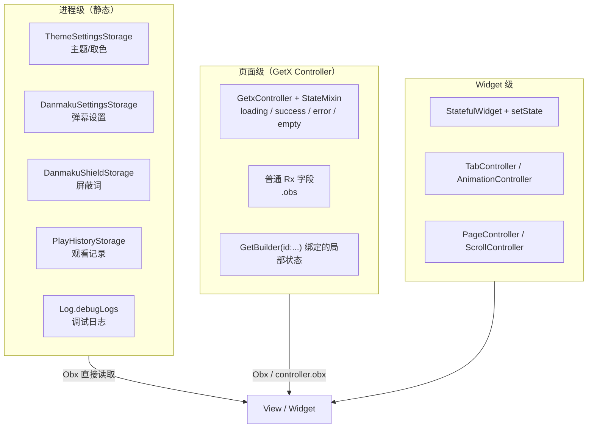
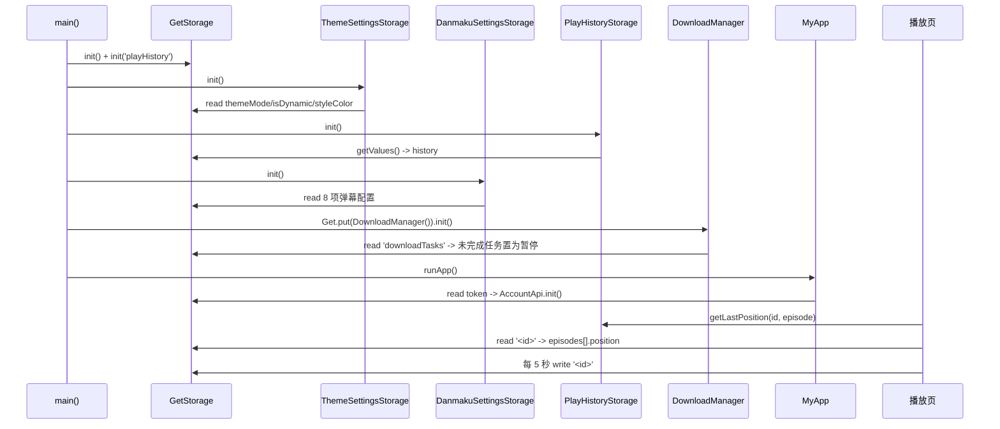

# 07 · 状态管理与本地持久化

本篇说明 AniCh 的状态组织方式（GetX）与本地持久化方案（GetStorage），包括：状态存放在哪里、如何跨页面共享、哪些键写入了磁盘、启动时如何恢复，以及当前实现中的数据一致性与安全风险。

---

## 7.1 状态管理总览

项目没有引入 Redux / Provider / Riverpod，而是全量使用 **GetX**。按生命周期可以分成三类状态载体：



| 载体 | 典型例子 | 共享范围 | 是否持久化 |
| --- | --- | --- | --- |
| 静态 Storage 类 | `ThemeSettingsStorage`、`DanmakuSettingsStorage`、`DanmakuShieldStorage`、`PlayHistoryStorage` | 全进程、所有页面 | 是（GetStorage） |
| 页面 Controller | `HomeController`、`BangumiVodPageController`、`CommentController` | 页面路由生命周期（`GetBuilder(init:)` 随路由销毁） | 否（历史记录除外） |
| Widget 局部状态 | 播放控件可见性、`TabController`、动画控制器 | 单个 Widget | 否 |

**为什么大量使用静态 Storage 类**：主题、弹幕设置这类配置需要「在任何页面即时生效」，而 GetX 的 `Get.find()` 依赖依赖注入注册。项目选择用静态 `Rx` 字段绕过注册表，`Obx` 可以直接订阅，代价是全局可变状态无法隔离、测试困难。

---

## 7.2 GetX 状态 API 的使用方式

### 7.2.1 响应式字段与 Obx

```dart
// lib/src/pages/settings/storage/theme_storage.dart
static RxInt themeMode = 0.obs;
static RxBool isDynamic = true.obs;
static RxInt styleColor = 0xff3498db.obs;
```

- 读取 `.value`，修改 `.value` 或调用 setter 即触发重建。
- 视图侧使用 `Obx(() => ...)` 或 `GetBuilder`。设置页采用 `Obx` 包裹 `SettingsCard` 的组合方式。

### 7.2.2 StateMixin 的四态约定

页面 Controller 普遍混入 `StateMixin`：

```dart
class HomeController extends GetxController with StateMixin {
  @override
  void onInit() {
    super.onInit();
    get();
  }

  void get() async {
    try {
      change(null, status: RxStatus.loading());
      final res = await HomeApi.getHome();
      // 解析后
      change(data, status: RxStatus.success());
    } catch (e) {
      change(null, status: RxStatus.error(e.toString()));
    }
  }
}
```

视图侧统一使用：

```dart
controller.obx(
  (data) => ListView(...),
  onLoading: const AppLoaddingWidget(),
  onError: (error) => ...,
  onEmpty: ...,
)
```

约定：`onInit()` 中先 `super.onInit()` 再发起请求；每个分支都必须 `change(...)`，否则 UI 会停留在 loading。

### 7.2.3 绑定与参数注入

- **路由级**：`GetPage` + `Get.toNamed`（见 [03 启动流程与运行机制](./03-启动流程与运行机制.md#35-路由表与鉴权守卫)）。
- **组件级**：`GetBuilder(id: Get.currentRoute, init: BangumiVodPageController(pId, pEpisode))` 在 Widget 树内创建并持有 Controller（`lib/src/pages/bangumi_vod/view.dart`）。
- **参数级**：`Get.arguments` 传 `Map`，页面内按约定键读取（见 [05 页面模块详解](./05-页面模块详解.md#517-页面参数契约汇总)）。

---

## 7.3 本地持久化：GetStorage

### 7.3.1 两个 Box

`lib/main.dart` 在 `runApp` 之前初始化两个容器：

```dart
await GetStorage.init();          // 默认 Box，键名直接读写
await GetStorage.init('playHistory'); // 独立 Box，专存观看记录
```

| Box | 初始化位置 | 使用方 | 内容 |
| --- | --- | --- | --- |
| 默认 Box（无名字） | `lib/main.dart` | 主题、播放器偏好、弹幕设置、屏蔽词、登录态、下载任务 | 配置、账号与缓存索引 |
| `playHistory` | `lib/main.dart:30` | `PlayHistoryStorage` | 每个番剧一条记录 |

在 Windows / Linux / macOS 上，GetStorage 落地为应用支持目录下的 JSON 文件；在 Android / iOS 上落在应用沙盒内。**两个 Box 都是明文 JSON**，没有加密。

### 7.3.2 初始化顺序

```dart
AppConfig.init();
ThemeSettingsStorage.init();   // 读主题
PlayHistoryStorage.init();     // 读历史
DanmakuSettingsStorage.init(); // 读弹幕设置
DanmakuShieldStorage.init();   // 读屏蔽词
runApp(const MyApp());
```

初始化只是把磁盘值灌入内存中的 `Rx` 变量，写回则发生在用户操作时（setter 内 `box.write`）。

---

## 7.4 主题设置：ThemeSettingsStorage

文件：[theme_storage.dart](../../lib/src/pages/settings/storage/theme_storage.dart)

| 字段 | 类型 | 默认值 | 存储键 | setter 副作用 |
| --- | --- | --- | --- | --- |
| `themeMode` | `RxInt` | `0`（跟随系统） | `themeMode` | 调用 `Get.changeThemeMode(ThemeMode.values[e])` |
| `isDynamic` | `RxBool` | `true` | `isDynamic` | 无（下次 `build` 生效） |
| `styleColor` | `RxInt` | `0xff3498db` | `styleColor` | 无（下次 `build` 生效） |

```dart
static void setThemeMode(int e) {
  themeMode.value = e;
  box.write('themeMode', e);
  final mode = ThemeMode.values[e];
  Get.changeThemeMode(mode);
}
```

注意事项：

- `ThemeMode.values` 只接受 `0..2`，若磁盘中被写入越界值会抛 `RangeError`。`MyApp.build()` 中的 `ThemeMode.values[ThemeSettingsStorage.themeMode.value]` 同样无保护。
- `isDynamic` / `styleColor` 的修改在 `MyApp.build()` 中读取，切换后需要重建根 Widget 才生效（`Get.changeThemeMode` 只改 `themeMode`，不重建动态取色分支）。

### 7.4.1 重复类名的死代码

[account_storage.dart](../../lib/src/pages/settings/storage/account_storage.dart) 中**也声明了一个 `class ThemeSettingsStorage`**，字段为 `avatar` / `isDynamic` / `styleColor`，`init()` 读取 `box.read('user')['avatar']`。该文件在整个 `lib/` 中没有任何 `import`，属于历史残留：

- 与 `theme_storage.dart` 类名冲突，若未来同时导入会编译失败。
- 它的 `avatar` 逻辑实际未被使用；头像展示在个人中心另走 `AccountApi.init()` 写入的 `user`。

---

## 7.5 观看记录：PlayHistoryStorage

文件：[play_history_storage.dart](../../lib/src/pages/settings/storage/play_history_storage.dart)

### 7.5.1 数据结构

`playHistory` Box 为「一个番剧一个键」，键是番剧 `id` 的字符串，值是嵌套 Map：

```json
{
  "id": 123,
  "title": "番剧标题",
  "date": 1720000000000,
  "image": "封面地址",
  "episodes": [
    {
      "episode": 3,
      "title": "第3集 剧集标题",
      "position": 812,
      "date": 1720000000000,
      "image": "剧集截图/封面"
    }
  ]
}
```

写入方是播放页控制器 `BangumiVodPageController`（[controller.dart](../../lib/src/pages/bangumi_vod/controller.dart)）：监听 `player.stream.position`，当播放位置与上次写入相差 ≥ 5 秒时刷新 `position` 并 `box.write('$id', bangumiInfo)`。因此**进度按 5 秒粒度落盘**，且同一时间只维护当前剧集。

### 7.5.2 静态 API

| 方法 | 作用 | 说明 |
| --- | --- | --- |
| `init()` | 把 `box.getValues()` 转 List 灌入 `history` | `history` 是 `[].obs`（`RxList`），设置页用它渲染列表 |
| `clean()` | 弹「确定清空吗」→ `box.erase()` → 刷新 `history` | 依赖 `Utils.showAlertDialog` |
| `remove(id)` | `box.remove(id.toString())` → 刷新 `history` | 不校验键是否存在 |
| `getLastPosition(id, episode)` | 读取指定剧集进度（秒） | 找不到返回 `0` |

```dart
static int getLastPosition(id, episode) {
  final history = box.read(id.toString());
  if (history != null) {
    final thisEpisode = history['episodes'].firstWhere(
        (e) => e['episode'].toString() == episode.toString(),
        orElse: () => {});
    return int.parse((thisEpisode['position'] ?? 0).toString());
  }
  return 0;
}
```

恢复链路：播放页 `onInit` 读取 `lastPosition` → `player.stream.position` 首次回调时 `player.seek(...)`（`controller.dart` 内 `if (currentinSeconds > 0 && lastPosition.value > 0)`）。

### 7.5.3 已知问题

- `history` 的刷新完全依赖 `box.getValues().toList()`，所以**顺序为 Box 内部键序**，并非按 `date` 倒序；删除/清空后才有变化。
- `Position` 字段是 `int` 秒，但写入时直接使用 `event.inSeconds`；`seek` 使用 `Duration(seconds: lastPosition.value)`，两者单位一致。
- 若番剧被删除或 `episodes` 结构异常（非 List），`firstWhere` / `[]` 可能抛异常，`getLastPosition` 无 `try/catch`。
- 播放页与设置页各自 `PlayHistoryStorage.init()` 调用（设置页 `lib/src/pages/settings/play_history.dart:17`），重复读取但幂等。

---

## 7.6 弹幕设置：DanmakuSettingsStorage

文件：[storage.dart](../../lib/src/widgets/danmaku_settings/storage.dart)

8 个配置项，全部写入**默认 Box**（与主题、屏蔽词共用）：

| 字段 | 类型 | 默认值 | 存储键 |
| --- | --- | --- | --- |
| `danmakuEnable` | `RxBool` | `true` | `danmakuEnable` |
| `danmakuArea` | `RxDouble` | `1.0` | `danmakuArea` |
| `danmakuOpacity` | `RxDouble` | `1.0` | `danmakuOpacity` |
| `danmakuSize` | `RxDouble` | `14.0` | `danmakuSize` |
| `danmakuSpeed` | `RxDouble` | `8.0` | `danmakuSpeed` |
| `bilibiliDanmakuEnable` | `RxBool` | `true` | `bilibiliDanmakuEnable` |
| `bilibiliHmtDanmakuEnable` | `RxBool` | `true` | `bilibiliHmtDanmakuEnable` |
| `qqDanmakuEnable` | `RxBool` | `true` | `qqDanmakuEnable` |

- 每个字段都有 `setXxx`，内部 `box.write` 后立即更新 `Rx`，弹幕引擎通过 `PlayerController.updateDanmuOption` 热更新（见 [06 播放器与弹幕系统](./06-播放器与弹幕系统.md#65-弹幕引擎-ns_danmaku)）。
- `danmakuSpeed` 的单位是「秒/屏」，播放页会把它换算为 `DanmakuOption.duration`。

---

## 7.7 弹幕屏蔽：DanmakuShieldStorage

文件：[storage.dart](../../lib/src/widgets/danmaku_shield/storage.dart)

| 成员 | 说明 |
| --- | --- |
| `storageKey = 'DanmakuShieldList'` | 默认 Box 中的键 |
| `shieldList` | `RxSet<String>`，关键词/正则集合 |
| `add()` / `remove()` | 基于 `textEditingController` 与集合操作，写入磁盘 |
| `addShieldList(e)` / `removeShieldList(e)` | 手动增删并 `box.write` |
| `shieldCheck(str)` | **屏蔽返回 `false`，正常返回 `true`**；遍历集合，按正则或包含匹配 |
| `defaultShieldCheck(data)` | 对 B 站弹幕列表按 `defaultList` 过滤（当前 `defaultList` 恒为空） |

```dart
static bool shieldCheck(str) {
  for (var keyword in shieldList) {
    Pattern? pattern;
    if (Utils.isRegexFormat(keyword)) {
      String removedSlash = Utils.removeRegexFormat(keyword);
      try {
        pattern = RegExp(removedSlash);
      } catch (e) {
        Log.d('关键词：$keyword 正则格式错误');
      }
    } else {
      pattern = keyword;
    }
    if (pattern != null && str.contains(pattern)) {
      Log.d('关键词：$keyword\n已屏蔽消息内容：$str');
      return false;
    }
  }
  return true;
}
```

风险：

- `defaultList` 是空列表且从不填充，`defaultShieldCheck` 实际不做任何过滤。
- `shieldCheck` 被放在 `player.stream.position` 的 100ms 回调里、对四个来源逐条调用，播放高弹幕密度视频时是热点路径。
- 正则由用户输入直接 `RegExp(...)`，仅靠 `try/catch` 兜底，存在 ReDoS 风险。
- `RxSet` 的迭代顺序不稳定，但只影响匹配顺序，不影响结果。

---

## 7.8 账号与登录态

登录态存放在默认 Box 的两个键（详见 [04 网络层与数据模型](./04-网络层与数据模型.md#43-鉴权头-_-的构造)）：

| 键 | 写入方 | 读取方 | 内容 |
| --- | --- | --- | --- |
| `token` | 登录/注册成功后写入 | `AuthMiddleware`、`AccountUtil.token()` | 字符串 token |
| `user` | `AccountApi.init()` | 个人中心、设置页 | Protobuf `login_user_` 转成的 JSON |

- `MyApp.build()` 中若 `token != null` 就调用 `AccountApi.init()`，**每次根 Widget 重建都会重新请求 `/init`**（`lib/main.dart:64-66`）。
- 退出登录会清除这两个键，`AuthMiddleware` 随后把 `/profile` 重定向到 `/login`。

---

## 7.9 存储键总表

| 键 | Box | 类型 | 写入方 | 读取方 |
| --- | --- | --- | --- | --- |
| `token` | 默认 | String | 账号 API | 中间件、鉴权头 |
| `user` | 默认 | Map（JSON） | `AccountApi.init()` | 个人中心/设置 |
| `themeMode` | 默认 | int | `ThemeSettingsStorage.setThemeMode` | `MyApp` |
| `isDynamic` | 默认 | bool | `ThemeSettingsStorage.setIsDynamic` | `MyApp` |
| `styleColor` | 默认 | int（ARGB） | `ThemeSettingsStorage.setStyleColor` | `MyApp` |
| `danmakuEnable` 等 8 项 | 默认 | bool/double | `DanmakuSettingsStorage` | 播放页/设置页 |
| `DanmakuShieldList` | 默认 | List\<String\> | `DanmakuShieldStorage` | 弹幕过滤 |
| `<bangumiId>` | `playHistory` | Map | 播放页 | 设置页/播放页 |
| `playerSpeed` / `playerVolume` / `playerScaleMode` | 默认 | double/int | `PlayerSettingsStorage` | 播放器初始化 |
| `playerSuperResolution` | 默认 | bool | `PlayerSettingsStorage` | `applySuperResolution()` |
| `playerRender4K` | 默认 | bool | `PlayerSettingsStorage` | `applyRenderSize()` |
| `downloadTasks` | 默认 | List\<Map\> | `DownloadManager` | 下载页/本地播放 |

> 所有配置键都写在默认 Box 且没有命名空间前缀。新增配置时建议使用 `模块.键` 形式（如 `player.speed`），避免与后端返回的 `user`、`token` 冲突。

---

## 7.10 启动到持久化的完整链路



---

## 7.11 状态与持久化的风险清单

| 级别 | 问题 | 位置 | 影响 |
| --- | --- | --- | --- |
| 高 | Token / user 明文存储在 GetStorage | 默认 Box | 设备被读取即可窃取登录态 |
| 高 | `account_storage.dart` 与 `theme_storage.dart` 类名重复 | `pages/settings/storage/` | 同时导入即编译失败；当前为死代码 |
| 中 | `ThemeMode.values[int]` 无越界保护 | `main.dart:89`、`theme_storage.dart:20` | 脏数据导致启动崩溃 |
| 中 | `isDynamic` / `styleColor` 修改后根 Widget 不重建 | 主题设置页 | 用户切换后要等下次冷启动才生效 |
| 中 | 观看记录每 5 秒整条 Map 重写 | `bangumi_vod/controller.dart` | 写放大；长剧集列表反复序列化 |
| 中 | `getLastPosition` 无异常保护 | `play_history_storage.dart:32-41` | 脏数据导致播放页初始化失败 |
| 中 | 屏蔽词正则无复杂度限制 | `danmaku_shield/storage.dart:46-66` | ReDoS 卡顿播放线程 |
| 低 | `PlayHistoryStorage.history` 静态 RxList 与设置页耦合 | 设置页 | 页面销毁后仍持有列表 |
| 低 | 配置键无前缀 | 默认 Box | 未来键冲突 |
| 低 | `defaultList` 恒空 | `danmaku_shield/storage.dart:88` | 默认屏蔽功能形同虚设 |

---

## 7.12 文件索引

| 文件 | 职责 |
| --- | --- |
| `lib/main.dart` | 两个 Box 初始化、四个 Storage `init()` |
| `lib/src/pages/settings/storage/theme_storage.dart` | 主题模式/动态取色/主题色 |
| `lib/src/pages/settings/storage/account_storage.dart` | 死代码，类名与主题 Storage 冲突 |
| `lib/src/pages/settings/storage/play_history_storage.dart` | 观看记录 CRUD 与进度读取 |
| `lib/src/widgets/danmaku_settings/storage.dart` | 8 项弹幕显示配置 |
| `lib/src/widgets/danmaku_shield/storage.dart` | 屏蔽词集合与匹配 |
| `lib/src/pages/settings/play_history.dart` | 观看记录设置页（再次调用 `init()`） |
| `lib/src/pages/settings/theme.dart` | 主题设置页（`Obx` + `ThemeSettingsStorage`） |
| `lib/src/pages/bangumi_vod/controller.dart` | 进度写入、进度恢复、弹幕配置消费 |
