# 08 · 通用组件与工具库

本篇汇总 `lib/src/utils/` 与 `lib/src/widgets/` 中被多处复用的公共代码：每个类的职责、关键函数签名、参数语义、调用方，以及重复/未使用代码的现状。

---

## 8.1 组件层总览

```mermaid
flowchart LR
    subgraph Utils["utils 工具层"]
        U["Utils<br/>弹窗/权限/更新/剪贴板"]
        AS["AppColors / AppStyle<br/>主题与间距常量"]
        CU["ColorUtil<br/>颜色转换"]
        T["Time<br/>时间格式化"]
        L["Log<br/>日志"]
        AU["AccountUtil<br/>鉴权头"]
        DT["DelayedThrottle<br/>节流"]
        FB["FourthButtonTapGestureRecognizer<br/>侧键手势"]
    end
    subgraph Widgets["widgets 通用组件"]
        S["settings/*<br/>设置项组件族"]
        NAV["navbar.dart<br/>悬浮导航"]
        KA["keepalive.dart"]
        ET["expandable_text.dart"]
        SB["search_bar.dart"]
        LD["app_loadding_widget.dart"]
        DR["drag_to_move_bar.dart"]
        MS["multi_sliver_compat/*"]
        SC["subordinate_scroll_controller.dart"]
        CM["thread_comment/*<br/>bangumi_vod_comment/*"]
        RP["reply.dart<br/>ReplyNewDialog / Debouncer"]
        ST["sticker.dart"]
    end
    Pages["pages/*"] --> Utils
    Pages --> Widgets
    Widgets --> Utils
```



---

## 8.2 工具类

### 8.2.1 `Utils`：通用弹窗与系统能力

文件：[utils.dart](../../lib/src/utils/utils.dart)（约 580 行，全项目引用最多的工具类）

#### 静态字段

| 字段 | 类型 | 说明 |
| --- | --- | --- |
| `packageInfo` | `late PackageInfo` | `main()` 中赋值，供版本比较与「关于」页使用 |
| `dateFormat` | `DateFormat` | `MM-dd HH:mm` |
| `dateFormatWithYear` | `DateFormat` | `yyyy-MM-dd HH:mm` |
| `timeFormat` | `DateFormat` | `HH:mm:ss`（`Log` 的时间戳也用它） |
| `deviceInfo` | `DeviceInfoPlugin` | Android SDK 版本判断（存储权限） |

#### 弹窗族

| 方法 | 签名要点 | 返回 | 调用方示例 |
| --- | --- | --- | --- |
| `showAlertDialog` | `(String content, {String title, String confirm, String cancel, bool selectable, List<Widget>? actions})` | `Future<bool>`，取消/关闭为 `false` | `PlayHistoryStorage.clean()`、`showStatement()` |
| `showMessageDialog` | `(String content, {String title, String confirm, bool selectable})` | `Future<bool>` | 单按钮提示 |
| `showEditTextDialog` | `(String content, {String title, String? hintText, String confirm, String cancel})` | `Future<String?>` 输入文本 | 修改昵称等 |
| `showOptionDialog<T>` | `(List<T> contents, T value, {String title})` | `Future<T?>` | 单选列表 |
| `showMapOptionDialog<T>` | `(Map<T, String> contents, T value, {String title})` | `Future<T?>` | 键值单选（支持 `.tr`） |
| `showBottomSheet` | `({required String title, required Widget child, double maxWidth = 600, double maxHeight, double scrollControlDisabledMaxHeightRatio = 0.5})` | `void` | 各页底部面板 |
| `showRightDialog` | `({required String title, Function()? onDismiss, required Widget child, double width = 320, bool useSystem = false})` | `void` | 弹幕设置、屏蔽词面板 |
| `hideRightDialog` | `()` | `void` | 关闭右侧面板（`SmartDialog.dismiss(status: SmartStatus.allCustom)`） |

`showAlertDialog` 的实现要点：

```dart
var result = await Get.dialog(
  AlertDialog(
    title: Text(title),
    content: Container(
      constraints: const BoxConstraints(maxHeight: 400),
      child: SingleChildScrollView(
        child: Padding(
          padding: AppStyle.edgeInsetsV12,
          child: selectable ? SelectableText(content) : Text(content),
        ),
      ),
    ),
    actions: [
      ...?actions,
      TextButton(onPressed: () => Get.back(result: false), child: Text(cancel.isEmpty ? '取消' : cancel)),
      TextButton(onPressed: () => Get.back(result: true), child: Text(confirm.isEmpty ? '确定' : confirm)),
    ],
  ),
);
return result ?? false;
```

`showRightDialog` 是桌面端/平板的右侧抽屉，基于 `SmartDialog.show` + `SlideTransition`（`Offset(1,0) → Offset.zero`，200ms），宽度默认 320，内部包 `SafeArea` 与 `MediaQuery(padding: zero)`。

#### 更新检查

```dart
static void checkUpdate({bool showMsg = false}) async {
  final versionInfo = await InfoApi.checkUpdate();
  final currentVersion = packageInfo.version.split('.');
  final latestVersion = versionInfo.data['name'].split('.');
  // 依次比较 major / minor / patch
  // majorBool || minorBool → 强制更新（不可取消）；patchBool → 可取消
  // 更新按钮 launchUrlString(versionInfo.data['html_url'], mode: LaunchMode.externalApplication)
}
```

- 版本号按 `.` 切分后逐段 `int.parse`，**要求严格三段**（`1.0.0`）。若接口返回 `v1.0.1` 或两段版本会抛异常，被 `catch` 吞掉并提示「检查更新失败」。
- `majorBool || minorBool` 时隐藏「取消」按钮，用户只能点「更新」或关闭弹窗（`barrierDismissible: false`）。
- 调用点在 `MyApp.build()`，每次根 Widget 重建都会触发一次网络请求。

#### 权限

| 方法 | 平台策略 |
| --- | --- |
| `checkPhotoPermission()` | 非 iOS 直接 `true`；iOS 请求 `Permission.photos`，拒绝时 toast「请授予相册访问权限」 |
| `checkStorgePermission()` | 非 Android 直接 `true`；Android SDK ≥ 33 用 `Permission.manageExternalStorage`，否则 `Permission.storage` |

两者都在 `try/catch` 中返回 `false`，调用方（截图保存、下载）需自行处理拒绝分支。

#### 其他纯函数

| 方法 | 行为 |
| --- | --- |
| `parseTime(DateTime?)` | 今天 → `HH:mm`；今年 → `MM-dd HH:mm`；更早 → `yyyy-MM-dd HH:mm`；`null` → `''` |
| `parseVersion(String)` | 每段 `padLeft(2,'0')` 后拼接为整数（`1.2.3` → `10203`） |
| `onlineToString(int)` | ≥ 10000 显示 `x.x万` |
| `convertHexColor(String)` | 支持 6/8 位（含 `#`），4 位先补 `00`；非法返回白色 |
| `copyToClipboard(String)` | 写剪贴板 + toast |
| `getClipboard()` | 读纯文本；空内容 toast 并返回 `null` |
| `isRegexFormat(String)` | `/.../` 包裹且长度 > 2 |
| `removeRegexFormat(String)` | 去掉首尾 `/`，**不校验长度**（与 `isRegexFormat` 配合使用） |
| `parseFileSize(int)` | B / KB / MB / GB，保留两位小数 |
| `splitList<T>(List<T>, int size)` | 按固定长度切分，最后一段不足保留 |

#### 免责声明

```dart
static Future showStatement() async {
  var text = await rootBundle.loadString('assets/statement.txt');
  var result = await showAlertDialog(text, selectable: true, title: '免责声明',
      confirm: '已阅读并同意', cancel: '退出');
  if (!result) exit(0);
}
```

**当前未被任何代码调用**，且仓库中不存在 `assets/statement.txt`（`pubspec.yaml` 也未声明），一旦启用会抛 `Unable to load asset`。

---

### 8.2.2 `AppColors` / `AppStyle`：主题与布局常量

文件：[app_style.dart](../../lib/src/utils/app_style.dart)

| 成员 | 说明 |
| --- | --- |
| `AppColors.lightColorScheme` / `darkColorScheme` | `ColorScheme.fromSeed` 的默认配色（主色 `0xff3498db`） |
| `AppColors.black333` | 统一的深色文字 |
| `AppStyle.lightTheme` / `darkTheme` | `ThemeData`：Material 3、`centerTitle: true`、透明系统导航栏 |
| `AppStyle.vGap4/8/12/24/32/48` | 竖向 `SizedBox` 常量 |
| `AppStyle.hGap4/8/12/16/24/32/48` | 横向 `SizedBox` 常量 |
| `AppStyle.edgeInsetsH4…H24`、`V4…V24`、`A4…A24`、`R4…R24`、`L4…L24`、`T4…T24`、`B4…B24` | 间距 `EdgeInsets` 常量 |
| `AppStyle.radius4/8/12/24/32/48` | 圆角 `BorderRadius` |
| `AppStyle.statusBarHeight` | `MediaQuery.of(Get.context!).padding.top` |
| `AppStyle.divider` | 通用分割线 |

注意：`AppStyle.lightTheme` / `darkTheme` 并未被 `main.dart` 使用（`MyApp` 内联构造了另一套 `ThemeData`，见 [03 启动流程](./03-启动流程与运行机制.md#333-getmaterialapp-配置详解)），属于重复定义。

---

### 8.2.3 `ColorUtil`

文件：[color.dart](../../lib/src/utils/color.dart)

| 方法 | 输入 | 输出 |
| --- | --- | --- |
| `fromHex(String)` | `aabbcc` / `ffaabbcc` / `#...` | 先补 `ff` 再 `int.parse(radix: 16)`；空串按 `#ffffff` |
| `decimalToColor(int)` | B 站弹幕的十进制颜色 | 取 `>>16` / `>>8` / `&0xFF` 组装 `ARGB(255, r, g, b)` |

弹幕来源不同，颜色字段格式也不同：本站是十六进制字符串（`fromHex`），B 站/腾讯是十进制整数（`decimalToColor`）。

---

### 8.2.4 `Time`

文件：[time.dart](../../lib/src/utils/time.dart)

| 方法 | 用途 | 示例输出 |
| --- | --- | --- |
| `dateTimeFormat(int timestamp, {bool time = false})` | 绝对时间 | `2024年08月25日` / `2024年08月25日 12:30:45` |
| `timeFormat(dynamic time)` | 秒数 → `mm:ss` / `h:mm:ss`；字符串含 `:` 原样返回 | `05:03`、`1:05:03` |
| `formatTimestampToRelativeTime(timeStamp)` | 完全相对 | `3年前`、`5个月前`、`2天前`、`刚刚` |
| `dateFormat(timeStamp, {formatType = 'list'})` | 列表/详情两种相对+绝对混合格式 | `刚刚`、`10分钟前`、`08-25 12:30` |
| `customStampStr({timestamp, date, toInt, formatType})` | 模板替换 `YY/MM/DD/hh/mm/ss` | `24年08月25日 12:30` |

`timeFormat` 的边界行为：`time == 0` 返回 `00:00`；大于 1 小时递归处理余数；入参为字符 `"01:23"` 时直接返回。

---

### 8.2.5 `Log`

文件：[log.dart](../../lib/src/utils/log.dart)

| 成员 | 说明 |
| --- | --- |
| `logger` | `Logger(PrettyPrinter(...))`，控制台美化输出 |
| `debugLogs` | `RxList<DebugLogModel>`，播放页调试面板消费 |
| `d/i/w/e(message, [writeFile = true])` | 写 `debugLogs` + `logger` +（可选）文件 |
| `logPrint(obj)` | 任意对象转字符串后同上 |
| `addDebugLog(content, color)` | release 模式直接返回；`请求响应` 内容会做缩进美化 |
| `initWriter()` / `disposeWriter()` | 创建/关闭 `LogFileWriter` |
| `LogFileWriter` | `path_provider` 下建日志文件，`writeSystemInfo()` 记录设备信息 |

**当前 `initWriter()` 从未被调用**，所以 `LogFileWriter` 始终为 `null`，`writeLog` 是空操作，磁盘上不会产生日志文件；`debugLogs` 只在 `kDebugMode` 且经过 `Log.d` 等入口时才有内容。

---

### 8.2.6 `AccountUtil`

文件：[account.dart](../../lib/src/utils/account.dart)

```dart
static String token() {
  final token = box.read('token');
  if (token != null) {
    final timestamp = DateTime.now().millisecondsSinceEpoch + 1000 * 60;
    final key = token_(token: token, time: timestamp.toRadixString(16));
    return key.writeToBuffer().join(',');
  }
  return '';
}
```

把 Protobuf 字节序列化成逗号分隔字符串，作为 HTTP Header `_` 的值。详细端点使用见 [04 网络层与数据模型](./04-网络层与数据模型.md#43-鉴权头-_-的构造)。

---

### 8.2.7 `DelayedThrottle`

文件：[custom_throttle.dart](../../lib/src/utils/custom_throttle.dart)

```dart
class DelayedThrottle {
  bool isInvoking = false;
  int eachDelayMilli;
  Future Function()? storeFunc;

  DelayedThrottle(this.eachDelayMilli);

  void invoke(Future Function() longCostFunc) {
    if (isInvoking) {
      storeFunc = longCostFunc; // 只保留最后一次
      return;
    }
    storeFunc = null;
    isInvoking = true;
    longCostFunc().then((value) {
      Future.delayed(Duration(milliseconds: eachDelayMilli), () {
        isInvoking = false;
        if (storeFunc != null) invoke(storeFunc!);
      });
    });
  }
}
```

语义：执行期间到来的调用只保留最后一个，在 `eachDelayMilli` 后补执行 —— 比标准 throttle 多一次「尾调用」。**当前无调用方**（全项目搜索不到 `DelayedThrottle(` 的使用），属于预留工具。

---

### 8.2.8 `FourthButtonTapGestureRecognizer`

文件：[listen_fourth_button.dart](../../lib/src/utils/listen_fourth_button.dart)

- 继承 `BaseTapGestureRecognizer`，在 `handleTapDown` 中判断 `down.buttons == 8`（鼠标侧键/XButton1）。
- 仅在 `main.dart` 的 `GestureBinding.instance.pointerRouter` 中注册，用于桌面端「侧键返回」：

```dart
GestureBinding.instance.pointerRouter.addGlobalRoute((event) { ... });
RawGestureDetector(
  gestures: {
    FourthButtonTapGestureRecognizer:
        GestureRecognizerFactoryWithHandlers<FourthButtonTapGestureRecognizer>(
      () => FourthButtonTapGestureRecognizer(),
      (instance) { ... },
    ),
  },
  ...
)
```

桌面端按鼠标第 4 键会触发 `Get.back()`（或返回上一页），移动端无影响。

---

## 8.3 设置组件族

目录：`lib/src/widgets/settings/`

| 组件 | 构造参数 | 渲染 |
| --- | --- | --- |
| `SettingsCard` | `child` | `Material` + 圆角 8 + 半透明底色（深色 `grey 0.2`，浅色 `white70`） |
| `SettingsAction` | `title`、`subtitle?`、`value?`、`onTap?`、`leading?`、`trailing?`、`rightIcon = true`、`color?` | 单行 `ListTile`，右侧可显示值 + `chevron_right` |
| `SettingsSwitch` | `value`、`title`、`subtitle?`、`onChanged(bool)` | `ListTile` + `Switch` |
| `SettingsNumber` | `title`、`value`、`max`、`subtitle?`、`onChanged(int)?`、`step = 1`、`min = 0`、`unit = ''`、`displayValue?` | 胶囊形容器内 `-` / 数值 / `+`，减到 `min` 截断 |
| `SettingsMenu<T>` | `title`、`value`、`valueMap`、`subtitle?`、`onChanged(T)?` | 点击弹出 `showModalBottomSheet` + `RadioListTile` 列表 |

使用示例（弹幕设置页）：

```dart
SettingsCard(
  child: Column(
    children: [
      Obx(() => SettingsNumber(
        title: '弹幕区域',
        value: (DanmakuSettingsStorage.danmakuArea.value * 10).round(),
        min: 1,
        max: 10,
        unit: '成',
        onChanged: (e) => DanmakuSettingsStorage.setDanmakuArea(e / 10),
      )),
      Obx(() => SettingsSwitch(
        title: '显示弹幕',
        value: DanmakuSettingsStorage.danmakuEnable.value,
        onChanged: DanmakuSettingsStorage.setDanmakuEnable,
      )),
    ],
  ),
)
```

已知问题：

- `SettingsAction` 中 `style: TextStyle(color: color ?? color)` 是无效写法，`color` 未传入时不会回退到主题色。
- `SettingsMenu` 的 `valueMap[value]!.tr`、`valueMap[e]?.tr ?? '???'` 混用非空断言，若传入的 `value` 不在 `valueMap` 中会崩溃。
- `SettingsNumber` 只对最小值做截断，`max` 需要在调用方保证或有内部上限（增减按钮的实现里各有一次 clamp）。

---

## 8.4 布局、导航与加载组件

| 组件 | 文件 | 职责 | 使用位置 |
| --- | --- | --- | --- |
| `NavBar` / `NavItem` | `navbar.dart` | 底部悬浮胶囊导航：`NavItem(icon, title, onTap)` 列表，`Stack` + 阴影 + 圆角 50 | 番剧页、角色/人物页、分类列表页 |
| `KeepAliveWrapper` | `keepalive.dart` | `AutomaticKeepAliveClientMixin` 包装，`wantKeepAlive = true`，保持 Tab 内滚动位置 | 首页四个 Tab、番剧各 Tab |
| `ExpandableText` | `expandable_text.dart` | 可展开/收起的长文本，参数含 `text`、`expandText`、`collapseText`、`maxLines`、`linkColor`、`style` | 番剧简介、播放页简介 |
| `CustomSearchBar` | `search_bar.dart` | 伪搜索框，点击跳 `/search_panel` 并带 `{'type': searchType}` | 搜索页顶部 |
| `AppLoaddingWidget` | `app_loadding_widget.dart` | 圆形卡片 + `CupertinoActivityIndicator`，作为 `StateMixin` 的 `onLoading` | 各页 `controller.obx` |
| `CustomDragToMoveArea` | `drag_to_move_bar.dart` | 桌面端隐藏标题栏后拖动窗口：`onPanStart → windowManager.startDragging()`，`drag` 控制是否启用 | 播放页全屏/小窗、番剧详情页 |
| `sticker` | `sticker.dart` | 硬编码的空贴纸表：`{name, path: 'assets/sticker/', list: []}` | 评论渲染；由于 `list` 为空，贴纸分支永不命中 |

`FixTabBarView`（`fix_tabbar_view.dart`）是为修正 `TabBarView` 手势冲突而封装的组件，**当前无引用**；`MultiSliverCompatWidget` 同理（见 8.5）。

---

## 8.5 滚动协调组件

### 8.5.1 `SubordinateScrollController`

文件：[subordinate_scroll_controller.dart](../../lib/src/widgets/subordinate_scroll_controller.dart)

```dart
class SubordinateScrollController extends ScrollController {
  SubordinateScrollController(this.parent, {super.initialScrollOffset, super.keepScrollOffset});
  final ScrollController parent;

  @override
  void attach(ScrollPosition position) {
    super.attach(position);
    parent.addListener(_onParentScroll);
  }
  // detach / dispose 时移除监听
}
```

用途：把「父级 `NestedScrollView` 的滚动」同步给 Tab 内的子列表，使页面头部折叠与内容滚动联动。典型写法：

```dart
// lib/src/pages/bangumi/views/index.dart
final SubordinateScrollController subController =
    SubordinateScrollController(parentController);
// NestedScrollView 的 body 中每个 Tab 用独立子 Controller
```

### 8.5.2 `multi_sliver_compat`

目录：`lib/src/widgets/multi_sliver_compat/`，是从第三方移植的多 Sliver 滚动兼容层：

| 文件 | 内容 |
| --- | --- |
| `sliver_compat.dart` | `MultiSliverCompatWidget`（`.asCommon` / `.asRoot` 两个命名构造）、`SliverCompat`（滚动量分配 `submitUserOffset`、`onScrollToTop`、`onScrollToBottom`、`onChildrenSubmit`）、`SliverCompat.ofNotNull(context)` |
| `multi_sliver_scroll_controller.dart` | `MultiSliverCompatScrollController.major/.minor`、`MultiSliverCompatScrollPosition`（重写 `applyUserOffset` 交给 `SliverCompat`）、`MajorScrollPosition` / `MinorScrollPosition` |
| `sliver_persistent_header_delegate.dart` | `CustomSliverPersistentHeaderDelegate`，支持 `onMaxOffset` / `onMinOffset` 回调 |

核心思想：`applyUserOffset(delta)` 不再直接移动自身，而是调用 `sliverCompat.submitUserOffset(this, delta)`，由 `SliverCompat` 根据各 Sliver 的可滚动余量分配 delta，返回「没吃完的滚动量」继续向下传递。这套代码**在当前页面中未被直接使用**（`MultiSliverCompatWidget` 仅自身文件出现），属于预留/实验代码，维护成本高于收益。

---

## 8.6 评论组件与回复弹窗

项目里有**两套几乎完全相同的评论组件**：

| 套件 | 目录 | Controller | 用途 |
| --- | --- | --- | --- |
| 帖子评论 | `lib/src/widgets/thread_comment/` | `CommentController` | 帖子详情页、帖子详情底部弹层 |
| 番剧评论 | `lib/src/widgets/bangumi_vod_comment/` | `BangumiVodCommentController` | 播放页「评论」Tab |

每套包含四个文件：

| 文件 | 内容 |
| --- | --- |
| `controller.dart` | 评论列表 CRUD：`getComments` / `getMoreComments` / `sendComment` / `replyComment` / `likeComment` / `cancelLikeComment` / `getCommentReplies` / `getMoreCommentReplies` |
| `comment_item.dart` | 单条评论卡片：头像、昵称、时间、正文（`contents` 数组，支持图片/贴纸/文本）、点赞、回复入口、回复预览 |
| `reply_item.dart` | 单条回复卡片，结构同上但缩进一级 |
| `replies_preview.dart` | 「查看全部 N 条回复」入口 + 前几条回复预览 |

`CommentController` 的公共契约：

```dart
class CommentController extends GetxController
    with StateMixin, WidgetsBindingObserver, GetTickerProviderStateMixin {
  CommentController(this.id);
  final String id;

  RxList comments = [].obs;
  RxBool commentsLoading = true.obs;
  RxList commentReplies = [].obs;
  RxBool commentRepliesLoading = true.obs;

  void getComments(id);          // change(null, status: loading) → ThreadApi.getComments → success/error
  void getMoreComments(id);      // 以 comments.last['id'] 为 skip
  void sendComment(json);        // ThreadApi.postComment，成功后 insert(0, body)
  Future<Map> replyComment({json, parent, reply});
  Future<bool> likeComment(id);
  Future<bool> cancelLikeComment(id);
  void getCommentReplies(id);
}
```

两套代码的差异基本只有 API 调用与文案，维护时应合并为参数化组件。相同的问题也存在：

- `getMoreComments` 直接取 `comments.last['id']`，列表为空时抛 `StateError`。
- 所有请求只判断 `statusCode == 200`，非 200 抛 `throw Error()`，`Error` 不带信息。
- `comment['contents']` 被假定为数组且最后一项为文本，`comment_item.dart` 中直接 `contents.last['content'] = ...` 会修改接口返回的 Map。

### 8.6.1 `ReplyNewDialog`

文件：[reply.dart](../../lib/src/widgets/reply.dart)

```dart
class ReplyNewDialog extends StatefulWidget {
  const ReplyNewDialog({
    required this.id,
    this.parent,
    this.reply,
    required this.sendFn,
  });
  final String id;
  final String? parent;
  final String? reply;
  final Function(Map json) sendFn;
}
```

- 以 `Get.bottomSheet(ReplyNewDialog(...))` 弹出，内部 `Form` + `TextFormField` + 表情/贴纸工具栏（`toolbarType = 'input'`）。
- `didChangeMetrics` 监听键盘高度，`keyboardHeight` 用于底部留白；`Debouncer(milliseconds: 200)` 做输入防抖。
- `submitReplyAdd()` 组装 `{id, contents, parent, reply}` 调 `sendFn`，成功后 `Get.back()`。

### 8.6.2 `Debouncer`

```dart
class Debouncer {
  final int? milliseconds;
  Timer? _timer;
  void run(VoidCallback action) {
    _timer?.cancel();
    _timer = Timer(Duration(milliseconds: milliseconds ?? 0), action);
  }
  void dispose() => _timer?.cancel();
}
```

仅用于回复输入框，未抽到 `utils/`。

---

## 8.7 组件复用现状与重复代码

| 问题 | 位置 | 说明 |
| --- | --- | --- |
| 两套评论组件 | `thread_comment/*` vs `bangumi_vod_comment/*` | 四个文件逐一对应，差异极小 |
| 两套列表页视图 | `bangumi_genre_list/view.dart` vs `bangumi_mark_list/view.dart` | 行数均约 700，疑似复制粘贴 |
| 主题重复定义 | `app_style.dart` 的 `lightTheme/darkTheme` vs `main.dart` 内联 `ThemeData` | 修改主题需改两处 |
| 未使用组件 | `FixTabBarView`、`MultiSliverCompatWidget`、`DelayedThrottle`、`sticker` | 占用维护成本 |
| 未调用工具 | `Utils.showStatement`、`Log.initWriter` | 功能不生效 |
| 无效样式 | `SettingsAction` 的 `color ?? color` | 颜色参数无效 |
| 命名错误 | `AppLoaddingWidget`（拼写应为 Loading） | 已扩散到多处引用 |

---

## 8.8 文件索引

| 文件 | 职责 |
| --- | --- |
| `lib/src/utils/utils.dart` | 弹窗、更新、权限、剪贴板、颜色/文件大小/分片等通用函数 |
| `lib/src/utils/app_style.dart` | `AppColors` / `AppStyle` / 间距与圆角常量 |
| `lib/src/utils/color.dart` | `ColorUtil` |
| `lib/src/utils/time.dart` | `Time` 时间格式化 |
| `lib/src/utils/log.dart` | `Log` / `LogFileWriter` / `DebugLogModel` |
| `lib/src/utils/account.dart` | `AccountUtil.token()` 鉴权头 |
| `lib/src/utils/custom_throttle.dart` | `DelayedThrottle`（未使用） |
| `lib/src/utils/listen_fourth_button.dart` | 桌面鼠标第 4 键识别 |
| `lib/src/widgets/settings/*` | 设置项组件族 |
| `lib/src/widgets/navbar.dart` | 悬浮底部导航 |
| `lib/src/widgets/keepalive.dart` | Tab 保活包装 |
| `lib/src/widgets/expandable_text.dart` | 可展开文本 |
| `lib/src/widgets/search_bar.dart` | 搜索入口条 |
| `lib/src/widgets/app_loadding_widget.dart` | 统一 loading |
| `lib/src/widgets/drag_to_move_bar.dart` | 桌面窗口拖动 |
| `lib/src/widgets/subordinate_scroll_controller.dart` | 父子滚动同步 |
| `lib/src/widgets/multi_sliver_compat/*` | 多 Sliver 滚动兼容层（未使用） |
| `lib/src/widgets/thread_comment/*` | 帖子评论四件套 |
| `lib/src/widgets/bangumi_vod_comment/*` | 播放页评论四件套 |
| `lib/src/widgets/reply.dart` | 回复弹窗与 `Debouncer` |
| `lib/src/widgets/sticker.dart` | 空贴纸表 |
