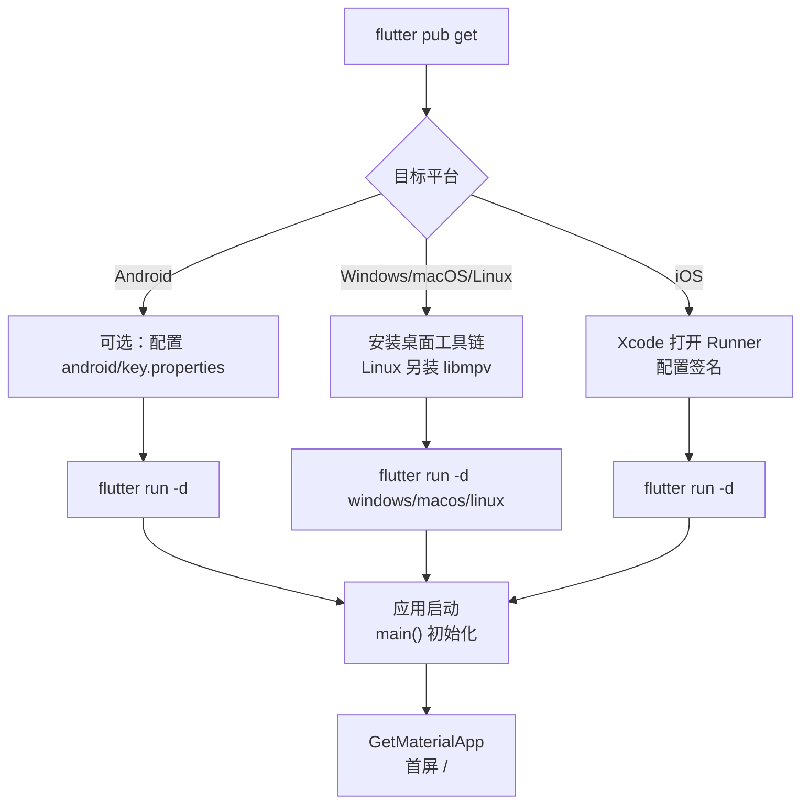

# 09 · 构建运行与开发指南

本篇说明如何把 AniCh 跑起来：环境要求、常用命令、各平台注意事项、构建签名、配置项、资源清单、测试现状与常见问题。

---

## 9.1 环境要求

| 项 | 要求 | 来源 |
| --- | --- | --- |
| Flutter | stable 分支，revision `b0850beeb25f6d5b10426284f506557f66181b36`（Flutter 3.22.x 系列） | `.metadata` |
| Dart SDK | `>=3.4.4 <4.0.0` | `pubspec.yaml:22` |
| 包管理 | pub（依赖锁定文件 `pubspec.lock` 已提交） | 仓库根目录 |
| Android | Android SDK + JDK 17（Flutter 3.22 要求） | `android/` |
| iOS / macOS | Xcode 15+，CocoaPods | `ios/`、`macos/` |
| Windows | Visual Studio 2022（含 C++ 桌面开发） | `windows/` |
| Linux | CMake、Ninja、Clang，以及 libmpv（`media_kit` 运行时依赖） | `linux/` |

> 项目 `pubspec.yaml` 未声明 `flutter` 字段的 SDK 约束，只约束了 Dart；因此 Flutter 版本以 `.metadata` 与 `pubspec.lock` 为准。

---

## 9.2 首次运行

```bash
# 1. 获取依赖
flutter pub get

# 2. 查看可用设备
flutter devices

# 3. 运行（以 Windows 桌面为例）
flutter run -d windows

# 4. 运行到 Android 真机/模拟器
flutter run -d <device-id>
```

首次启动会执行以下初始化（详见 [03 启动流程与运行机制](./03-启动流程与运行机制.md#321-初始化顺序表)）：

1. `MediaKit.ensureInitialized()` —— 初始化 libmpv。
2. `GetStorage.init()` 与 `GetStorage.init('playHistory')` —— 建立本地存储。
3. `initWindow()` —— 仅桌面端，创建 1280×820 无标题栏窗口。
4. `PackageInfo.fromPlatform()`、`AppConfig.init()`、四个 Storage `init()`。
5. `runApp()`，`MyApp.build()` 内触发检查更新与 `AccountApi.init()`。

---

## 9.3 平台支持现状

| 平台 | 目录 | 状态 | 说明 |
| --- | --- | --- | --- |
| Android | `android/` | ✅ 主要目标 | 支持 PiP（`floating`）、方向锁定、亮度/音量控制、相册保存 |
| iOS | `ios/` | ✅ 可构建 | `screen_brightness`、`image_gallery_saver`、`permission_handler` 均有 iOS 分支 |
| Windows | `windows/` | ✅ 主要桌面目标 | `window_manager` 无标题栏窗口、鼠标侧键返回、窗口拖动 |
| macOS | `macos/` | ✅ 可构建 | 与 Windows 同属桌面路径，`window_manager` 生效 |
| Linux | `linux/` | ⚠️ 理论可用 | 需系统安装 mpv/libmpv；`initWindow` 同样生效 |
| Web | `web/` | 🚫 不可用 | 代码大量使用 `dart:io`（`Platform.isAndroid`、`File`）、`window_manager`、`media_kit` 等不支持 Web 的依赖，`flutter run -d chrome` 会在编译期失败 |

---

## 9.4 常用命令

| 目的 | 命令 |
| --- | --- |
| 获取依赖 | `flutter pub get` |
| 静态分析 | `flutter analyze` |
| 代码格式化 | `dart format lib test` |
| 运行（桌面） | `flutter run -d windows` / `-d macos` / `-d linux` |
| 运行（移动端） | `flutter run -d <android-device>` |
| 打包 Android APK | `flutter build apk --release`（签名见 9.5） |
| 打包 App Bundle | `flutter build appbundle --release` |
| 打包 Windows | `flutter build windows --release` |
| 打包 macOS | `flutter build macos --release` |
| 打包 iOS | `flutter build ios --release`（需 Xcode 签名） |
| 生成应用图标 | `flutter pub run flutter_launcher_icons:main` |
| 修改包名 | 使用 `change_app_package_name`（dev 依赖） |
| 测试 | `flutter test` |

---

## 9.5 Android 签名配置

`android/app/build.gradle` 在 `android/key.properties` 存在时使用正式签名，缺失时自动回退 `signingConfigs.debug`，因此克隆仓库后可直接构建（包括 `flutter run`）。

如需发布正式包，在 `android/` 下自建：

```properties
storeFile=../app/release-key.jks
storePassword=******
keyAlias=release
keyPassword=******
```

`key.properties` 已被 `.gitignore` 排除，不要提交到仓库。

| 配置 | 位置 | 值 |
| --- | --- | --- |
| `namespace` / `applicationId` | `android/app/build.gradle` | `cx.xs.open` |
| `versionCode` / `versionName` | 由 `pubspec.yaml` 的 `1.1.0+2` 生成（`2` / `1.1.0`） | 由 Flutter 构建脚本注入 |
| 图标配置 | `pubspec.yaml:138-155` | `assets/images/icon.png`，含 Android/iOS/macOS/Windows |

---

## 9.6 可配置项

### 9.6.1 服务端地址

`lib/src/config.dart`：

```dart
class AppConfig {
  static const baseUrl = 'https://ani.emmmm.eu.org';
  static const bilibiliApiProxyUrl = 'https://bili-dm.emmmm.eu.org';
  static const qqVideoApiUrl = 'https://dm.video.qq.com';
  static RxString version = ''.obs;
  static RxString ua = ''.obs;

  static init() async {
    packageInfo = await PackageInfo.fromPlatform();
    version(packageInfo.version);
    // ua = '<packageName> <Platform> <version>'
  }
}
```

- 更换后端只需改三个常量；`baseUrl` 被 `apis/*.dart` 中的多个 `Dio` 引用。
- `AppConfig.init()` 同时导出一个全局 `packageInfo`（`config.dart:6` 的 `late PackageInfo packageInfo`），与 `Utils.packageInfo` 是两份独立实例。

### 9.6.2 检查更新地址

`lib/src/apis/info.dart` 中的仓库地址指向 `nansheng1810/AniCh-Next`，仓库改名后需同步替换为实际仓库的 `owner/repo`。

### 9.6.3 未使用的根目录文件

| 文件 | 状态 |
| --- | --- |
| `api.json` | 已移除 |
| `app_version.json` | 已移除，版本信息实际来自 GitHub API |

---

## 9.7 资源与字体

`pubspec.yaml` 资源声明：

```yaml
flutter:
  uses-material-design: true
  assets:
    - assets/images/
    - assets/icons/
  fonts:
    - family: Ubuntu
      fonts:
        - asset: fonts/Ubuntu.ttf
```

| 资源 | 是否存在 | 使用者 |
| --- | --- | --- |
| `assets/images/icon.png` | ✅ | 应用图标、启动图标生成 |
| `assets/images/no_image.svg` | ✅ | 播放页/列表占位图（`bangumi_vod/controller.dart` 的 `noImage`） |
| `assets/icons/danmaku_off.svg` / `danmaku_on.svg` / `danmaku_setting.svg` | ✅ | 播放器控件（`widgets/player/controls.dart`） |
| `fonts/Ubuntu.ttf` | ✅ | `MyApp` 的 `fontFamily: 'Ubuntu'` |
| `assets/statement.txt` | ❌ 缺失 | `Utils.showStatement()`（该方法当前未被调用） |
| `assets/sticker/` 目录 | ❌ 缺失 | `sticker.dart` 的空列表，暂不会加载 |

> `assets/` 只声明了 `images/` 与 `icons/` 两个目录。若新增 `assets/sticker/` 或 `assets/statement.txt`，必须同步修改 `pubspec.yaml`，否则 `rootBundle.loadString` 会失败。

---

## 9.8 代码规范与静态检查

`analysis_options.yaml` 仅继承官方规则：

```yaml
include: package:flutter_lints/flutter.yaml

linter:
  rules:
```

- 没有启用 `prefer_const_constructors`、`avoid_print` 等额外规则，也没有 exclude 配置。
- 当前 `flutter analyze` 结果为 `No issues found!`，可作为提交前的基线。
- CI（`.github/workflows/ci.yml`）执行 `flutter analyze` 与 `flutter test`；如需强制格式化，可再加 `dart format --set-exit-if-changed`。

---

## 9.9 测试现状

Flutter 模板生成的计数器测试已移除，替换为 `test/bangumi_collection_model_test.dart`，覆盖收藏分页响应中 `next` 字段的 JSON 解析。

`flutter analyze` 与 `flutter test` 均可通过；CI 配置见 `.github/workflows/ci.yml`。

后续可继续为纯函数补测试：`Time.*`、`ColorUtil.*`、`Utils.parseVersion` / `parseFileSize` / `splitList` / `isRegexFormat`。

---

## 9.10 常见问题排查

| 现象 | 可能原因 | 处理 |
| --- | --- | --- |
| 需要发布正式签名包 | 仓库不包含 `key.properties` | 按 9.5 创建 `key.properties`；本地构建缺失时会自动回退 debug 签名 |
| 启动白屏/闪退，控制台报 `MediaKit` 未初始化 | 未执行 `MediaKit.ensureInitialized()` 或平台库缺失 | 确认 `main()` 第 28 行存在；Linux 安装 libmpv |
| 桌面窗口没有标题栏、无法关闭 | `initWindow()` 使用 `TitleBarStyle.hidden` | 用页面内的关闭按钮/快捷键；或修改 `WindowOptions` |
| 播放黑屏但有声音 | `media_kit` 视频输出或 URL 解码失败 | 检查 `/vod` 返回的 `url` 是否能被 `urlDecode` 正常还原 |
| Windows 上点击无响应 | 全局手势覆盖（侧键/ESC）或 `SmartDialog` 遮罩 | 查看 `main.dart` 的 `pointerRouter` 与 `showRightDialog` |
| 切换主题后没变化 | `isDynamic` / `styleColor` 只在 `MyApp.build()` 读取 | 重启应用；或把这两个值改为 `Obx` 驱动 |
| 检查更新总提示失败 | `apis/info.dart` 仍为占位仓库/网络不可达 | 替换为实际 `owner/repo` 或检查代理 |
| `flutter build web` 失败 | 代码使用 `dart:io` 与桌面插件 | Web 不在支持范围，使用桌面/移动端 |
| 弹幕不显示 | 弹幕源开关关闭、屏蔽词误伤、或时间匹配不到 | 检查 `DanmakuSettingsStorage` 三个源开关与屏蔽列表 |
| 首页/列表空白 | 服务端不可达或返回结构变化 | 用 `Log.d` 打印响应，核对 Protobuf 字段 |

---

## 9.11 运行方式总结



---

## 9.12 文件索引

| 文件 | 用途 |
| --- | --- |
| `pubspec.yaml` | 依赖、版本、资源、字体、图标生成 |
| `pubspec.lock` | 依赖锁定 |
| `.metadata` | Flutter revision 与平台迁移记录 |
| `analysis_options.yaml` | Lint 规则 |
| `lib/main.dart` | 运行入口与初始化 |
| `lib/src/config.dart` | 服务端地址、UA、版本 |
| `android/app/build.gradle` | Android 签名与包名 |
| `android/key.properties` | 缺失，需本地创建 |
| `test/bangumi_collection_model_test.dart` | 收藏分页 `next` 解析测试 |
| `.github/workflows/ci.yml` | CI：`flutter analyze` + `flutter test` |
