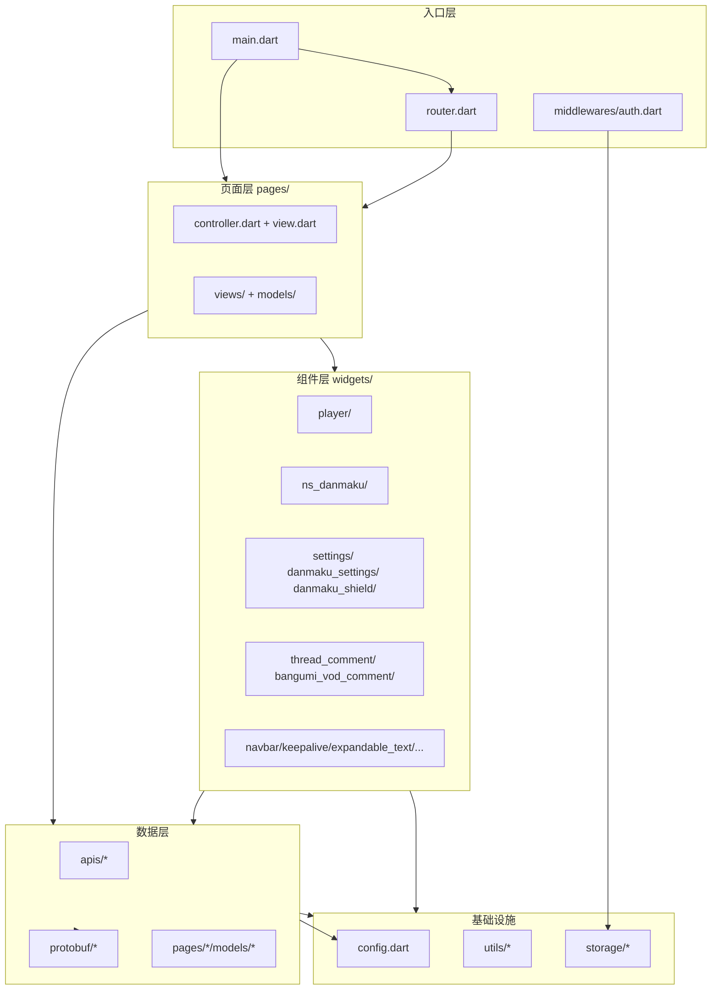
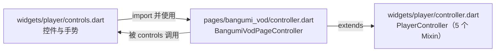
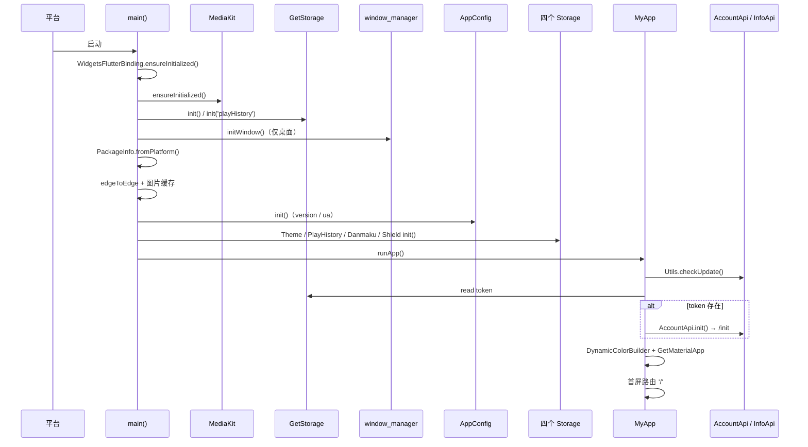
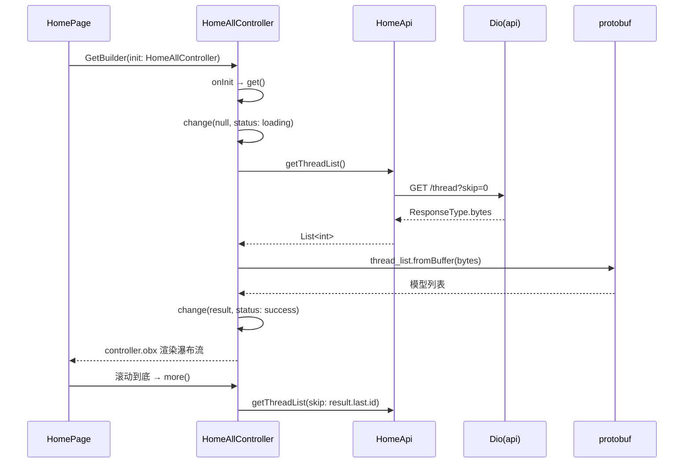
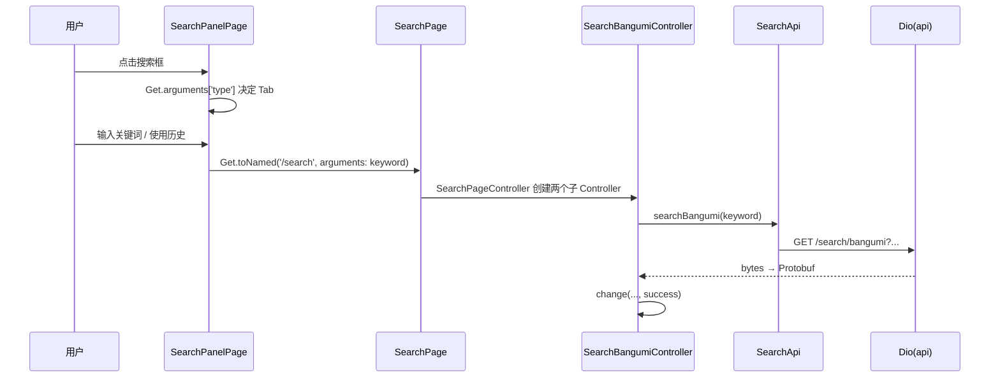
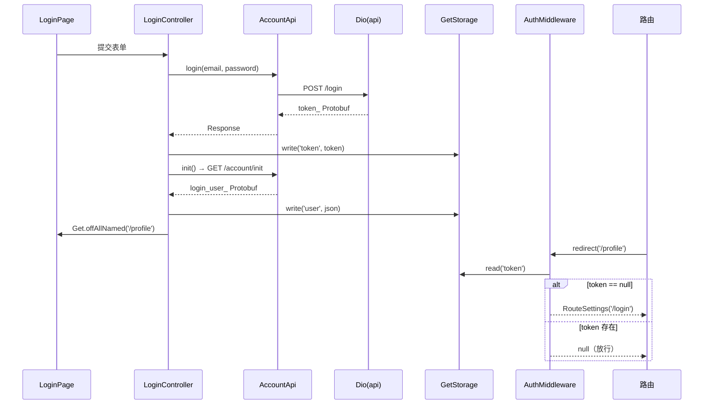
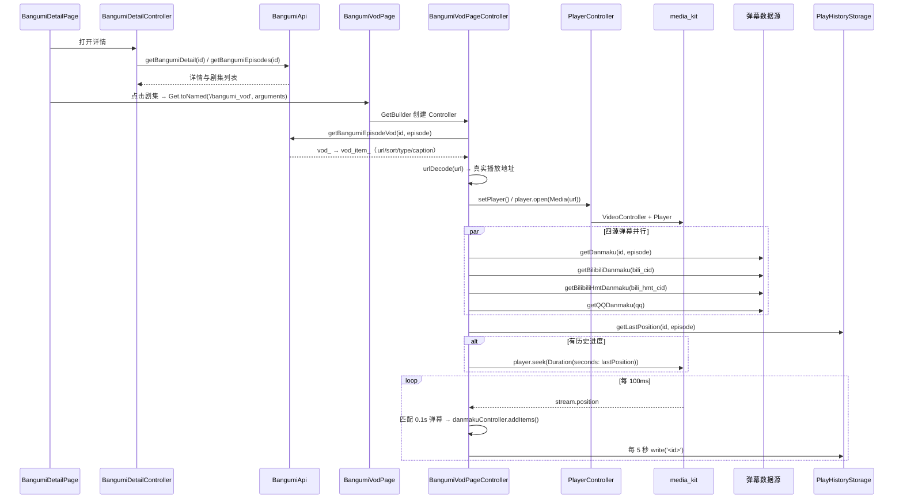
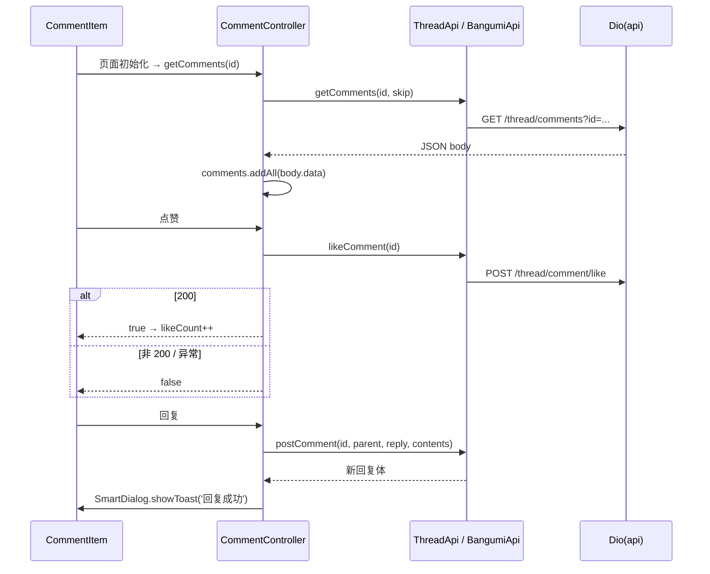
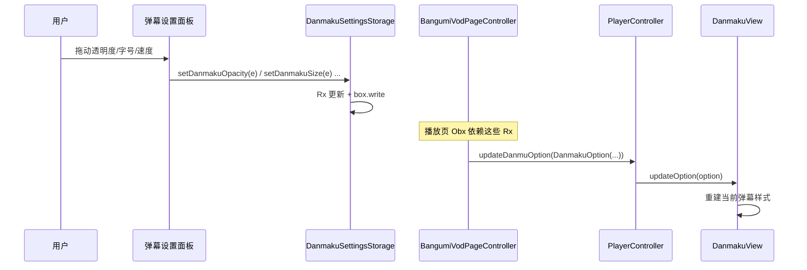

# 10 · 依赖关系与调用链路

本篇从「依赖」和「调用」两个视角描述项目：外部包依赖表、内部模块依赖图（含反向依赖与循环）、以及六条主要业务流程的完整时序。

---

## 10.1 外部依赖总表

来源：[pubspec.yaml](../../pubspec.yaml#L30-L84)

### 10.1.1 运行时依赖

| 包 | 版本 | 用途 | 主要使用位置 |
| --- | --- | --- | --- |
| `get` | ^4.6.6 | 状态管理、路由、依赖注入、国际化 | 所有 Controller/View |
| `dio` | ^5.4.3+1 | HTTP 客户端 | `lib/src/apis/*` |
| `protobuf` | ^3.1.0 | 二进制协议序列化 | `lib/protobuf/*` |
| `get_storage` | ^2.1.1 | 本地键值存储 | 各 Storage 类、登录态 |
| `dynamic_color` | ^1.7.0 | Material You 动态取色 | `main.dart` |
| `logger` | ^2.4.0 | 控制台日志美化 | `utils/log.dart` |
| `intl` | ^0.19.0 | 日期格式化 | `utils/utils.dart`、`utils/time.dart` |
| `wakelock_plus` | ^1.2.7 | 播放时屏幕常亮 | `player/controller.dart` |
| `window_manager` | ^0.4.0 | 桌面窗口（无标题栏/尺寸/拖动） | `main.dart`、`drag_to_move_bar.dart` |
| `package_info_plus` | ^8.0.1 | 版本号/包名 | `main.dart`、`config.dart`、`utils.dart` |
| `device_info_plus` | ^10.1.1 | 设备/SDK 信息 | `utils.dart`、`player/controller.dart` |
| `floating` | ^4.0.1 | Android 画中画（PiP） | `player/controller.dart` |
| `perfect_volume_control` | ^1.0.5 | 系统音量控制 | `player/controller.dart` |
| `screen_brightness` | ^0.2.2+1 | 屏幕亮度控制 | `player/controller.dart` |
| `auto_orientation` | ^2.3.1 | 横竖屏切换 | `player/controller.dart` |
| `photo_view` | ^0.15.0 | 图片缩放预览 | 图片社区帖子详情 |
| `image_gallery_saver` | ^2.0.3 | 保存图片到相册 | 播放器截图 |
| `file_picker` | ^8.0.7 | 文件选择 | 设置/关于页 |
| `permission_handler` | ^11.3.1 | 相册/存储权限 | `utils.dart` |
| `path_provider` | ^2.1.4 | 日志/缓存目录 | `utils/log.dart` |
| `url_launcher` | ^6.3.0 | 打开更新页/外部链接 | `utils.checkUpdate` |
| `flutter_staggered_grid_view` | ^0.7.0 | 瀑布流布局 | 首页图片 Tab |
| `flutter_svg` | ^2.0.10+1 | SVG 图标/占位图 | 播放器控件、播放页 |
| `flutter_smart_dialog` | ^4.9.7+9 | 轻量弹窗/Toast/右侧面板 | `main.dart`、设置/播放器 |
| `media_kit` | ^1.1.10+1 | 播放器内核（libmpv） | `player/controller.dart` |
| `media_kit_video` | ^1.2.4 | 视频渲染 Widget | 播放页 |
| `media_kit_libs_video` | ^1.0.4 | 各平台 libmpv 二进制 | 构建期 |

### 10.1.2 开发依赖

| 包 | 版本 | 用途 |
| --- | --- | --- |
| `flutter_lints` | ^3.0.0 | Lint 规则 |
| `flutter_launcher_icons` | ^0.13.1 | 应用图标生成 |
| `change_app_package_name` | ^1.5.0 | 包名批量替换 |

### 10.1.3 依赖的平台覆盖

| 包 | Android | iOS | Windows | macOS | Linux | Web |
| --- | --- | --- | --- | --- | --- | --- |
| `media_kit` 系列 | ✅ | ✅ | ✅ | ✅ | ✅ | ⚠️（需额外配置，本项目未启用） |
| `window_manager` | ❌ | ❌ | ✅ | ✅ | ✅ | ❌ |
| `floating`（PiP） | ✅ | ❌ | ❌ | ❌ | ❌ | ❌ |
| `screen_brightness` | ✅ | ✅ | ⚠️ | ⚠️ | ⚠️ | ❌ |
| `image_gallery_saver` | ✅ | ✅ | ❌ | ❌ | ❌ | ❌ |
| `auto_orientation` | ✅ | ✅ | ❌ | ❌ | ❌ | ❌ |
| `permission_handler` | ✅ | ✅ | ❌ | ❌ | ❌ | ❌ |

代码中通过 `Platform.isAndroid` / `Platform.isIOS` 做能力分支，非目标平台直接跳过相关调用。

---

## 10.2 内部模块依赖

### 10.2.1 分层依赖方向

正常方向是「上层依赖下层」。项目中有两处例外，需要特别注意。

### 10.2.2 反向依赖与循环

**循环 1：播放器组件 ↔ 播放页**

- `BangumiVodPageController extends PlayerController`：页面继承组件。
- `controls.dart` 直接 `import 'package:xs/src/pages/bangumi_vod/controller.dart'`，并接收 `BangumiVodPageController` 参数。

后果：`player/` 不能脱离播放页复用；任何播放页字段改名都会影响控件层。更合理的做法是把播放页状态抽象为接口/回调，让 `controls.dart` 只依赖 `PlayerController`。

**反向依赖 2：设置组件 → 页面模型**

`widgets/danmaku_settings/view.dart`、`widgets/danmaku_shield/view.dart` 直接读写 `DanmakuSettingsStorage` / `DanmakuShieldStorage` 静态字段，而这两个 Storage 又被播放页消费。组件层因此隐式依赖「弹幕配置」这一业务概念。

**重复依赖 3：评论组件双份**

`thread_comment/*` 与 `bangumi_vod_comment/*` 各有一份 `CommentController`，两套都依赖 `apis/thread.dart` 与 `apis/bangumi.dart` 的评论端点，逻辑重复。

### 10.2.3 关键模块的被依赖次数

| 模块 | 被谁依赖 | 说明 |
| --- | --- | --- |
| `utils/utils.dart` | 几乎所有页面与组件 | 弹窗、时间、权限、剪贴板 |
| `utils/app_style.dart` | 几乎所有 UI | 间距/圆角常量、主题 |
| `apis/bangumi.dart` | 番剧列表/详情/播放/收藏/角色/人物/评论 | 最大的 API 类（约 300 行、20+ 端点） |
| `protobuf/*` | `apis/*` 与页面 Controller | 所有二进制响应的解析目标 |
| `storage/*` | `main.dart`、播放页、设置页 | 配置与历史 |
| `widgets/ns_danmaku/*` | 仅 `player/controls.dart` | 弹幕引擎相对独立 |

---

## 10.3 调用链路一：应用启动

关键点：`MyApp.build()` 内发起两个网络请求，意味着**根 Widget 每次重建都会重新请求**，而不只是冷启动一次。

---

## 10.4 调用链路二：首页信息流

- 四个 Tab 各自持有独立 Controller：`HomeAllController`、`HomeArtworkController`、`HomeCosplayController`、`HomeTagsController`。
- `HomeController` 只负责 `TabController` 与当前索引（默认 `index = 1`）。
- 分页游标是 `result.last.id`；列表为空时 `result.last` 会抛 `StateError`（见 [11 代码质量](./11-代码质量与改进建议.md#1138-空列表取-last)）。

---

## 10.5 调用链路三：搜索

- `SearchPanelController.searchType = Get.arguments['type']!`：若调用方未传 `type` 会抛空指针。
- 搜索历史只存在内存（`SearchPanelController` 的局部列表），**不持久化**，重启即丢。

---

## 10.6 调用链路四：登录与鉴权

- 鉴权头由 `AccountUtil.token()` 生成（Protobuf `token_` → CSV 字节串），放在 HTTP Header `_` 中。
- 中间件只做「有没有 token」的判断，不校验 token 是否过期；过期后接口会返回错误，但页面不会自动跳登录。

---

## 10.7 调用链路五：番剧详情 → 播放 → 弹幕 → 历史

- 播放地址经过自定义 `urlDecode`（base64 还原，去掉第 4 个字符），解析失败返回空串。
- 弹幕按「时间精确到 0.1 秒」匹配：`double.parse(e.time.toStringAsFixed(1)) == currentPosition / 10`。
- 进度写入以 5 秒为阈值，整条 Map 重写。

---

## 10.8 调用链路六：评论与点赞

- 评论接口返回 **JSON**，不是 Protobuf。
- 点赞采用「请求成功后再更新 UI」，没有乐观更新；失败时无回滚提示（仅返回 `false`）。

---

## 10.9 调用链路七：修改弹幕设置

- 设置写盘与内存更新是同步的，UI 立即响应。
- 弹幕引擎的 `DanmakuOption` 是**每次重建新对象**，`updateOption` 会触发内部状态刷新。

---

## 10.10 依赖与调用层面的问题汇总

| 类型 | 问题 | 影响 |
| --- | --- | --- |
| 循环依赖 | `widgets/player/controls.dart` ↔ `pages/bangumi_vod/controller.dart` | 播放器无法独立复用，改动耦合 |
| 重复依赖 | 两套评论组件、两套列表页视图 | 维护两份逻辑 |
| 越层调用 | 组件层直接读写 Storage 静态字段 | 组件依赖业务配置，难以测试 |
| 全局副作用 | `MyApp.build()` 内发网络请求 | 重建即请求，测试不可控 |
| 无拦截器 | 每个 API 文件独立创建 `Dio` | 无法统一加超时、重试、鉴权、日志 |
| 静态单例 | `PlayHistoryStorage.history` 等静态 `Rx` | 跨页面共享，生命周期不可控 |
| 未初始化 | `Log.initWriter()` 未调用 | 文件日志为空操作 |
| 未使用 | `MultiSliverCompatWidget`、`DelayedThrottle` | 增加阅读成本 |

详细修复建议见 [11 代码质量与改进建议](./11-代码质量与改进建议.md)。
