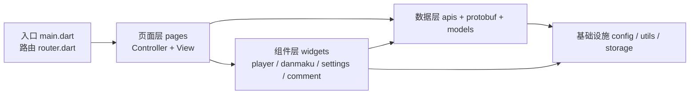

# AniCh Code Wiki

本 Wiki 面向 AniCh 项目的开发者，系统描述项目的整体架构、模块职责、关键类与函数、依赖关系以及运行方式。

> 文档基线：仓库当前代码（`pubspec.yaml` 版本 `1.1.0+2`，日期 2026-11-02）。
> 文档中所有路径均相对于仓库根目录；带行号的引用以当前代码为准。

---

## 1. 项目速览

| 项 | 值 |
| --- | --- |
| 项目名称（pubspec name） | `xs` |
| 应用展示名 | AniCh（桌面窗口标题同为 AniCh） |
| 技术栈 | Flutter + Dart 3.4.4+、GetX、Dio、Protobuf、media_kit |
| 目标平台 | Android、iOS、Windows、macOS、Linux（web 目录存在但不可用，见 [09 构建与运行](./09-构建运行与开发指南.md#93-平台支持现状)） |
| 核心能力 | 番剧索引/搜索、番剧详情、在线播放、多源弹幕、弹幕过滤、追番收藏、评论、观看记录、图片社区 |
| 服务端 | 自建 API（`https://ani.emmmm.eu.org`）+ B 站弹幕代理 + 腾讯视频弹幕接口 |

---

## 2. 文档地图

| 文档 | 内容 | 适合谁 |
| --- | --- | --- |
| [01 项目概览](./01-项目概览.md) | 项目定位、功能清单、代码规模、技术选型与平台 | 初次接触项目的人 |
| [02 目录结构与分层架构](./02-目录结构与分层架构.md) | 目录树、四层架构、模块依赖方向、命名约定 | 需要快速定位代码的人 |
| [03 启动流程与运行机制](./03-启动流程与运行机制.md) | `main()` 初始化顺序、主题、路由表、鉴权中间件、桌面窗口、全局交互 | 排查启动/路由/主题问题的人 |
| [04 网络层与数据模型](./04-网络层与数据模型.md) | Dio 实例、全部 API 端点、鉴权头构造、Protobuf 与 JSON 模型 | 对接后端、改接口的人 |
| [05 页面模块详解](./05-页面模块详解.md) | 路由 → 页面 → Controller → 视图 → API 的逐模块说明 | 开发/修改具体页面的人 |
| [06 播放器与弹幕系统](./06-播放器与弹幕系统.md) | 播放器 Mixin 分层、播放链路、手势/全屏/小窗/PiP、弹幕渲染与多源聚合 | 维护播放器与弹幕的人 |
| [07 状态管理与本地持久化](./07-状态管理与本地持久化.md) | GetX 状态模式、GetStorage 分库、各 Storage 类与键值约定 | 处理设置/历史/登录态的人 |
| [08 通用组件与工具库](./08-通用组件与工具库.md) | 可复用 Widget 与 Utils/Time/Log/Color 等工具类 | 做 UI 复用与公共逻辑的人 |
| [09 构建运行与开发指南](./09-构建运行与开发指南.md) | 环境要求、常用命令、打包签名、配置项、测试现状、已知障碍 | 需要把项目跑起来的人 |
| [10 依赖关系与调用链路](./10-依赖关系与调用链路.md) | 外部依赖表、模块依赖图、启动/搜索/播放/登录/评论时序图 | 做架构评审或重构的人 |
| [11 代码质量与改进建议](./11-代码质量与改进建议.md) | 重复代码、占位/死代码、潜在 Bug、安全与性能风险、改进优先级 | 做重构与维护的人 |

推荐阅读顺序：**01 → 02 → 03 → 04 → 05 → 06 → 09**；做重构时追加 **07、10、11**。

---

## 3. 一分钟理解架构

- **页面层**：每个页面目录固定为 `controller.dart` + `view.dart` + `views/`（子视图）+ `models/`（JSON 模型），Controller 继承 `GetxController` 并混入 `StateMixin`，视图通过 `GetBuilder(init: ...)` 绑定。
- **数据层**：每个领域一个 API 类（静态方法），响应用 `ResponseType.bytes` 接收后用 Protobuf `fromBuffer` 解析；少数接口返回 JSON。
- **组件层**：播放器（`widgets/player`）、弹幕（`widgets/ns_danmaku`）是两套独立子系统，通过回调控制器桥接。
- **基础设施**：`config.dart` 固化服务端地址与 UA；`utils/` 提供弹窗、时间、日志、颜色、账号鉴权组包等。

---

## 4. 快速导航（高频代码位置）

| 需求 | 文件 |
| --- | --- |
| 应用入口 / 主题 / 全局手势 | `lib/main.dart` |
| 路由注册与鉴权 | `lib/src/router.dart`、`lib/src/middlewares/auth.dart` |
| 服务端地址 / UA | `lib/src/config.dart` |
| 播放页业务 | `lib/src/pages/bangumi_vod/controller.dart` |
| 播放器内核与手势 | `lib/src/widgets/player/controller.dart` |
| 播放器 UI 控件 | `lib/src/widgets/player/controls.dart` |
| 弹幕渲染引擎 | `lib/src/widgets/ns_danmaku/danmaku_view.dart` |
| 弹幕设置/屏蔽 | `lib/src/widgets/danmaku_settings/`、`lib/src/widgets/danmaku_shield/` |
| 全部接口 | `lib/src/apis/` |
| 二进制协议模型 | `lib/protobuf/` |

---

## 5. 文档约定

- 「✅ 已实现」= 代码中存在完整链路；「⚠️ 部分实现」= 有界面但逻辑不完整；「🚧 占位」= 仅界面壳或无数据源。
- 行号引用格式：`文件:行号`，例如 `lib/main.dart:26`。
- 图表使用 Mermaid，GitHub 与多数 IDE 预览可直接渲染；不支持时可按文字描述阅读。
